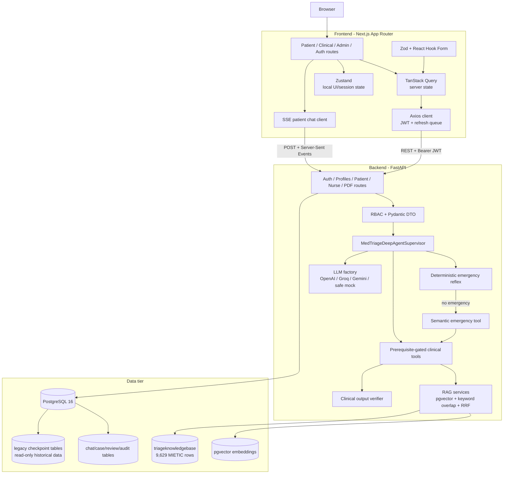
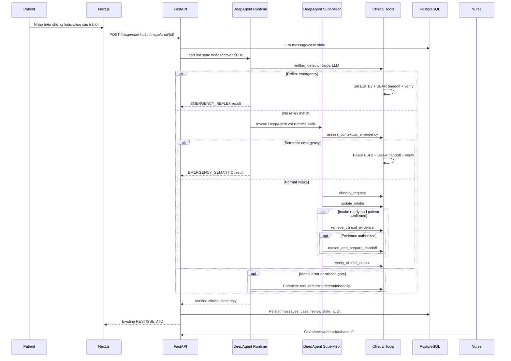

# MedTriage AI Architecture

Tài liệu này là source of truth hiện hành cho kiến trúc MedTriage AI trên nhánh
`feat/deepagent-clinical-runtime`. Nó hợp nhất mô tả kiến trúc tổng thể và đặc
tả DeepAgent runtime từng được tách thành một tài liệu riêng.

Repo hiện dùng FastAPI, PostgreSQL/pgvector, Next.js và tool-gated DeepAgent.
Deep Agents dùng LangGraph như dependency nội bộ của thư viện, nhưng MedTriage
không còn sở hữu custom `StateGraph`, không compile graph riêng và không ghi
PostgreSQL graph checkpointer trong runtime hiện tại.

## 1. Mục tiêu hệ thống

MedTriage AI hỗ trợ tiếp nhận triệu chứng, phát hiện tình huống nguy hiểm,
thu thập intake có cấu trúc, truy xuất bằng chứng RAG và tạo proposal ESI/SBAR
để điều dưỡng xác nhận. Hệ thống không chẩn đoán bệnh, không kê đơn và không tự
ra quyết định lâm sàng cuối cùng.

Các ràng buộc an toàn không được nới lỏng:

- red-flag reflex xác định chạy trước mọi LLM;
- semantic emergency assessment bằng DeepAgent chạy sau reflex âm tính;
- patient confirmation bắt buộc trước retrieval/reasoning không khẩn cấp;
- evidence và authority gate fail-closed;
- ESI, citation và SBAR phải do tool tạo, không lấy từ văn bản tự do của model;
- output diagnosis/prescribing firewall luôn kiểm tra trước khi trả về;
- kết quả AI là proposal chờ nurse HITL review.

## 2. Kiến trúc tổng thể



## 3. Runtime DeepAgent

Runtime nằm trong `src/agents/deepagent_runtime/`.

| File | Trách nhiệm |
| --- | --- |
| `supervisor.py` | Khởi tạo DeepAgent, skill, subagent, execute turn và stream event |
| `tools.py` | Tool gates, node adapter, emergency preflight và final verifier |
| `subagents.py` | Specialist profiles và tool scope của từng specialist |
| `state_store.py` | Hot session state trong process |
| `events.py` | Ánh xạ tool execution sang SSE phases tương thích frontend |
| `schemas.py` | Internal state, audit và result contracts |

DeepAgent chịu trách nhiệm lập kế hoạch và chọn capability. Quyền thay đổi
clinical state vẫn thuộc các deterministic tool. Tool gọi sai thứ tự, thiếu
prerequisite hoặc lặp không hợp lệ trả `REJECTED` và không mutate state.

## 4. Luồng một lượt hội thoại



Tool order chuẩn:

1. `redflag_detector` chạy trước DeepAgent và không chờ network.
2. `assess_contextual_emergency` hiểu tổ hợp dấu hiệu, câu hỏi giáo dục và phủ
   định theo ngữ cảnh; tool chỉ có quyền nâng cảnh báo.
3. `classify_request` phân loại intent và trả scope response nếu ngoài luồng.
4. `update_intake` chạy answer alignment, extraction, contradiction, readiness,
   clarification hoặc patient confirmation.
5. `retrieve_clinical_evidence` chỉ chạy khi intake ready và confirmed.
6. `reason_and_prepare_handoff` chỉ chạy sau evidence gate hợp lệ.
7. `verify_clinical_output` kiểm tra confirmation, authority, citation, SBAR và
   diagnosis suppression trước khi output được lưu hoặc hiển thị.

`DEEPAGENT_MAX_TOOL_CALLS_PER_TURN` đặt recursion budget hữu hạn cho vòng lặp
agent. Khi model/package/provider lỗi, runtime đi vào degraded mode an toàn,
hoàn tất các tool bắt buộc theo thứ tự xác định và không bịa ESI/citation.

## 5. Specialist subagents

| Subagent | Vai trò | Tool được cấp |
| --- | --- | --- |
| `emergency-context-analyst` | Hiểu tổ hợp dấu hiệu khẩn cấp theo ngữ cảnh | `assess_contextual_emergency` |
| `intake-planner` | Intent, intake và next question | `classify_request`, `update_intake` |
| `evidence-analyst` | Retrieval và authority gate | `retrieve_clinical_evidence` |
| `clinical-reasoner` | Reasoning sau khi evidence đã được gate | `reason_and_prepare_handoff` |
| `sbar-writer` | Điều phối handoff đã đủ điều kiện | `reason_and_prepare_handoff` |
| `citation-verifier` | Final evidence/output firewall | `verify_clinical_output` |

Supervisor cũng có các tool trên để xử lý tác vụ một bước. Không subagent nào
có quyền DB, shell hoặc host filesystem.

## 6. Runtime skills

Bốn skill được dùng khi phát triển và được seed vào StateBackend ảo của
DeepAgent theo progressive disclosure:

- `.agents/skills/medtriage-deepagent-system`
- `.agents/skills/medtriage-deepagent-router`
- `.agents/skills/medtriage-rag-evidence`
- `.agents/skills/medtriage-clinical-safety`

Runtime không trỏ `FilesystemBackend` vào repo. Chỉ nội dung skill cần thiết
được nạp vào virtual files của từng invocation, tránh cấp quyền đọc/ghi host
cho model.

## 7. Frontend

Frontend nằm trong `frontend/` và dùng Next.js App Router, React, TypeScript,
Tailwind, shadcn/ui, Radix, TanStack Query, Zustand, React Hook Form, Zod,
Framer Motion và Axios.

Các nhóm route chính:

- `/`: landing và lối vào sản phẩm;
- `/auth/*`: login, register, OTP, forgot password, OAuth callback;
- `/triage`: patient triage chat, red-flag overlay, confirmation, HITL status;
- `/triage/guest-session`: tạo guest session không chứa PII;
- `/profile`, `/profile/ehr`: EHR Lite và hồ sơ gia đình;
- `/history`, `/history/[id]`: lịch sử, replay, SBAR và PDF;
- `/clinical/queue`, `/clinical/cases/[caseId]`: Nurse Core MVP;
- `/admin/*`: dashboard, audit, guardrails và RAG database UI.

Frontend không cache payload API dài hạn trong Zustand. TanStack Query sở hữu
remote data; Zustand chỉ giữ auth hydration và trạng thái UI/session cục bộ.
Patient chat dùng SSE và validate event bằng Zod trước khi cập nhật UI.

## 8. Backend FastAPI

Backend nằm trong `src/`.

```text
src/
├── main.py                 # FastAPI app, CORS, lifespan, DB/DeepAgent runtime
├── config.py               # Pydantic Settings
├── api/                    # APIRouter và dependency RBAC
├── models/                 # SQLModel entities + Pydantic v2 DTO
├── agents/                 # DeepAgent runtime, clinical state, guardrails, tools
└── services/               # DB, auth/security, RAG, email, OAuth, PDF
```

FastAPI lifespan:

1. Khởi tạo PostgreSQL schema và extension `vector`.
2. Pre-create LLM client nếu có API key.
3. Prebuild tool-gated DeepAgent supervisor nếu provider/model phù hợp.
4. Giữ deterministic degraded mode nếu package/model không khả dụng.
5. Shutdown thì xóa hot runtime state và dispose connection pool/executor.

Các nhóm API:

- Auth: register, OTP, login, guest, refresh, logout, OAuth, forgot/reset.
- Profiles: CRUD hồ sơ, EHR Lite, emergency contacts.
- Patient triage: start, SSE chat, messages, history, detail.
- Nurse: queue, case detail, claim/release, observation, intake, decision,
  escalate, handoff, acknowledge, break-glass PII.
- Document: xuất SBAR PDF Unicode.
- Compatibility/demo: `/api/v1/chat`, `/api/v1/status`, `/health`.

## 9. Database và persistence

Hệ thống dùng PostgreSQL 16, SQLModel/SQLAlchemy 2, asyncpg và pgvector.
Durable state nằm trong các bảng domain, không nằm trong graph checkpoint.

| Bảng | Vai trò | Số dòng đã xác minh |
| --- | --- | ---: |
| `users` | Danh tính, role, OAuth, guest | 3 |
| `ehr_profiles` | Hồ sơ gia đình và EHR Lite | 4 |
| `triage_cases` | Phiên triage, ESI proposal, red flag, SBAR | 29 |
| `chat_messages` | Hội thoại và lựa chọn cấu trúc | 164 |
| `nurse_review_states` | HITL và optimistic version | 8 |
| `clinical_observations` | Sinh hiệu append-only | 0 |
| `audit_logs` | Audit hành động nhạy cảm | 9 |
| `refresh_token_sessions` | Refresh token rotation/revoke | 25 |
| `triageknowledgebase` | MIETIC case dataset thật cho MVP RAG | 9,629 |
| `checkpoints` | Legacy checkpoint, runtime mới không ghi | 326 |
| `checkpoint_blobs` | Legacy checkpoint blob | 606 |
| `checkpoint_writes` | Legacy checkpoint writes | 2,820 |
| `checkpoint_migrations` | Legacy checkpoint schema version | 10 |

`DeepAgentSessionStore` giữ hot clinical state trong process. Khi process
restart hoặc hot state mất, `recover_triage_state()` dựng lại intake bảo thủ từ
`chat_messages` và không tự suy ra ESI.

## 10. RAG authority

Backup hiện có 9,629 dòng trong bảng legacy `triageknowledgebase`. Theo trạng
thái sản phẩm hiện tại, đây là dataset thật của MVP và được dùng cho demo RAG
khi bật `RAG_DEMO_LEGACY_MIETIC_ENABLED=true`.

Điểm cần phân biệt:

- `triageknowledgebase` là case dataset thật, không phải mock data;
- output kỹ thuật hiện vẫn là `CASE_EXAMPLE_SUPPORT` và `DEMO_ONLY` vì đó là
  nhãn authority của case examples, không phải tuyên bố dữ liệu giả;
- case examples không được relabel thành validated protocol;
- production evidence gate vẫn fail-closed cho tới khi có protocol corpus đã
  ingest, calibrate và clinician approve;
- hiện chưa có bảng production `triage_protocol_documents` hoặc
  `triage_case_examples` trong DB restore;
- production hybrid adapter có trong source, nhưng patient evidence node hiện
  chưa gọi adapter đó cho protocol production.

RAG production dự kiến dùng dense VI, dense EN, sparse keyword overlap và
Reciprocal Rank Fusion. Sparse channel hiện là keyword-overlap có kiểm soát,
chưa phải BM25 scoring đầy đủ.

## 11. LLM provider và degraded mode

Factory ưu tiên provider theo thứ tự:

1. OpenAI `gpt-4o-mini`;
2. Groq qua OpenAI-compatible API;
3. Gemini `2.5-flash` hoặc `2.5-pro`;
4. `MockClinicalAI` an toàn nếu không có provider.

Mock không tạo ESI hay citation. Trong degraded mode, emergency reflex,
readiness, evidence gate và verifier vẫn chạy theo thứ tự xác định. Thiếu
validated evidence thì hệ thống trả thông báo chưa đủ thông tin và chờ điều
dưỡng xác nhận.

## 12. Clinical safety và HITL

Safety gồm ba lớp:

- deterministic reflex đọc `data/guard_rules/ontology_vi_en.json`, trích xuất
  keyword, vital sign và một số phủ định/câu hỏi giáo dục;
- semantic emergency assessment dùng structured output để nhận diện tổ hợp nguy
  cơ khi reflex không bắt được;
- output firewall chặn chẩn đoán, kê đơn và clinical claim không có authority.

Kết quả emergency từ reflex ghi `EMERGENCY_REFLEX`. Emergency do semantic tool
nhận diện ghi `EMERGENCY_SEMANTIC`, policy hiện set ESI 2 chờ nurse xác nhận.
Các proposal thường đều đi qua nurse queue; nurse có claim, release, decision,
override, handoff, acknowledge và audit trail.

## 13. API và SSE compatibility

Public REST DTO, endpoint và SSE phases được giữ ổn định qua migration runtime.
Adapter vẫn phát các phase như `SAFETY_CHECK`, `INTENT_CLASSIFICATION`,
`INTAKE_EXTRACTION`, `CLARIFICATION`, `PATIENT_CONFIRMATION`, `RETRIEVAL`,
`REASONING`, `HANDOFF` và `COMPLETE`.

Chuỗi SSE gồm `accepted`, các event `progress`, heartbeat khi chờ, event
`intent` nếu có, rồi đúng một `result` hoặc `error`.

## 14. Docker và dependency

- Backend image chạy Python 3.11.
- Runtime pin `deepagents==0.7.6`.
- Repo pin trực tiếp `langgraph>=1.2.11,<2.0.0` vì Deep Agents import API này.
- `langgraph-checkpoint-postgres` không còn là direct dependency.
- Image dùng CPU-only `torch==2.13.0+cpu`; bản 2.3.1 cũ đã bị loại vì có
  nhiều CVE đã công bố.
- `transformers` pin `>=5.5,<6` để giữ cùng major version và tránh các CVE
  còn tồn tại trong dòng 4.x.
- Backend cần rebuild image khi thay requirements; source mount không tự cài
  package mới vào image cũ.

Các biến môi trường quan trọng:

```text
DEEPAGENT_RUNTIME_ENABLED=true
DEEPAGENT_MODEL_NAME=
DEEPAGENT_MAX_TOOL_CALLS_PER_TURN=12
DEEPAGENT_REQUIRE_TOOL_GATES=true
SEMANTIC_EMERGENCY_CONFIDENCE_THRESHOLD=0.80
RAG_DEMO_LEGACY_MIETIC_ENABLED=false
```

`DEEPAGENT_MODEL_NAME` rỗng nghĩa là dùng `MODEL_NAME`. Môi trường demo local có
thể bật `RAG_DEMO_LEGACY_MIETIC_ENABLED=true` để dùng 9,629 dòng MIETIC.

## 15. Trạng thái sẵn sàng

Repo đã đủ để demo MVP full-stack: auth/guest, EHR Lite, patient triage, SSE,
emergency escalation, persistence, history, Nurse Core, SBAR/PDF và RAG từ
dataset MIETIC thật. Điểm chưa sẵn sàng production là protocol authority:
thiếu corpus phác đồ đã duyệt, calibration lâm sàng, benchmark chuyên gia,
security hardening cho PII và realtime nurse feed hoàn chỉnh end-to-end.

Mô tả chính xác hiện tại: demo-ready clinical triage MVP foundation, chưa phải
hệ thống tự động ra quyết định y khoa production.
