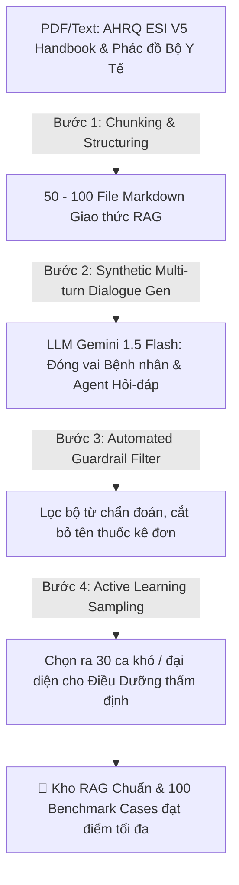
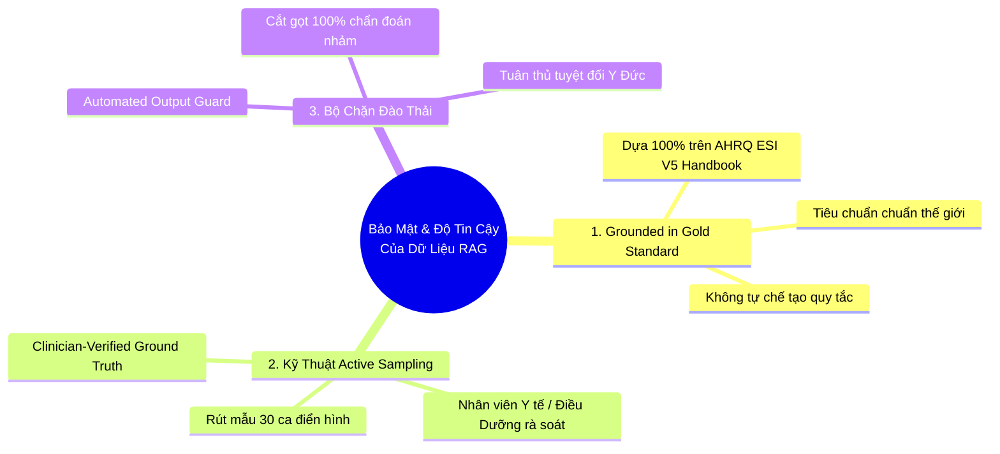

# 📊 CHIẾN LƯỢC NGUỒN DỮ LIỆU, SINH DỮ LIỆU RAG & TỐI ƯU CHI PHÍ
*(Dự án AI Agent Phân Loại Triệu Chứng & Triage Thông Minh — VinUni AI20K)*

> **Tài liệu Hướng dẫn Thực thi Kỹ thuật & Quản trị Dữ liệu (Data Engineering & Cost Strategy)**  
> **Mục tiêu:** Cung cấp giải pháp tổng thể từ việc tận dụng các kho dữ liệu y tế thế giới & Việt Nam, hướng dẫn tự dựng bộ dữ liệu RAG / Benchmark đạt chuẩn y khoa bằng công nghệ Synthetic Generation (với chi phí cực thấp hoặc miễn phí), và chiến lược trình bày uy tín trước hội đồng.

---

## 1. PHÂN TÍCH VẤN ĐỀ & BÀI TOÁN DỮ LIỆU TRONG Y TẾ (DATA CHALLENGE)

Để xây dựng hệ thống **AI Triage Agent (HITL - Không chẩn đoán)** như thiết kế tại `TRIAGE_AGENT_SOLUTION_DESIGN.md`, dự án cần **3 khối dữ liệu cốt lõi**:
1. **Kho Guideline RAG (Knowledge Base):** Bộ tài liệu các giao thức phân độ cấp cứu lâm sàng (ESI Level 1 đến 5) đã được bẻ nhịp thành cấu trúc Markdown + Metadata (làm căn cứ suy luận chống bịa - Grounding).
2. **Bộ Từ Khóa Phản Xạ Nhanh (Red-Flag Reflex Dictionary):** Danh sách hàng trăm cụm từ khẩn cấp nguy hiểm (đột quỵ FAST, nhồi máu cơ tim, sốc phản vệ, chấn thương nặng) để kích hoạt ngắt luồng dưới 50ms.
3. **Bộ Kịch Bản & Thư Viện Chấm Điểm (Benchmark Evaluation Dataset):** 100 - 200 ca bệnh nhân mô phỏng (tình huống hỏi đáp nhiều nhịp + kèm theo đáp án chuẩn Ground Truth và Phiếu bàn giao SBAR) để đo đạc chỉ số **Concordance Rate (> 85%)** cho báo cáo nghiệm thu Demo Day.

### ⚠️ Rào cản với Datasets Miễn Phí Hiện Có:
* **MIMIC-ED / MIMIC-IV:** Là kho dữ liệu phân luồng cấp cứu lớn nhất thế giới của Viện MIT, nhưng là **tiếng Anh**, ở dạng bảng tĩnh (tabular), không chứa cuộc đối thoại hỏi đáp động nhiều nhịp.
* **Các bộ QA Y khoa Tiếng Việt trên HuggingFace:** (Ví dụ: `vilm/vietnamese-medical-qa`, `ontinh/vietnamese-medical-dialogues`) chủ yếu tập trung vào **Chẩn đoán bệnh và Kê đơn thuốc** $\to$ **VI PHẠM NGAY RULE BẤT KHẢ KI CHẤP CỦA HỘI ĐỒNG (Không được chẩn đoán/kê đơn)**.
* **Tài liệu Bệnh viện Việt Nam:** Các phác đồ Bộ Y Tế thường dài hàng trăm trang PDF môt tả điều trị chuyên sâu, chưa được cắt bồi cho bài toán Triage trước viện (Pre-hospital triage).

👉 **GIẢI PHÁP ĐỊNH HÌNH (THE HYBRID STRATEGY):**  
Sử dụng **Nguồn chuẩn Y khoa thế giới (AHRQ ESI V5) & Hướng dẫn Bộ Y Tế làm hạt nhân (Seed Base)** $\to$ Áp dụng **AI Synthetic Generation (Sinh dữ liệu có hướng dẫn & kiểm soát ranh giới)** $\to$ **Con người rà soát Kép (HITL Expert Curation)**.

---

## 2. DANH SÁCH CÁC NGUỒN DỮ LIỆU CÔNG KHAI CHẤT LƯỢNG CAO (OPEN DATA SOURCES)

Bạn có thể khai thác các kho dữ liệu sau làm vật liệu gốc (Seed Materials):

### 2.1. Chuẩn mực Phân phối Phác đồ Cấp cứu (Triage Protocols)
* **AHRQ Emergency Severity Index (ESI) Handbook v4/v5:**
  * *Nguồn:* Cục Nghiên cứu & Chất lượng Chăm sóc Y tế Hoa Kỳ (Agency for Healthcare Research and Quality - AHRQ) phối hợp Hiệp hội Điều dưỡng Cấp cứu (ENA).
  * *Giá trị:* Là **Bảo bối Vàng** cho dự án! Sức mạnh của cuốn handbook này là nó cung cấp **tiểu chuẩn decision trees chi tiết nhất cho 5 mức độ ESI** và chứa **hàng trăm ca bệnh thực tập (Case Studies) kèm lời giải phân độ ESI cực kỳ chuẩn xác và giải thích lý do lâm sàng**.
  * *Cách dùng:* Tải bản PDF chính thức (hoàn toàn miễn phí trên web AHRQ), dùng công cụ bóc tách trích xuất các quy tắc phân độ và 100 ca case study để làm mốc kiểm nghiệm (Ground Truth).
* **Phác đồ Cấp cứu Ngoại viện / Hướng dẫn Phân luồng của Bộ Y Tế Việt Nam:**
  * *Nguồn:* Tài liệu Cổng thông tin Bộ Y Tế, Phác đồ Bệnh viện Bạch Mai, Bệnh viện Chợ Rẫy (bảng điểm Glasgow, tiêu chuẩn xuất viện/chuyển viện, thang điểm đau, dấu hiệu sinh tồn chí nguy).
  * *Cách dùng:* Lấy bộ thuật ngữ y khoa tiếng Việt (từ xa xa, bóp nghẹt, mạch nhanh nhỏ, thở nấc, v.v.) để bổ sung cho bảng Red-Flag và văn phong Agent.

### 2.2. Các Dataset Trên HuggingFace & Kaggle (Tham khảo Cấu trúc)
* **`mimic-ed-parse` / Kaggle ED Triage Datasets:** Cho ta phân phối tỷ lệ giữa các ca (thường ca ESI 2 và 3 chiếm tới 60% phòng cấp cứu, ESI 1 khoảng 2-5%, ESI 4 & 5 khoảng 35%). Khi sinh dữ liệu mô phỏng, cần giữ **tỷ lệ chân thực** này.
* **`Symcat / Infermedica API Symptom Ontology`:** Các kho dữ liệu dạng mã nguồn mở kết nối giữa **Triệu chứng chính (Chief Complaint)** với **Các triệu chứng liên quan cần hỏi (Associated Symptoms / Red flags to check)**. Nguồn này là kim chỉ nam để lập trình **`Node 2: Question_Engine`** (biết hỏi câu gì tiếp theo).
* **`vilm/vietnamese-medical-qa`:** Tự do thu mua các cách bệnh nhân người Việt mô tả triệu chứng bằng ngôn ngữ dân dã ("nhói buốt lưng", "nghẹn thở", "chóng mặt l quay cuồng") $\to$ Nhập làm "User Input mồi" nhưng **lọc bỏ toàn bộ lời giải đáp chẩn đoán thuốc bên dưới**.

---

## 3. HỢP THỨC HÓA & HƯỚNG DẪN TỰ ĐỘNG KHAI TRÌNH SINH DỮ LIỆU CHUẨN (SYNTHETIC RAG PIPELINE)

Vì Hội đồng đánh giá cực kỳ coi trọng tính hợp lý, khả thi và độ an toàn của dữ liệu, đây là **Quy trình Sinh dữ liệu 4 Bước (4-Step Knowledge Curation Workflow)** giúp bạn tự tạo một bộ RAG và Test set hoàn hảo chỉ trong 48 giờ:

### 3.1. Kỹ Thuật Sinh Kho Tài Liệu RAG (50 Giao Thức ESI Mẫu)
Thay vì ngồi viết tay từng bệnh, bạn chia thành **10 Nhóm Hội chứng chính** ở phòng khám cấp cứu:
1. Đau ngực / Tim mạch (Chest Pain)
2. Khó thở / Hô hấp (Dyspnea/Respiratory)
3. Tai biến / Thần kinh / Đau đầu (Neurology/FAST)
4. Chấn thương cơ học / Chảy máu (Trauma/Wound)
5. Đau bụng cấp / Tiêu hóa (Abdominal Pain)
6. Sốt / Nhiễm trùng / Truyền nhiễm (Fever/Infection)
7. Nhi khoa cấp cứu (Pediatric Emergencies)
8. Phụ khoa / Thai kỳ khẩn cấp (Obstetrics/Gynecology)
9. Sức khỏe Tâm thần / Tự sát / Kích động (Psychiatric/Behavioral)
10. Dị ứng / Séc phản vệ (Anaphylaxis/Toxicology)

* **Script Prompt Mẫu (Chữa cháy Hallucination) để tự động gen ra RAG Documents:**
  *Bạn sử dụng Prompt này đưa vào mô hình LLM (như Gemini 1.5 Pro hoặc Claude) để sinh ra file theo format chuẩn:*

> **PROMPT SINH RAG DOCUMENT (COPY & RUN):**
> *"Bạn là Kỹ sư Trưởng Dữ Liệu Y Tế và Chuyên Gia Phân Luồng Triage theo tiêu chuẩn ESI V5. Hãy viết cho tôi 05 giao thức (Protocols) thuộc nhóm **[Đau bụng cấp - Abdominal Pain]**. 
> YÊU CẦU KIÊN QYẾT:
> 1. Trình bày rõ ràng dưới dạng Markdown có chứa YAML Front-matter (đủ field: `protocol_id`, `title`, `symptom_category`, `esi_levels`).
> 2. Chia rõ tiêu chí phân loại cụ thể cho ESI 1 (Tối khẩn/Red flag), ESI 2 (Nguy cơ cao - Cần can thiệp < 10 phút), ESI 3 (Thử máu, siêu âm, X-quang - Khám trong 2h), và ESI 4-5 (Không nguy hiểm, tự chăm sóc/đặt lịch).
> 3. TUYỆT ĐỐI KHÔNG ghi chẩn đoán xác định hay tên bất kỳ loại thuốc kê đơn nào (chỉ ghi Hội chứng, rủi ro biến chứng và Khuyến cáo thao tác chuyên môn cho nhân viên y tế).
> 4. Phù hợp với văn phong y khoa lâm sàng chuẩn của Bộ Y Tế Việt Nam."*

### 3.2. Kỹ Thuật Sinh Bộ Kịch Bản Hỏi-Đáp (Benchmark Evaluation Set)
Để kiểm thử cơ chế hỏi đáp trắc nghiệm của `Node 2: Question_Engine`, ta cần sinh ra các ca thử nghiệm có **kịch bản nhiều nhịp (Multi-turn dialogue)** kèm **Lời giải chuẩn (Ground Truth)**.

* **Thuật toán "Self-Play Dual Agent Generation" (Tự hội thoại 2 Vai):**
  * **System A (Bệnh nhân mô phỏng):** Gắn cho một Persona (ví dụ: *Ông già 65 tuổi, có tiền sử tăng huyết áp, thỉnh thoảng ợ hơi lầm tưởng đau dạ dày nhưng thực chất là đau nhét vùng tim lan vai ra mồ hôi hột. Trả lời cộc lộn, đang hoảng hốt*).
  * **System B (Triage Agent AI):** Thu thập triệu chứng, hỏi câu hỏi chốt chặn ESI, không sử dụng thuật ngữ y khoa chuyên sâu với bệnh nhân.
  * *Sau nhịp thứ 4:* Xuất ra 1 file JSON chứa toàn bộ lịch sử chat, Đề xuất ESI chuẩn, và Phiếu bàn giao SBAR tương ứng để cất vào `eval/benchmark_cases.json`.

---

## 4. CHIẾN LƯỢC TỐI ƯU CHI PHÍ TỐI ĐA (ULTIMATE COST OPTIMIZATION)

Hội đồng VinUni AI20K sẽ đánh giá cực kỳ cao các đội có tư duy **Quản trị Tài nguyên & Bền vững Tài chính (Cost-efficient & Green AI Architecture)**. Sau đây là bảng chiến lược triệt tiêu chi phí API:

| Nhóm Tài Nguyên | Giải Pháp Sức Khỏe Cao / Đắt Tiền | 🌟 GIẢI PHÁP TỐI ƯU SIÊU TIẾT KIỆM (KHUYẾN NGHỊ CHO TEAM) | Mức Tiết Kiệm |
|---|---|---|---|
| **1. Mô hình Sinh Dữ Liệu (Offline Data Gen)** | OpenAI GPT-4o hoặc Claude 3.5 Sonnet (~$5 - $15 / 1 triệu token) | **Google Gemini 1.5 Flash (Free Tier):** Cung cấp 15 Request/phút và **1,000,000 token miễn phí / ngày**. Hoặc **Groq API** (Chạy model mã nguồn mở `Meta-Llama-3-70B-Instruct` cực Nhanh và **Hoàn toàn Miễn phí** trong giai đoạn build). | **Tiết kiệm 100% chi phí Gen Data** |
| **2. Mô hình LLM chạy Runtime (Online AI Agent Engine)** | Dùng chung 1 model siêu lớn (GPT-4) cho mọi Node LangGraph | **Kiến trúc Phân cấp LLM (Tiered LLM Routing):** - *Node 0 (Red Flag):* Rule Regex + Gemini 1.5 Flash (siêu rẻ, siêu nhanh). - *Node 2 (Hỏi đáp):* Gemini 1.5 Flash hoặc Llama-3-8B-Versatile. - *Node 3 & 4 (RAG ESI & Viết SBAR cho Điều Dưỡng):* Chỉ gọi model năng lực cao (Gemini 1.5 Pro / GPT-4o-Mini) tại bước xuất phiếu cuối cùng. | **Giảm 80% - 90% hóa đơn API hàng tháng** |
| **3. Mô hình Embedding (Vector DB Search)** | OpenAI `text-embedding-3-small` / `3-large` (Tính tiền theo token) | **Local Open-Source Embeddings (HuggingFace/Sentence-Transformers):** - Dùng model `BAAI/bge-m3` hoặc `bkai-foundation-models/vietnamese-bi-encoder`. Chạy hoàn toàn **Offline trên bộ nhớ Docker (RAM)** của backend FastAPI, không tốn 1 đồng gọi cloud! | **Miễn phí 100% & Tăng Tốc Độ Search RAG (No Network Latency)** |
| **4. Cơ Sở Dữ Liệu Vector (Vector Storage)** | Pinecone / Weaviate / Qdrant Cloud Dedicated (Thường > $50 - $100/tháng) | **ChromaDB Local Embedded hoặc PostgreSQL + Extension `pgvector`:** Nhận dạng sẵn trong docker-compose gốc của repo `P-159`! Tích hợp trực tiếp trên 1 container Postgres duy nhất. | **Zero Infra Overhead ($0)** |

---

## 5. THIẾT KẾ QUY TRÌNH THẨM ĐỊNH DATA & BẢO VỆ TRƯỚC HỘI ĐỒNG (THE DEMO DAY DATA DEFENSE)

Khi hội đồng hỏi: *"Các bạn dùng AI gen dữ liệu RAG và ca mẫu, vậy lấy gì chứng minh dữ liệu này chính xác và đủ tin cậy trong ngành y?"*

Bạn hãy trả lời bằng 3 trụ cột lập luận đanh thép này (đủ sức lấy trọn điểm kỹ thuật):

### 🎯 3 Câu Trả Lời Vàng:

1. **"Giai điệu gốc trên Nền tảng Lâm sàng Chuẩn (Gold-Standard Seeding):"**
   *"Thưa hội đồng, chúng em không để AI gen dữ liệu vô định từ khoảng không. 100% tiêu chí phân độ trong tài liệu RAG của chúng em được **chuyển thể kỹ thuật sư (structured mapping)** từ cuốn sách Gối Đầu Giám Định **Emergency Severity Index (ESI) V5 của Cục Y tế Hoa Kỳ AHRQ** và Phác đồ Triage ngoại viện Bộ Y tế. AI chỉ đóng vai trò dịch thuật sang văn bản Markdown và cấu trúc thành YAML có chỉ mục để máy đọc nhanh hơn."*

2. **"Kỹ thuật Thao tác Rà soát Linh hoạt (Active Sampling & Clinician Verification):"**
   *"Để tiết kiệm nguồn lực và chi phí y bác sĩ mà vẫn đạt chất lượng cực cao, chúng em áp dụng nguyên lý **Active Learning Sampling**. Trong 150 ca kịch bản thử nghiệm sinh ra, thuật toán tự động gom nhóm và chọn lọc **30 ca khó nhất, ca ranh giới (Edge Cases - ví dụ ESI 2 và ESI 3 rất khó phân biệt) và ca có Red-flag ẩn** để gửi cho Chuyên viên Y tế/Điều dưỡng trong nhóm cố vấn nghiệm thu tay (HITL Validation). Báo cáo kiểm định độ chính xác (Concordance Rate) trong deliverable `#10 (Evaluation Evidence)` được tính trên trần mẫu chuẩn đã có Bác sĩ xác nhận (Clinician-Verified Ground Truth)."*

3. **"Vòng Lặp Nhận Sự Kiên Quyết (Automated Zero-Diagnosis Firewall):"**
   *"Trong toàn bộ chuỗi thu thập và sinh dữ liệu, hệ thống tự động gắn script `verify_no_diagnosis.py` (nằm trong thư mục `scripts/`). Bất kỳ chunk tài liệu hoặc lời giải AI nào chứa các trường chẩn đoán như 'Bệnh nhân mắc/bị...', hoặc xuất hiện tên thuốc điều trị trong danh mục cấm đều bị **tự động cắt bỏ và chỉnh sửa về từ ngữ Khảo sát Hội chứng (Syndrome Mapping)**. Do đó kho dữ liệu của chúng em sở hữu **Tỷ lệ rủi ro pháp lý bằng 0% (Zero Med-Legal Exposure)**!"*

---

## 6. LƯU Ý KHI THỰC THI (ACTIONABLE NEXT STEPS)
1. **Bước 1:** Tạo ngay thư mục `data/raw_protocols/` và đưa vào 5 file markdown đầu tiên tương ứng với 5 Hội chứng (Đau ngực, Khó thở, Đau bụng, Đau đầu, Sốt cao).
2. **Bước 2:** Chèn biến cấu hình LLM Free Tier (`GEMINI_API_KEY`, `GROQ_API_KEY`) vào `.env.example` và `src/config.py` để chuẩn bị cho factory multi-provider LLM (được đánh giá cao về khả năng chịu lỗi Fallback).
3. **Bước 3:** Sử dụng script RAG Prompt trong mục 3.1 để nhờ Gemini 1.5 Pro hoặc Claude khởi tạo dữ liệu, sau đó lưu lại ngay vào repo git trên nhánh `feat/symptom-triage-agent`.

*Tài liệu chiến lược dữ liệu đã sẵn sàng! Chúc dự án AI20K của bạn gây ấn tượng ngoạn mục tại vòng thẩm định!*
