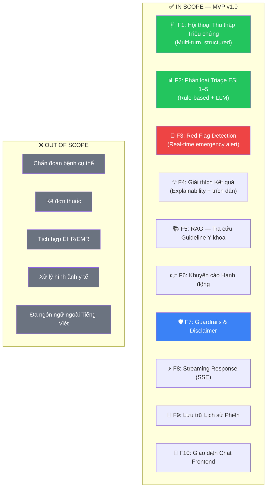

# 📄 Project Brief — MedTriage AI

> **Tài liệu lịch sử:** Nội dung dưới đây mô tả kiến trúc hoặc kế hoạch trước khi MedTriage chuyển sang tool-gated DeepAgent. Không dùng tài liệu này làm source of truth cho runtime hiện tại; xem [`ARCHITECTURE.md`](../ARCHITECTURE.md).

## Intelligent Symptom Classification & Triage Agent

| Trường | Giá trị |
|--------|---------|
| **Tên dự án** | MedTriage AI — Intelligent Symptom Classification & Triage Agent |
| **Team** | TEAM159 (P-159) |
| **Phiên bản** | 1.0 |
| **Ngày tạo** | 2026-08-01 |
| **Chương trình** | VinUni AI20K Build Phase — Cohort 3 |
| **Phương pháp luận** | BMAD-v6 (Phase 1: Analysis → Phase 2: Planning) |
| **Trạng thái** | ✅ Hoàn thiện |

---

## 1. Tóm tắt Dự án (Executive Summary)

### 1.1. Bối cảnh

Hệ thống y tế Việt Nam đang đối mặt với áp lực gia tăng: **quá tải phòng cấp cứu**, **thiếu hụt nhân lực y tế**, và **chất lượng phân loại bệnh nhân không đồng đều**. Theo Bộ Y tế, trung bình mỗi điều dưỡng triage phải xử lý 40–60 bệnh nhân/ca trực, dẫn đến sai sót trong phân loại mức độ ưu tiên, đặc biệt trong giờ cao điểm hoặc tình huống dịch bệnh.

### 1.2. Tầm nhìn Sản phẩm (Product Vision)

> **"Mỗi bệnh nhân đều được phân loại mức độ cấp thiết nhanh chóng, chính xác và nhất quán — bất kể thời điểm hay nơi nào — nhờ AI hỗ trợ thông minh."**

### 1.3. Mô tả Ngắn gọn

**MedTriage AI** là một AI Agent sử dụng kiến trúc LangGraph, có khả năng:
- Thu thập triệu chứng thông qua hội thoại đa bước
- Phân loại mức độ ưu tiên theo thang **ESI (Emergency Severity Index) Level 1–5**
- Phát hiện triệu chứng nguy hiểm (Red Flags) và cảnh báo khẩn cấp
- Đề xuất hướng xử lý ban đầu với giải thích minh bạch
- **Tuyệt đối KHÔNG thay thế chẩn đoán của bác sĩ**

### 1.4. Elevator Pitch (30 giây)

> *"MedTriage AI là trợ lý AI giúp phân loại mức độ cấp thiết của triệu chứng bệnh nhân. Thay vì chờ đợi và lo lắng, người dùng chỉ cần trò chuyện với AI để biết mình nên gọi cấp cứu, đến phòng khám, hay theo dõi tại nhà — trong vòng 2 phút, chính xác 80%+, hoạt động 24/7. Hệ thống KHÔNG chẩn đoán bệnh mà hỗ trợ phân loại sơ bộ, giúp bệnh nhân đúng nơi — đúng lúc."*

---

## 2. Phân tích Vấn đề (Problem Analysis)

### 2.1. Vấn đề Cốt lõi

```
┌──────────────────────────────────────────────────────────────────┐
│  ❌ HIỆN TRẠNG (AS-IS)                                          │
│                                                                  │
│  Bệnh nhân → Tiếp nhận thủ công → Phân loại bằng kinh nghiệm  │
│                                                                  │
│  Pain Points:                                                    │
│  🔴 Thiếu nhất quán giữa các ca trực                           │
│  🔴 Chậm trễ xử lý khi đông bệnh nhân                         │
│  🔴 Dữ liệu triệu chứng thiếu cấu trúc                       │
│  🔴 Không scale được khi có dịch bệnh                          │
│  🔴 Bệnh nhân lo lắng không biết mức độ nghiêm trọng          │
├──────────────────────────────────────────────────────────────────┤
│  ✅ GIẢI PHÁP (TO-BE)                                           │
│                                                                  │
│  Bệnh nhân → Chat AI → Phân loại ESI tự động → Khuyến cáo     │
│                                                                  │
│  Benefits:                                                       │
│  🟢 Nhất quán — cùng kịch bản, cùng tiêu chuẩn               │
│  🟢 Nhanh chóng — phản hồi tức thì 24/7                       │
│  🟢 An toàn — Guardrails y tế 3 lớp                           │
│  🟢 Minh bạch — giải thích lý do phân loại                    │
│  🟢 Mở rộng — phục vụ hàng ngàn người cùng lúc                │
└──────────────────────────────────────────────────────────────────┘
```

### 2.2. Impact Matrix (Ma trận Tác động)

| Đối tượng | Vấn đề hiện tại | Giải pháp MedTriage AI | Tác động kỳ vọng |
|-----------|-----------------|----------------------|------------------|
| **Bệnh nhân** | Lo lắng, không biết mức độ nghiêm trọng, chờ đợi lâu | Chat nhanh → biết cần đi cấp cứu hay không | Giảm 60% lo lắng không cần thiết |
| **Điều dưỡng Triage** | Quá tải, đánh giá thiếu nhất quán, thiếu thời gian | Công cụ hỗ trợ sàng lọc trước | Tăng 40% năng suất phân loại |
| **Bệnh viện/Phòng khám** | Quá tải phòng cấp cứu, phân bổ tài nguyên sai | Phân loại trước → bệnh nhân đúng nơi đúng lúc | Giảm 25% quá tải cấp cứu |

---

## 3. Đối tượng Sử dụng (User Personas)

### 3.1. Persona chính: Người dùng cuối (Patient)

```
┌─────────────────────────────────────────────────┐
│  👤 PERSONA: Nguyễn Minh Anh                    │
│  📍 TP.HCM | 28 tuổi | Nhân viên văn phòng     │
├─────────────────────────────────────────────────┤
│                                                  │
│  🎯 Mục tiêu:                                   │
│  • Biết triệu chứng có nghiêm trọng không       │
│  • Nên đi khám ngay hay chờ được                 │
│  • Nhận tư vấn nhanh, dễ hiểu                    │
│                                                  │
│  😰 Nỗi đau:                                    │
│  • Lo lắng khi có triệu chứng bất thường         │
│  • Không biết nên đi khoa nào                     │
│  • Google triệu chứng → thông tin quá nhiều, sợ  │
│  • Ngại đi khám nếu triệu chứng nhẹ             │
│                                                  │
│  📱 Hành vi:                                     │
│  • Dùng smartphone, quen chat                     │
│  • Tìm kiếm sức khỏe trên mạng thường xuyên     │
│  • Muốn câu trả lời nhanh, cụ thể               │
│                                                  │
│  ✅ Kỳ vọng từ MedTriage:                        │
│  "Nói cho tôi biết tôi cần lo lắng đến mức nào   │
│   và tôi nên làm gì tiếp theo"                   │
└─────────────────────────────────────────────────┘
```

### 3.2. Persona phụ: Nhân viên Y tế (Nurse / Triage Officer)

```
┌─────────────────────────────────────────────────┐
│  👩‍⚕️ PERSONA: ĐD. Trần Thị Hương                │
│  📍 BV Đa khoa Trung ương | 35 tuổi | 10 năm KN│
├─────────────────────────────────────────────────┤
│                                                  │
│  🎯 Mục tiêu:                                   │
│  • Phân loại nhanh, chính xác, nhất quán         │
│  • Không bỏ sót ca nguy hiểm                     │
│  • Giảm tải công việc thủ công                   │
│                                                  │
│  😰 Nỗi đau:                                    │
│  • 50+ bệnh nhân/ca, không đủ thời gian          │
│  • Lo sót Red Flag trong giờ cao điểm             │
│  • Thiếu công cụ hỗ trợ quyết định               │
│                                                  │
│  ✅ Kỳ vọng:                                     │
│  "Một công cụ giúp tôi sàng lọc nhanh, đặc biệt  │
│   những ca cần ưu tiên ngay"                      │
└─────────────────────────────────────────────────┘
```

### 3.3. Persona phụ: Quản lý Y tế (Admin)

```
┌─────────────────────────────────────────────────┐
│  👨‍💼 PERSONA: BS. Lê Văn Đức                     │
│  📍 Giám đốc Phòng khám đa khoa | 45 tuổi       │
├─────────────────────────────────────────────────┤
│                                                  │
│  🎯 Mục tiêu:                                   │
│  • Nắm xu hướng triệu chứng trong cộng đồng     │
│  • Tối ưu phân bổ nhân sự theo mức triage        │
│  • Dữ liệu thống kê phục vụ báo cáo             │
│                                                  │
│  ✅ Kỳ vọng:                                     │
│  "Dashboard trực quan, biết ngay xu hướng         │
│   triệu chứng và hiệu suất phân loại"            │
└─────────────────────────────────────────────────┘
```

---

## 4. Phạm vi Sản phẩm (Product Scope)

### 4.1. MVP Scope (Minimum Viable Product)



### 4.2. Mức Ưu tiên Tính năng

| Mức | Tính năng | Lý do |
|:---:|-----------|-------|
| **P0 — Must Have** | F1 (Intake), F2 (Triage), F3 (Red Flag), F4 (Explain), F7 (Guardrail) | Cốt lõi sản phẩm, không có thì sản phẩm không hoạt động |
| **P1 — Should Have** | F5 (RAG), F6 (Khuyến cáo), F8 (Streaming), F10 (Chat UI) | Tăng chất lượng và trải nghiệm đáng kể |
| **P2 — Nice to Have** | F9 (Lịch sử) | Nâng cao trải nghiệm nhưng không cần thiết cho MVP |

---

## 5. Giải pháp Kỹ thuật Tổng quan (Technical Solution Overview)

### 5.1. Kiến trúc Cao cấp

```
┌─────────────────────────────────────────────────────────────┐
│                        MEDTRIAGE AI                         │
│                    System Architecture                      │
├─────────────────────────────────────────────────────────────┤
│                                                             │
│  ┌──────────────┐    ┌─────────────────────────────────┐   │
│  │  🖥️ Frontend  │    │  ⚙️ Backend (FastAPI)            │   │
│  │  Chat UI      │───▶│                                 │   │
│  │  (Streamlit/  │    │  ┌───────────────────────────┐  │   │
│  │   Next.js)    │    │  │  🧠 LangGraph Agent Core  │  │   │
│  │              │◀───│  │                           │  │   │
│  │  Dashboard   │    │  │  Intake → Red Flag Check  │  │   │
│  │  (Statistics)│    │  │  → Classify → RAG         │  │   │
│  └──────────────┘    │  │  → Explain → Guardrail    │  │   │
│                      │  │  → Response               │  │   │
│                      │  └───────────┬───────────────┘  │   │
│                      │              │                   │   │
│                      │  ┌───────────▼───────────────┐  │   │
│                      │  │  🔧 Services               │  │   │
│                      │  │  LLM | Triage | RAG | Sess │  │   │
│                      │  └───────────┬───────────────┘  │   │
│                      └──────────────┼──────────────────┘   │
│                                     │                       │
│  ┌──────────────────────────────────▼──────────────────┐   │
│  │  💾 Data Layer                                       │   │
│  │  ChromaDB/FAISS │ SQLite/PostgreSQL │ Rules Engine  │   │
│  └─────────────────────────────────────────────────────┘   │
└─────────────────────────────────────────────────────────────┘
```

### 5.2. Tech Stack Chính

| Layer | Công nghệ | Vai trò |
|-------|-----------|---------|
| **AI Agent** | LangGraph + LangChain | Orchestration luồng triage |
| **LLM** | OpenAI GPT-4o-mini | Xử lý ngôn ngữ tự nhiên |
| **Backend** | FastAPI + Uvicorn | API server, SSE streaming |
| **RAG** | ChromaDB/FAISS + Embeddings | Tra cứu guideline y khoa |
| **Database** | SQLite (dev) / PostgreSQL (prod) | Lưu session, lịch sử |
| **Frontend** | Streamlit hoặc Next.js | Giao diện chat |
| **DevOps** | Docker + GitHub Actions | CI/CD, deployment |
| **Monitoring** | LangSmith | Tracing, debugging |

### 5.3. Dữ liệu Nguồn

| Dữ liệu | Quy mô | Mục đích |
|----------|--------|----------|
| Dataset triệu chứng-bệnh | ~15,000 bản ghi | Knowledge base, training rules, benchmark |
| ESI Triage Guidelines | Chuẩn hóa | Quy tắc phân loại ESI 1–5 |
| Red Flags Database | ~30 patterns | Phát hiện triệu chứng nguy hiểm |
| Evaluation Test Cases | 50–100 kịch bản | Đánh giá chất lượng agent |

---

## 6. Phân tích Cạnh tranh (Competitive Landscape)

### 6.1. Bối cảnh Thị trường

| Giải pháp | Ưu điểm | Nhược điểm | So sánh MedTriage AI |
|-----------|---------|------------|---------------------|
| **Google triệu chứng** | Dễ dùng, sẵn có | Không cấu trúc, gây lo sợ, không phân loại ESI | ✅ Phân loại ESI có cấu trúc |
| **WebMD Symptom Checker** | Database lớn | Tiếng Anh, dạng form, không conversational | ✅ Tiếng Việt, hội thoại tự nhiên |
| **Ada Health** | AI conversational | Tiếng Anh, hướng chẩn đoán (chúng tôi KHÔNG chẩn đoán) | ✅ Focus triage, guardrails y tế |
| **Triage thủ công** | Chính xác bởi chuyên gia | Không scale, thiếu nhất quán, giới hạn thời gian | ✅ 24/7, nhất quán, bổ trợ chuyên gia |

### 6.2. Lợi thế Cạnh tranh (USP — Unique Selling Points)

```
┌─────────────────────────────────────────────────┐
│  🏆 Lợi thế Cạnh tranh MedTriage AI            │
│                                                  │
│  1️⃣  Tiếng Việt first — thiết kế cho người Việt │
│  2️⃣  ESI-based — tiêu chuẩn triage quốc tế     │
│  3️⃣  Guardrails 3 lớp — an toàn y tế tối đa    │
│  4️⃣  Explainable — giải thích lý do phân loại  │
│  5️⃣  Red Flag Alert — cảnh báo khẩn cấp 0-delay│
│  6️⃣  RAG-grounded — dẫn nguồn y khoa uy tín    │
│  7️⃣  Open-source — minh bạch, kiểm chứng được  │
└─────────────────────────────────────────────────┘
```

---

## 7. Tiêu chí Thành công (Success Criteria)

### 7.1. KPIs Kỹ thuật

| Metric | Mục tiêu | Phương pháp đo | Ưu tiên |
|--------|----------|----------------|:-------:|
| **Triage Accuracy** | ≥ 80% | So sánh với expert-labeled ground truth | 🔴 Critical |
| **Red Flag Recall** | ≥ 95% | Sensitivity test trên ca nguy hiểm | 🔴 Critical |
| **Red Flag Precision** | ≥ 70% | Precision test trên cảnh báo | 🟡 High |
| **Guardrail Compliance** | 100% | Kiểm tra mọi response có disclaimer | 🔴 Critical |
| **Response Latency** | < 3 giây | End-to-end response time | 🟡 High |
| **RAG Relevance** | ≥ 0.7 RAGAS | RAGAS Faithfulness score | 🟢 Medium |

### 7.2. KPIs Sản phẩm

| Metric | Mục tiêu | Phương pháp đo |
|--------|----------|----------------|
| **User Satisfaction** | ≥ 4.0/5.0 | Survey sau sử dụng |
| **Task Completion Rate** | ≥ 85% | % phiên triage hoàn thành |
| **Avg. Session Duration** | ≤ 3 phút | Thời gian trung bình 1 phiên |
| **Demo Day Score** | ≥ 35/50 | Đánh giá từ BTC AI20K |

### 7.3. Definition of Done — Tiêu chuẩn Hoàn thành

- [ ] Agent phân loại đúng ≥ 80% ESI level trên test set
- [ ] Red Flag detection recall ≥ 95% (KHÔNG được bỏ sót ca nguy hiểm)
- [ ] Guardrails hoạt động 100% (chặn chẩn đoán, kê đơn)
- [ ] Response time < 3 giây
- [ ] Frontend chat hoạt động mượt mà, hiển thị ESI color-coded
- [ ] Deployed live URL hoạt động ổn định
- [ ] 10/10 deliverables hoàn thiện
- [ ] Video demo 3–5 phút chuyên nghiệp
- [ ] README.md hoàn chỉnh
- [ ] Evaluation evidence đầy đủ

---

## 8. Ràng buộc & Giới hạn (Constraints)

### 8.1. Ràng buộc Kỹ thuật

| Ràng buộc | Chi tiết | Giải pháp |
|-----------|----------|-----------|
| **Thời gian** | 6 tuần phát triển (theo AI20K schedule) | Agile sprints, ưu tiên P0 |
| **Budget API** | Hạn chế chi phí OpenAI | GPT-4o-mini (rẻ), caching, batch |
| **Team size** | 1 team (~3-5 người) | Phân công rõ ràng, song song hóa |
| **Scope** | Prototype/MVP, không phải production medical device | Disclaimer rõ ràng ở mọi nơi |

### 8.2. Ràng buộc Pháp lý & Đạo đức

| Ràng buộc | Giải pháp |
|-----------|-----------|
| **Không được chẩn đoán bệnh** | Guardrail chặn + chỉ phân loại triage |
| **Không được kê đơn thuốc** | Guardrail chặn hoàn toàn |
| **Phải có disclaimer** | Mọi response kèm cảnh báo y tế |
| **Bảo mật thông tin bệnh nhân** | Không lưu PII, session-based |
| **Phát hiện ý định tự hại** | Chuyển hướng hotline tâm lý 1800 599 920 |

---

## 9. Rủi ro & Giải pháp (Risk Assessment)

| # | Rủi ro | Xác suất | Tác động | Chiến lược giảm thiểu |
|---|--------|:--------:|:--------:|----------------------|
| R1 | LLM hallucinate thông tin y tế | Cao | 🔴 Nghiêm trọng | Guardrail 3 lớp + RAG grounding + validation |
| R2 | Bỏ sót Red Flag nguy hiểm | Thấp | 🔴 Nghiêm trọng | Rule-based detector + LLM double-check, ưu tiên recall |
| R3 | Over-triage (phân loại quá nặng) | Trung bình | 🟡 Trung bình | Acceptable — an toàn hơn under-triage |
| R4 | Under-triage (phân loại quá nhẹ) | Thấp | 🔴 Nghiêm trọng | Multiple validation layers, conservative thresholds |
| R5 | Chi phí API vượt budget | Trung bình | 🟡 Trung bình | GPT-4o-mini, caching, rate limiting |
| R6 | Vấn đề pháp lý y tế | Thấp | 🔴 Nghiêm trọng | Disclaimer ở MỌI nơi, KHÔNG chẩn đoán/kê đơn |

---

## 10. Lộ trình Tổng quan (High-level Roadmap)

```
┌─────────────────────────────────────────────────────────────────┐
│  📅 MEDTRIAGE AI — DEVELOPMENT ROADMAP (6 Tuần)                │
├──────────┬──────────┬──────────┬──────────┬──────────┬─────────┤
│  Tuần 1  │  Tuần 2  │  Tuần 3  │  Tuần 4  │  Tuần 5  │ Tuần 6 │
│Foundation│Core Agent│ RAG+Intel│ API+UI   │ Test+Eval│ Deploy  │
├──────────┼──────────┼──────────┼──────────┼──────────┼─────────┤
│• Setup   │• Intake  │• RAG     │• REST API│• 100 test│• Docker │
│• Dataset │  Node    │  Pipeline│• WebSocket│ cases   │• Deploy │
│  15K     │• Red Flag│• Explain │• Chat UI │• Eval    │• README │
│• Triage  │  Node    │  Node    │• ESI     │  metrics │• Video  │
│  Rules   │• Classify│• Response│  badges  │• Bug fix │• Pitch  │
│• Schemas │  Node    │  Node    │• Session │• Optimize│• Submit │
│• Red     │• Guard-  │• E2E     │  mgmt    │          │         │
│  Flags   │  rail    │  Flow    │          │          │         │
│          │• Graph   │          │          │          │         │
└──────────┴──────────┴──────────┴──────────┴──────────┴─────────┘
```

---

## 11. Deliverables Mapping (Bản đồ Giao nộp)

| # | Deliverable | Tài liệu liên quan | Vị trí File | Trạng thái |
|---|------------|--------------------|-----------:|:----------:|
| 1 | Source Code | PRD §4-6 | `src/` | ⬜ |
| 2 | README.md | Brief §1, PRD §1 | `README.md` | ⬜ |
| 3 | Architecture Diagram | PRD §4.1, §5.2 | `docs/architecture_diagram.md` | ⬜ |
| 4 | AI Logs | LangSmith + Hooks | `.ai-log/` | ⬜ |
| 5 | Live URL | PRD §10 | Deploy | ⬜ |
| 6 | Video Demo | PRD §11 Phase 6 | `presentation/` | ⬜ |
| 7 | Pitch Deck | Brief §1.4 | `presentation/` | ⬜ |
| 8 | Dev Journal | Weekly updates | `docs/TeamWork/JOURNAL.md` | ⬜ |
| 9 | Worklog | Daily updates | `docs/TeamWork/WORKLOG.md` | ⬜ |
| 10 | Evaluation Evidence | PRD §9 | `eval/` | ⬜ |

---

## 12. Phê duyệt (Approval)

| Vai trò | Tên | Chữ ký | Ngày |
|---------|-----|--------|------|
| Product Owner | TEAM159 Lead | _______ | ____/____/____ |
| Tech Lead | TEAM159 Tech | _______ | ____/____/____ |
| Mentor | _______ | _______ | ____/____/____ |

---

> [!IMPORTANT]
> **Nguyên tắc xuyên suốt:** Sản phẩm này KHÔNG phải thiết bị y tế. Mọi output đều mang tính hỗ trợ phân loại sơ bộ. Luôn kèm disclaimer y tế và khuyến nghị gặp chuyên gia.

---
// new update
*Tài liệu này được tạo bởi TEAM159 — MedTriage AI Project*  
*Dựa trên PRD v1.0 | Cập nhật: 2026-08-01*
