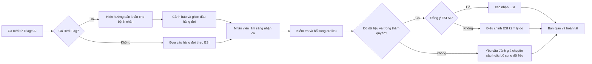

# Kế hoạch cổng Clinical Triage hợp nhất

| Thuộc tính | Giá trị |
| --- | --- |
| Phạm vi | Vai trò hợp nhất `CLINICAL_NURSE`; `DOCTOR` là alias tương thích dữ liệu cũ |
| Phiên bản | Baseline 2.0 |
| Trạng thái | Đã phê duyệt định hướng |
| Ngày phê duyệt | 2026-08-12 |
| Mục tiêu | Gộp Nurse và Doctor vào một cổng Triage + HITL có cùng hàng đợi và ma trận quyền |

## 1. Kết luận định hướng

Cổng Clinical Triage là một **trạm sàng lọc, phân luồng và đánh giá chuyên sâu**, không phải dashboard vận hành bệnh viện, màn hình quản trị AI hay bàn chẩn đoán.

MVP chỉ cần hai màn hình nghiệp vụ:

1. **Hàng đợi cần xử lý**: giúp nhân viên lâm sàng biết ngay ca nào nguy cấp, ca nào chờ lâu, ca nào cần đánh giá chuyên sâu và ca nào đang do mình phụ trách.
2. **Chi tiết ca phân luồng**: giúp kiểm tra dữ liệu, xem ngữ cảnh chuyên sâu sau khi nhận ca, bổ sung thông tin, xác nhận hoặc điều chỉnh ESI, sau đó bàn giao. Chế độ **Đánh giá chuyên sâu** là một bộ lọc có lối tắt rõ ràng của chính hàng đợi, không phải phân hệ thứ ba.

Cảnh báo ca nguy cấp là một lớp thông báo toàn cục, không cần trở thành một phân hệ riêng.

## 2. Quyết định sản phẩm đã chốt

Bốn quyết định dưới đây là baseline bắt buộc cho thiết kế và triển khai:

- **Một vai trò lâm sàng duy nhất:** `CLINICAL_NURSE` hấp thụ quyền HITL an toàn trước đây gắn với Doctor. Tài khoản `DOCTOR` cũ được ánh xạ vào cùng cổng và cùng API.
- **Nhân viên lâm sàng được quyền chốt ESI:** được xác nhận hoặc điều chỉnh mức ESI. Đây là quyết định phân luồng, không phải chẩn đoán bệnh.
- **Chỉ tập trung Triage + HITL:** Sản phẩm hỗ trợ sàng lọc trước hoặc tại điểm tiếp nhận; chưa tích hợp xe cấp cứu, giường bệnh hay EHR/EMR thật.
- **Duyệt tất cả ESI 1–5:** Mọi kết quả phân luồng đều phải được nhân viên y tế duyệt. Với Red Flag/ESI 1, hướng dẫn gọi 115 vẫn xuất hiện ngay và cảnh báo Điều dưỡng được gửi song song, không chờ HITL mới bảo vệ bệnh nhân.

Mọi đề xuất mở rộng sau này phải chứng minh được rằng không làm suy yếu bốn quyết định trên.

## 3. Audit phạm vi hiện tại

Đối chiếu với mục tiêu trong `docs/Brief.md` và `docs/PRD.md`, cổng Điều dưỡng hiện mở rộng vượt khỏi nhiệm vụ “sàng lọc nhanh, không bỏ sót ca nguy hiểm, giảm thao tác thủ công”.

| Mức độ | Vấn đề | Bằng chứng hiện tại | Hướng xử lý |
| --- | --- | --- | --- |
| Critical | Dữ liệu sinh hiệu được suy ra cứng từ mức ESI, có thể khiến dữ liệu mô phỏng trông như dữ liệu đo thật | `frontend/src/components/clinical/KanbanPatientCard.tsx` | Xóa hoàn toàn sinh hiệu suy diễn; chỉ hiển thị giá trị có nguồn, người đo và thời điểm đo |
| Critical | Nội dung “chẩn đoán”, chỉ định thuốc và hướng điều trị vượt ranh giới phân luồng | `frontend/src/components/clinical/review/Col3HitlDecisionConsole.tsx`, `frontend/src/hooks/queries/use-clinical-hitl.ts` | Đổi thành quyết định phân luồng; loại bỏ tên bệnh khẳng định, thuốc, đơn điều trị và chỉ định cận lâm sàng khỏi thao tác Điều dưỡng |
| High | Quyền Điều dưỡng mâu thuẫn: tài liệu cho phép duyệt/đổi ESI nhưng UI hiện khóa toàn bộ thao tác `APPROVE/OVERRIDE` | `frontend/src/components/clinical/review/Col3HitlDecisionConsole.tsx` | Chốt một ma trận quyền duy nhất và cưỡng chế ở cả backend lẫn frontend |
| High | Giao diện có luồng EMS 115, ETA xe, chuẩn bị giường bệnh nhưng dự án chưa có tích hợp ngoại viện thật | `frontend/src/app/clinical/emergency-feed/page.tsx` | Bỏ khỏi Nurse MVP; chỉ giữ cảnh báo Red Flag từ chính hệ thống Triage |
| High | Khi API lỗi, ứng dụng âm thầm trả dữ liệu bệnh nhân mẫu và vẫn cho commit giả thành công | `frontend/src/hooks/queries/use-clinical-hitl.ts`, `frontend/src/hooks/mutations/use-hitl-mutations.ts` | Production phải fail-closed; dữ liệu demo chỉ chạy trong chế độ demo có nhãn rõ ràng |
| Medium | Dashboard chứa biểu đồ lưu lượng, nhịp tim trung bình và Concordance Rate; đây là dữ liệu quản trị/chất lượng, không hỗ trợ xử lý ca ngay | `frontend/src/components/clinical/QueueTelemetryHeader.tsx` | Chuyển sang Admin/Analytics hoặc hoãn; Nurse MVP chỉ giữ bốn chỉ số tác nghiệp |
| Medium | Thư viện phác đồ SBAR là một menu riêng, làm nhân viên rời khỏi ca đang xử lý | `frontend/src/app/clinical/sbar-guidelines/page.tsx` | Hiển thị căn cứ ngắn ngay trong ca; toàn văn dành cho Clinical Governance/QA |
| Medium | Màn hình chi tiết ba cột chứa quá nhiều EHR, PII, RAG, transcript và thuật ngữ kỹ thuật | `frontend/src/components/clinical/review/` | Sắp lại theo một luồng dọc: dữ liệu thiết yếu → dữ liệu thiếu → quyết định → bàn giao |
| Medium | Chuyển vai trò Nurse/Doctor và mở ca demo nằm ngay trong điều hướng nghiệp vụ | `frontend/src/components/clinical/ClinicalSidebar.tsx` | Chỉ cho phép trong môi trường demo/dev; không xuất hiện trong sản phẩm |
| Low | Tên gọi như “Bàn phán quyết”, “quyền lực tối cao”, “Zero-Latency RAG” gây nhiễu và không mô tả nhiệm vụ | Nhiều component trong `frontend/src/components/clinical/` | Dùng ngôn ngữ nghiệp vụ ngắn: Hàng đợi, Xem ca, Xác nhận phân luồng, Đánh giá chuyên sâu |

## 4. Ranh giới vai trò Clinical Triage hợp nhất

### 4.1. Nhân viên lâm sàng được phép làm

- Nhận cảnh báo ca Red Flag hoặc ca ESI cao.
- Xem hàng đợi đã được ưu tiên theo nguy cơ và thời gian chờ.
- Nhận ca để tránh hai người xử lý trùng nhau.
- Kiểm tra triệu chứng chính, thời điểm khởi phát, Red Flag, tiền sử liên quan và dữ liệu sinh hiệu có nguồn.
- Ghi bổ sung hoặc sửa dữ liệu thu thập sai; mọi thay đổi phải lưu người sửa và thời điểm.
- Xác nhận ESI do AI đề xuất hoặc điều chỉnh ESI kèm lý do lâm sàng.
- Yêu cầu một nhân viên lâm sàng khác đánh giá chuyên sâu khi dữ liệu mâu thuẫn hoặc nằm ngoài giao thức; ca quay lại hàng đợi và không bị mất.
- Xem transcript lâm sàng đầy đủ sau khi đã nhận ca; nội dung đóng mặc định để giảm tải nhận thức.
- Ghi trạng thái bàn giao và kết thúc phần việc phân luồng.
- Truy cập thông tin liên hệ tối thiểu khi thật sự cần gọi bệnh nhân/người thân, kèm lý do và audit log.

### 4.2. Vai trò hợp nhất không được phép làm trong sản phẩm này

- Khẳng định chẩn đoán một bệnh cụ thể.
- Kê hoặc đề xuất thuốc, liều dùng, phác đồ điều trị.
- Ra chỉ định xét nghiệm, chụp chiếu hoặc thủ thuật như một y lệnh.
- Điều phối xe 115, đội EMS hoặc giường bệnh khi chưa có tích hợp chính thức.
- Chỉnh sửa kho RAG, prompt, guardrail hoặc cấu hình hệ thống.
- Xem KPI Concordance, biểu đồ vận hành dài hạn hay audit toàn hệ thống trong luồng xử lý ca.
- Mở PII hàng loạt hoặc xem dữ liệu không cần thiết cho ca đang phụ trách.

## 5. Danh sách chức năng mục tiêu

### P0 — Bắt buộc cho Nurse MVP

#### NUR-P0-01 — Hàng đợi ưu tiên

Mỗi ca chỉ hiển thị những thông tin cần để quyết định mở ca:

- Mã ca và tên đã che mờ.
- Tuổi hoặc nhóm tuổi, giới tính nếu đã biết.
- Triệu chứng chính.
- Red Flag và mức ESI do AI đề xuất.
- Thời gian chờ.
- Trạng thái: chưa nhận, đang xử lý, thiếu dữ liệu, cần đánh giá chuyên sâu.
- Một CTA chính: **Nhận và xem ca**.

Thứ tự bắt buộc: Red Flag → ESI thấp nhất về số → thời gian chờ lâu nhất. SLA phải lấy từ cấu hình cơ sở, không hard-code một mốc chung cho mọi ESI.

#### NUR-P0-02 — Tiếp nhận cảnh báo nguy cấp

- Cảnh báo chỉ bật cho ca nguy cấp mới hoặc ca tăng mức nguy cơ.
- Nút **Xác nhận đã thấy** chỉ tắt âm thanh, không xóa cảnh báo và không hoàn tất ca.
- Ca vẫn được ghim đầu hàng đợi cho tới khi có người nhận xử lý.
- Ghi nhận ai đã xác nhận và vào thời điểm nào.
- Không trộn cảnh báo Triage với dữ liệu xe cứu thương ngoài hệ thống.

#### NUR-P0-03 — Nhận ca và chống xử lý trùng

- Điều dưỡng bấm nhận ca trước khi chỉnh sửa dữ liệu.
- Hệ thống hiển thị người đang phụ trách.
- Hai người không thể chốt cùng một phiên bản ca.
- Cho phép trả ca về hàng đợi hoặc chuyển người khác, bắt buộc có lý do ngắn.

#### NUR-P0-04 — Rà soát dữ liệu phân luồng

Màn hình phải trả lời trong ba giây:

1. Bệnh nhân nào?
2. Triệu chứng gì?
3. Mức độ khẩn ra sao?
4. Điều dưỡng cần làm gì tiếp theo?

Thông tin được chia thành bốn khối, theo đúng thứ tự:

1. **Tóm tắt ca**: triệu chứng chính, khởi phát, diễn tiến, mức đau.
2. **Cảnh báo và sinh hiệu**: Red Flag, mạch, huyết áp, nhịp thở, SpO2, nhiệt độ, tri giác; trường chưa đo phải ghi rõ “Chưa có dữ liệu”.
3. **Yếu tố nguy cơ liên quan**: bệnh nền, dị ứng, thuốc đang dùng và thai kỳ nếu có liên quan.
4. **Đề xuất của AI**: ESI, lý do ngắn, độ đầy đủ dữ liệu và nguồn tham chiếu có thể mở rộng.

Transcript đầy đủ và nội dung RAG dài không hiển thị mặc định.

#### NUR-P0-05 — Bổ sung hoặc sửa dữ liệu

- Cho phép nhập sinh hiệu thực đo kèm đơn vị, nguồn và thời điểm đo.
- Cho phép đánh dấu `không biết`, `chưa đo`, `không áp dụng`; không tự điền giá trị mặc định.
- Cho phép sửa câu trả lời hoặc triệu chứng đã ghi nhận nhưng phải lưu giá trị trước/sau.
- Hiển thị rõ dữ liệu nào đến từ bệnh nhân, AI, thiết bị hay Điều dưỡng.
- Nếu thiếu trường ảnh hưởng đến phân luồng, hệ thống chặn chốt và nêu đúng trường cần bổ sung.

#### NUR-P0-06 — Quyết định phân luồng

Chỉ có ba lựa chọn nghiệp vụ:

1. **Xác nhận ESI đề xuất**.
2. **Điều chỉnh ESI** và nhập lý do bắt buộc.
3. **Yêu cầu đánh giá chuyên sâu** và chọn lý do; ca được bỏ gán và quay lại cùng hàng đợi cho một người khác nhận.

Kết quả lưu tối thiểu: ESI AI, ESI cuối, loại quyết định, mã lý do, ghi chú ngắn, người thực hiện, thời điểm và phiên bản dữ liệu. Không đưa thuốc hoặc hướng điều trị vào danh sách lựa chọn.

#### NUR-P0-07 — Bàn giao và hoàn tất phần việc

- Chọn điểm đến nghiệp vụ: xử trí cấp cứu tức thì, khám trực tiếp ưu tiên hoặc hàng đợi thường quy.
- Ghi chú bàn giao ngắn theo SBAR; ưu tiên dữ liệu cấu trúc, tránh đoạn văn dài.
- Trạng thái hoàn tất chỉ xuất hiện sau khi quyết định đã được lưu thành công ở server.
- Nếu server lỗi, giữ nguyên ca trong hàng đợi và cho phép thử lại; không giả lập commit thành công.

#### NUR-P0-08 — Audit tối thiểu

Phải ghi lại:

- Nhận/trả/chuyển ca.
- Xác nhận cảnh báo.
- Thay đổi dữ liệu lâm sàng.
- Xác nhận hoặc điều chỉnh ESI.
- Truy cập PII.
- Bàn giao và đóng ca.

Audit log không được cho phép người dùng sửa hoặc xóa từ giao diện Nurse.

### P1 — Bổ sung sau khi P0 ổn định

- Tìm kiếm theo mã ca và lọc theo trạng thái/người phụ trách.
- Danh sách **Ca của tôi** và hỗ trợ bàn giao ca trực.
- Mẫu lý do điều chỉnh ESI đã được hội đồng chuyên môn duyệt.
- Phím tắt bàn phím và tối ưu tablet.
- Thông báo khi dữ liệu ca thay đổi trong lúc đang xem.
- Xem lịch sử quyết định của chính ca đang xử lý. Transcript ca đã nhận được triển khai ngay trong Baseline 2.0.
- Liên hệ bệnh nhân/người thân theo cơ chế just-in-time và audit đầy đủ.

### P2 — Hoãn hoặc chuyển vai trò khác

- Dashboard xu hướng 24 giờ và Concordance Rate: chuyển Admin/Quality.
- Thư viện phác đồ đầy đủ: chuyển Clinical Governance/Admin; mã nguồn liên quan vẫn hiển thị tại ca.
- Quản trị RAG, prompt, guardrail: chuyển AI Ops/Admin.
- EMS telemetry, ETA xe và chuẩn bị giường: ngoài phạm vi cho tới khi có tích hợp thật.
- Xuất PDF, báo cáo quản trị và thống kê nâng cao: chưa cần cho Nurse MVP.

## 6. Kiến trúc màn hình đề xuất

### 6.1. Màn hình 1 — Hàng đợi lâm sàng hợp nhất

Route mục tiêu: `/clinical/queue`

```text
Thanh trạng thái: Đang chờ | Nguy cấp | Đánh giá chuyên sâu | Chờ lâu nhất

Bộ lọc: Tất cả | Nguy cấp | Ca của tôi | Thiếu dữ liệu | Đánh giá chuyên sâu

Danh sách ưu tiên:
  [Red Flag / ESI] [Tên che mờ + tuổi] [Triệu chứng chính]
  [Thời gian chờ] [Trạng thái]       [Nhận và xem ca]
```

Không hiển thị biểu đồ, thư viện RAG, dữ liệu EMS hoặc thẻ KPI quản trị.

### 6.2. Màn hình 2 — Chi tiết ca phân luồng

Route mục tiêu: `/clinical/cases/[caseId]`

```text
Header cố định: Ca bệnh | ESI AI | Red Flag | Thời gian chờ | Người phụ trách

1. Dữ liệu thiết yếu và sinh hiệu
2. Dữ liệu thiếu / cần nhân viên lâm sàng xác minh
3. Tóm tắt SBAR và căn cứ AI rút gọn
4. Xác nhận ESI | Điều chỉnh ESI | Yêu cầu đánh giá chuyên sâu

CTA chính: Lưu quyết định phân luồng
```

PII, transcript và nguồn RAG đầy đủ chỉ mở khi có mục đích cụ thể.

### 6.3. Điều hướng Nurse MVP

Sidebar chỉ cần:

- **Hàng đợi**.
- **Ca của tôi** — có thể là một tab/filter của Hàng đợi, không cần route riêng trong P0.
- **Đánh giá chuyên sâu** — lối tắt vào bộ lọc `specialist=1` của Hàng đợi, giúp quyền hợp nhất hiển thị rõ mà không tách lại vai trò Doctor.

Loại khỏi sidebar Nurse:

- Bàn phán quyết demo.
- Còi báo động/EMS Feed.
- Phác đồ và tiêu chuẩn SBAR.
- Công tắc đổi vai trò Nurse/Doctor.

## 7. Luồng nghiệp vụ mục tiêu



### Trạng thái đề xuất

Không dùng một trường `status` cho cả phiên AI và công việc Điều dưỡng. Tách `triage_status` khỏi `review_status`.

| `review_status` | Ý nghĩa |
| --- | --- |
| `WAITING_REVIEW` | Đang chờ nhân viên y tế nhận ca |
| `ASSIGNED` | Đã có Điều dưỡng phụ trách |
| `IN_REVIEW` | Đang kiểm tra/bổ sung dữ liệu |
| `NEEDS_MORE_INFO` | Chưa đủ dữ liệu để quyết định |
| `SPECIALIST_REVIEW_REQUIRED` | Cần một nhân viên lâm sàng khác đánh giá chuyên sâu |
| `TRIAGE_DECIDED` | Đã xác nhận hoặc điều chỉnh ESI |
| `HANDED_OFF` | Đã bàn giao và hoàn tất phần việc lâm sàng |

Red Flag là cờ nguy cơ độc lập, không phải trạng thái kết thúc phiên.

## 8. Dữ liệu tối thiểu cần có

### 8.1. Thẻ hàng đợi

| Trường | Bắt buộc | Ghi chú |
| --- | :---: | --- |
| `case_id` | Có | ID duy nhất |
| `masked_patient_label` | Có | Không lộ PII mặc định |
| `age_or_age_group` | Khi biết | Tuổi rất quan trọng cho ESI |
| `sex` | Khi biết | Hiển thị `unknown` nếu chưa có |
| `chief_complaint` | Có | Một dòng, không chẩn đoán |
| `ai_recommended_esi` | Có | Luôn ghi rõ là đề xuất AI |
| `red_flags` | Có | Mảng mã + nhãn dễ hiểu |
| `waiting_since` | Có | Server timestamp |
| `review_status` | Có | Theo bảng trạng thái |
| `assignee` | Không | Người đang phụ trách |
| `data_completeness` | Có | Đủ/thiếu và danh sách trường thiếu |

### 8.2. Sinh hiệu

Mỗi giá trị sinh hiệu phải đi kèm:

- `value` và `unit`.
- `measured_at`.
- `source`: `PATIENT_REPORTED`, `NURSE_MEASURED`, `DEVICE` hoặc `UNKNOWN`.
- `recorded_by` nếu do nhân viên nhập.

Không được suy ra sinh hiệu từ ESI hoặc dùng giá trị mẫu không gắn nhãn.

### 8.3. Quyết định phân luồng

- `decision_type`: `CONFIRM_ESI`, `ADJUST_ESI`, `REQUEST_SPECIALIST_REVIEW`.
- `ai_esi` và `final_esi`.
- `reason_code` và `note`.
- `reviewer_id`, `reviewer_role`, `decided_at`.
- `case_version` để chống ghi đè quyết định của người khác.
- `handoff_destination` và `handoff_status`.

## 9. API và bảo mật cần chuẩn hóa

Mã nguồn hiện dùng lẫn `/api/v1/clinical/...` và `/api/v1/nurse/...`. Khi triển khai cần chọn một namespace duy nhất. Đề xuất:

| Method | Endpoint | Mục đích |
| --- | --- | --- |
| `GET` | `/api/v1/nurse/queue` | Lấy hàng đợi đã ưu tiên |
| `POST` | `/api/v1/nurse/cases/{id}/claim` | Nhận ca có kiểm soát đồng thời |
| `GET` | `/api/v1/nurse/cases/{id}` | Lấy chi tiết ca tối thiểu cần thiết |
| `PATCH` | `/api/v1/nurse/cases/{id}/intake` | Bổ sung/sửa triệu chứng chính kèm audit |
| `PATCH` | `/api/v1/nurse/cases/{id}/observations` | Bổ sung/sửa dữ liệu và sinh hiệu |
| `POST` | `/api/v1/nurse/cases/{id}/decision` | Xác nhận/điều chỉnh ESI |
| `POST` | `/api/v1/nurse/cases/{id}/escalate` | Yêu cầu đánh giá chuyên sâu trong vai trò hợp nhất; giữ path để tương thích client |
| `POST` | `/api/v1/nurse/cases/{id}/handoff` | Ghi nhận bàn giao |
| `POST` | `/api/v1/nurse/alerts/{alertId}/acknowledge` | Xác nhận đã thấy cảnh báo |
| `POST` | `/api/v1/nurse/cases/{id}/pii-access` | Mở thông tin liên hệ có lý do, thời hạn và audit |

Yêu cầu bắt buộc:

- Backend kiểm tra RBAC cho từng hành động; không chỉ ẩn nút ở frontend.
- Decision phải idempotent và kiểm tra `case_version`.
- PII che mờ mặc định; unmask cần lý do, thời hạn hiển thị và audit.
- API lỗi không được trả mock data như dữ liệu thật.
- Dữ liệu demo phải có cờ `demo_mode` và nhãn cố định trên UI.
- Không log PII, transcript hoặc payload lâm sàng đầy đủ ra console trình duyệt.

## 10. Kế hoạch thay đổi theo thành phần

| Thành phần hiện tại | Quyết định |
| --- | --- |
| `ClinicalSidebar.tsx` | Rút còn Hàng đợi/Ca của tôi; bỏ role switch và menu ngoài phạm vi |
| `QueueTelemetryHeader.tsx` | Giữ bốn số tác nghiệp; bỏ chart và Concordance Rate |
| `KanbanBoardWorkspace.tsx` | Giữ logic ưu tiên nhưng cân nhắc chuyển thành danh sách/bảng dễ quét hơn bốn cột |
| `KanbanPatientCard.tsx` | Bỏ sinh hiệu giả, RAG badge và thông tin thứ cấp; giữ một CTA |
| `EmergencyAlarmController.tsx` | Giữ cảnh báo Red Flag; tách “xác nhận đã thấy” khỏi trạng thái xử lý ca |
| `emergency-feed/page.tsx` | Loại khỏi Nurse MVP |
| `sbar-guidelines/page.tsx` | Loại khỏi sidebar; đưa căn cứ liên quan vào ca đang xem |
| `ClinicalReviewTerminal.tsx` | Tái cấu trúc thành một luồng xem dọc tập trung vào dữ liệu → quyết định |
| `Col1EpidemiologyCard.tsx` | Chỉ giữ dữ liệu có ảnh hưởng phân luồng; PII theo just-in-time |
| `Col2SbarRagViewer.tsx` | Rút gọn SBAR; transcript/citation dài mặc định đóng |
| `Col3HitlDecisionConsole.tsx` | Đổi “phán quyết y khoa” thành “quyết định phân luồng”; bỏ thuốc, điều trị và ngôn ngữ chẩn đoán |
| `use-clinical-hitl.ts` | Bỏ silent mock fallback; chuẩn hóa query keys và API contract |
| `use-hitl-mutations.ts` | Không trả commit giả khi server lỗi; rollback rõ ràng |
| Backend Nurse routes | Bổ sung claim, observations, escalate, handoff, RBAC và optimistic concurrency |

## 11. Lộ trình triển khai

### Giai đoạn 0 — Chốt nghiệp vụ

- Trạng thái phạm vi: **Đã phê duyệt ngày 2026-08-12**.
- Đã chốt Điều dưỡng có quyền xác nhận/điều chỉnh ESI.
- Đã chốt phạm vi chỉ gồm Triage + HITL.
- Đã chốt tất cả ESI 1–5 đều phải qua duyệt.
- Dùng một ma trận quyền `CLINICAL_NURSE`; chỉ duy trì `DOCTOR` như alias tương thích dữ liệu cũ ở backend.
- Trước khi viết code, chốt SLA theo chính sách cơ sở và phạm vi PII cần thiết cho MVP.

**Đầu ra:** phạm vi chức năng cốt lõi đã được duyệt; các chi tiết vận hành còn lại sẽ được cụ thể hóa trong API contract và user stories.

### Giai đoạn 1 — Chuẩn hóa contract và safety

- Tách `triage_status` và `review_status`.
- Chuẩn hóa DTO queue, observations và decision.
- Chuẩn hóa một namespace API.
- Gỡ dữ liệu sinh hiệu suy diễn, chẩn đoán/thuốc và silent mock success.
- Bổ sung RBAC, audit và chống ghi đè đồng thời.

**Đầu ra:** backend contract và quy tắc an toàn đủ để xây UI thật.

### Giai đoạn 2 — Xây Nurse Core UI

- Rút gọn sidebar.
- Xây hàng đợi tập trung theo mức khẩn và thời gian chờ.
- Xây trang chi tiết ca theo một luồng đọc dọc.
- Xây form bổ sung sinh hiệu và ba lựa chọn quyết định phân luồng.
- Giữ cảnh báo Red Flag toàn cục, có acknowledge đúng nghĩa.

**Đầu ra:** Điều dưỡng hoàn thành một ca từ nhận → rà soát → quyết định → bàn giao mà không đi qua màn hình phụ.

### Giai đoạn 3 — Kiểm thử và nghiệm thu

- Unit/integration test cho sắp xếp ưu tiên, claim, decision, escalation, audit và RBAC.
- E2E test cho luồng Red Flag và luồng thường.
- Kiểm thử hai người cùng nhận/chốt một ca.
- Kiểm thử API mất kết nối: tuyệt đối không hiện seed data hoặc báo thành công giả.
- Accessibility: keyboard, focus rõ, screen reader, touch target tối thiểu 44px.
- Usability test với kịch bản Điều dưỡng tìm và mở ca nguy cấp trong dưới ba giây.

**Đầu ra:** Nurse MVP đáp ứng Definition of Done ở mục 12.

## 12. Definition of Done

- Điều dưỡng thấy ca nguy cấp và hành động chính trong dưới ba giây.
- Red Flag luôn nằm trên đầu, không biến mất chỉ vì đã tắt còi.
- Một ca có đúng một người phụ trách tại một thời điểm.
- Không có sinh hiệu, EHR hoặc trạng thái “live” giả mạo dữ liệu thật.
- Nhân viên lâm sàng có thể xác nhận ESI, điều chỉnh ESI kèm lý do hoặc yêu cầu đánh giá chuyên sâu theo đúng ma trận quyền đã duyệt.
- Không có chức năng chẩn đoán, kê thuốc, chỉ định điều trị hoặc quản trị AI trong Nurse UI.
- Mỗi màn hình có tối đa một CTA chính; thông tin lâm sàng đứng trước control.
- Mọi thay đổi dữ liệu, quyết định, truy cập PII và bàn giao đều có audit.
- Backend từ chối thao tác trái quyền ngay cả khi gọi API trực tiếp.
- API lỗi không tạo dữ liệu hoặc kết quả thành công giả.
- Toàn bộ P0 có automated test và kịch bản E2E tương ứng.

## 13. Biên bản quyết định

### Quyết định 1 — Thẩm quyền chốt ESI

**Đã chốt:** `CLINICAL_NURSE` là vai trò Clinical Triage hợp nhất, được xác nhận hoặc điều chỉnh ESI kèm lý do và yêu cầu đồng nghiệp đánh giá chuyên sâu. Không còn bước chuyển sang một cổng Doctor riêng.

Quyền này không bao gồm chẩn đoán, kê thuốc, chỉ định xét nghiệm hoặc ban hành phác đồ điều trị.

### Quyết định 2 — Bối cảnh vận hành

**Đã chốt:** Sản phẩm chỉ tập trung vào AI Triage + HITL.

EMS, ETA xe, phân giường và điều phối 115 không thuộc Nurse MVP. Các phần này chỉ được xem xét lại khi có yêu cầu nghiệp vụ, nguồn dữ liệu và tích hợp thật.

### Quyết định 3 — Phạm vi ca phải duyệt

**Đã chốt:** Tất cả ESI 1–5 đều phải qua HITL trước khi phát hành kết quả phân luồng cuối.

Red Flag vẫn kích hoạt hướng dẫn gọi 115 tức thì và cảnh báo Điều dưỡng song song; cơ chế an toàn này không được chờ quyết định HITL.

### Quyết định 4 — Truy cập PII

**Đã chốt ngày 2026-08-12:** PII được che mặc định. Chỉ Điều dưỡng đã nhận ca mới được mở thông tin liên hệ, bắt buộc nhập lý do, ghi audit và giao diện tự che lại sau 5 phút hoặc khi rời màn hình.

### Quyết định 5 — Hiển thị SLA

**Đã chốt ngày 2026-08-12:** Nurse MVP chỉ hiển thị thời gian chờ thực tế. Không hard-code cảnh báo quá SLA theo ESI khi cơ sở y tế chưa cung cấp cấu hình; API trả `sla_target_minutes = null` trong trường hợp này.

### Quyết định 6 — Ma trận quyền API

**Cập nhật ngày 2026-08-12:** `CLINICAL_NURSE` là vai trò chuẩn duy nhất cho cổng lâm sàng. Tài khoản DB mang role `DOCTOR` được backend chấp nhận như alias kế thừa và trả về frontend dưới role `CLINICAL_NURSE`; không còn giao diện hay redirect Doctor riêng.

## 14. Trạng thái triển khai Baseline 2.0

| Hạng mục | Trạng thái | Ghi chú |
| --- | --- | --- |
| Backend contract `/api/v1/nurse` | Đã triển khai | 10 endpoint typed cho queue, case, claim, intake, observations, decision, escalation, handoff, alert và PII |
| Tách trạng thái AI/Nurse | Đã triển khai | `TriageCase.status` giữ trạng thái AI; `NurseReviewState.review_status` giữ công việc Điều dưỡng |
| Chống xử lý trùng | Đã triển khai | Người phụ trách duy nhất, row lock và `case_version` cho mọi mutation quan trọng |
| Sinh hiệu có nguồn | Đã triển khai | Bảng append-only `ClinicalObservation`; không suy ra sinh hiệu từ ESI |
| Audit tối thiểu | Đã triển khai | Nhận/trả ca, sửa triệu chứng/sinh hiệu, quyết định ESI, yêu cầu đánh giá chuyên sâu, acknowledge, PII và bàn giao |
| Hàng đợi `/clinical/queue` | Đã triển khai | Red Flag → ESI → thời gian chờ; không chart, EMS hoặc KPI quản trị |
| Chi tiết `/clinical/cases/[caseId]` | Đã triển khai | Luồng dọc dữ liệu → sinh hiệu → nguy cơ → AI/transcript đóng mặc định → quyết định → bàn giao |
| Fail-closed frontend | Đã triển khai | Không seed fallback và không commit giả khi API lỗi |
| RBAC hợp nhất | Đã triển khai | Backend chấp nhận `CLINICAL_NURSE` và alias DB `DOCTOR`; frontend chỉ nhận diện `CLINICAL_NURSE` |
| Kiểm tra tự động | Đã chạy | Ruff, ESLint, TypeScript, API tests và Next.js production build |

---

Tài liệu này là baseline chức năng đã được phê duyệt để tiếp tục tách thành user stories, API contract và task triển khai. Mọi thay đổi bốn quyết định cốt lõi phải được ghi nhận thành phiên bản tài liệu mới.
