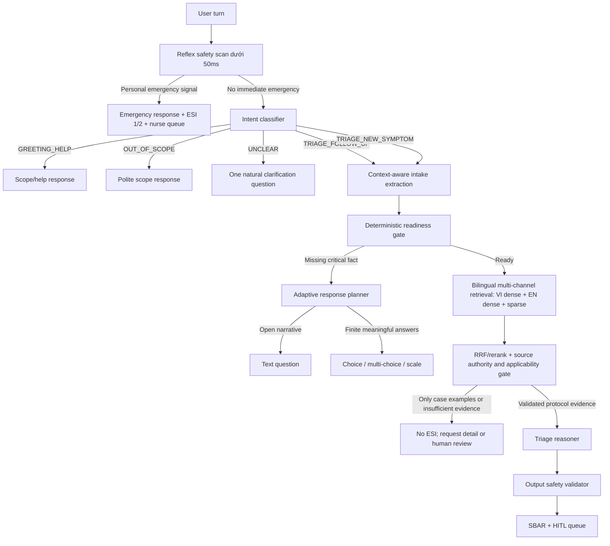

# Kế hoạch cải tiến Triage Agent thích ứng và phản hồi tiến trình thời gian thực

> **Tài liệu lịch sử:** Nội dung dưới đây mô tả kiến trúc hoặc kế hoạch trước khi MedTriage chuyển sang tool-gated DeepAgent. Không dùng tài liệu này làm source of truth cho runtime hiện tại; xem [`ARCHITECTURE.md`](../ARCHITECTURE.md).

## 1. Trạng thái tài liệu

- Loại tài liệu: kế hoạch kiến trúc, biên bản triển khai và corrective-action plan sau audit.
- Trạng thái: **IMPLEMENTED ở tầng kỹ thuật ngày 2026-08-13 / CLINICAL ROLLOUT BLOCKED**. Code fail-closed và regression đã hoàn tất; chỉ được mở production proposal sau khi clinical owner duyệt protocol corpus, calibration profile và retrieval gold set.
- Phạm vi: LangGraph Triage Agent, FastAPI SSE, hợp đồng dữ liệu chat, giao diện bệnh nhân, schema/index RAG và migration dữ liệu `triageknowledgebase`.
- Không bao gồm: tự động thay đổi quyền Điều dưỡng hoặc tự phê duyệt nội dung/phác đồ lâm sàng thay cho clinician.
- Nguyên tắc an toàn: AI chỉ thu thập thông tin và đề xuất phân luồng; không chẩn đoán, không kê đơn và không sinh ESI khi chưa đủ dữ liệu/bằng chứng.

Bốn quyết định đã được phê duyệt và áp dụng:

1. Câu ngoài phạm vi được từ chối lịch sự và điều hướng về Triage, không thêm công cụ thời tiết/web.
2. Dữ liệu mơ hồ hoặc bằng chứng không đủ luôn có ESI `null`, không tạo citation/SBAR giả.
3. ACK, intent, phase và heartbeat chỉ là trạng thái UI tạm thời, không lưu vào lịch sử bệnh án.
4. `MIETIC_v1` là case-example corpus, không phải authoritative protocol corpus; không được dùng một mình để mở cổng ESI hoặc tạo nhãn “protocol verified”.

### 1.1. Biên bản triển khai ngày 2026-08-13

Trạng thái kỹ thuật: **implementation hoàn tất ở chế độ fail-closed; chưa được phép production rollout lâm sàng**. Lý do còn chặn rollout không phải lỗi code: repository chưa có protocol corpus đã được clinical owner phê duyệt, source whitelist/model revision đang để trống có chủ đích, và retrieval benchmark chưa có relevance judgment của clinician/information specialist.

| Phase | Trạng thái sau triển khai | Bằng chứng/ghi chú |
|---|---|---|
| 0 | Hoàn tất | Characterization/regression bao phủ intent, negation, contradiction, MIETIC authority rejection, ingest validator và RRF provenance trong `tests/test_agents/test_adaptive_conversation.py` |
| 1 | Hoàn tất | Deterministic-first intent router; LLM fallback mặc định tắt và chỉ opt-in; `UNCLEAR` không tự route sang Triage |
| 2 | Hoàn tất | Fact provenance theo turn/raw span; onset conflict không silent overwrite; contradiction node chặn retrieval; intake không còn gọi LLM để thêm/dịch fact |
| 3A | Hoàn tất ở application boundary | Production retriever chỉ import/query `TriageProtocolDocument`; MIETIC/legacy table không còn reachable từ RAG tool hoặc evidence gate |
| 3B | Tooling hoàn tất, chưa `--apply` | `step5_migrate_mietic_triage_db.py` dry-run mặc định, parse ESI 1-5, quarantine case-example, controlled keyword, content hash, pinned real embedding và idempotency; chưa ghi DB vì chưa có snapshot/revision được duyệt |
| 3C | Hoàn tất ở code, chờ corpus thật | VI dense, EN dense và sparse chạy độc lập; RRF giữ channel rank/score; authority/scope/population/per-channel calibration gate; reasoner có `ABSTAIN` |
| 4 | Hoàn tất | SSE có `accepted`, typed phase/intent, heartbeat 2 giây, `result`/`error` có validator và không nuốt lỗi |
| 5 | Hoàn tất | Optimistic message/activity card, cancel request, chống double-submit, Zod full event/result contract, citation chỉ mang nhãn đã duyệt khi đủ authority metadata |
| 6 | Hoàn tất phần code/telemetry; chờ clinical review | Metric không ghi raw PHI; diagnostic production; manifest ingest; gold-set evaluator. Fixture đang `PENDING_CLINICAL_REVIEW` nên evaluator chủ động từ chối chạy |

Các điểm triển khai quan trọng:

- `scripts/test_rag_retrieval_case.py` mặc định chạy **production mode** trên `triage_protocol_documents`; `--mode legacy-audit` mới đọc `triageknowledgebase` và luôn ghi rõ đây không phải production evidence.
- `scripts/ingest_validated_protocols.py` chỉ validate theo mặc định. `--apply` yêu cầu source whitelist, quyền sử dụng, clinical reviewer, effective/version/section, calibration profile theo channel/cluster/population và immutable embedding revision.
- `eval/triage_retrieval_benchmark.json` chỉ là query fixture tổng hợp, không giả mạo relevance label. `scripts/evaluate_protocol_retrieval.py` fail hard cho tới khi benchmark có trạng thái `APPROVED` và mỗi case có clinician judgment.
- Cấu hình hiện tại trả `PROTOCOL_SOURCE_WHITELIST_EMPTY` (và sẽ trả `EMBEDDING_REVISION_UNPINNED` nếu chỉ điền whitelist). Do đó evidence gate trả `INSUFFICIENT_EVIDENCE`, citation rỗng và ESI `null`.
- Rollback flag được triển khai ở biên an toàn bằng `RAG_PROTOCOL_RETRIEVAL_ENABLED=false`: tắt proposal dựa trên RAG nhưng vẫn giữ intent/contradiction/reflex guardrail mới. Không phục hồi graph cũ vì graph cũ chính là đường lỗi có thể route sai và tạo ESI/citation không có căn cứ.
- Safety reflex dùng `safety_rule_id` nội bộ, không giả danh mã protocol/RAG citation. Full citation authority/version/section/hash/reviewer/calibration được lưu cùng proposal để replay trung thực.

Kết quả xác minh cuối:

- Backend: `75 passed`; Ruff và compileall đạt.
- Frontend: TypeScript đạt; ESLint `0 errors` (còn warning legacy ngoài phạm vi); Next.js production build đạt.
- Production RAG diagnostic: 0 kết quả, `INSUFFICIENT_EVIDENCE`, `eligible_for_esi=false` với cấu hình whitelist/revision đang trống; không có database mutation.

## 2. Vấn đề quan sát được

Ví dụ tái hiện:

```text
Người dùng: "thời tiết hôm nay như nào"
Agent: "Xin bạn cho biết khoảng thời gian mà triệu chứng này bắt đầu nhé?"
```

Đây là lỗi kiến trúc điều phối của baseline trước ngày 2026-08-12: đồ thị cũ chỉ có hai nhánh sau lớp Red Flag (`intake_analyzer` hoặc `summary_creator`). Intent router hiện đã được thêm, nhưng audit mới ngày 2026-08-13 cho thấy các lỗi tiếp theo ở extraction/readiness, dữ liệu RAG, evidence authority và truthful rendering vẫn chưa được khóa.

### 2.1. Audit backend/agent baseline ngày 2026-08-12

Bảng này giữ lại nguyên nhân của đợt cải tiến trước để truy vết lịch sử. Một số mục như intent router, no-fake-empty-RAG và SSE progress đã có implementation; không được xem bảng này là mô tả đầy đủ trạng thái code ngày 2026-08-13.

| Mức độ | Vấn đề | Bằng chứng hiện tại | Hậu quả | Hướng sửa |
|---|---|---|---|---|
| Critical | Không có intent router | `graph.py` luôn đi `redflag_detector -> intake_analyzer` nếu không có Red Flag | Câu thời tiết, chào hỏi và câu vô nghĩa đều bị coi là triệu chứng | Thêm `intent_classifier` và conditional routing trước intake |
| Critical | Có thể ghi ESI khi chưa đánh giá | `routes_patient.py` lấy `current_esi_level` với mặc định `3` cho cả phản hồi hỏi thêm | Sidebar/hồ sơ xuất hiện ESI giả dù agent chưa đủ dữ liệu | Chỉ cập nhật `ai_proposed_esi` khi `decision_status=READY` |
| Critical | RAG tạo bằng chứng giả khi không tìm thấy tài liệu | `rag_retriever.py` sinh `PRO_GEN_001`, nội dung và similarity `0.92` | Agent có thể suy luận dựa trên nguồn không tồn tại | Trả danh sách rỗng và route sang `NEEDS_MORE_INFO`/`HUMAN_REVIEW` |
| High | Confidence do LLM tự gán quyết định route | `intake_analyzer.py` yêu cầu LLM tự sinh `confidence_score`; `graph.py` dùng ngưỡng `0.8` | Điểm không hiệu chỉnh có thể kích hoạt ESI quá sớm | Tách `extraction_confidence` khỏi `decision_readiness`; readiness tính bằng rule |
| High | Question engine bắt buộc trắc nghiệm | Schema bắt buộc `options`; fallback cũng luôn tạo hai lựa chọn | Hội thoại gượng ép và mất ngữ cảnh | Cho phép `TEXT`, `CHOICE`, `MULTI_CHOICE`, `SCALE`; chọn theo loại trường cần hỏi |
| High | Fallback LLM vẫn giả lập kết luận lâm sàng | `MockClinicalAI` trả câu ESI hoặc biểu mẫu chung khi provider lỗi | Demo có thể tạo kết quả y khoa không có căn cứ | Fallback phải fail-safe, không sinh ESI/citation giả |
| High | Trạng thái hội thoại không phân biệt câu trả lời follow-up | Intent hiện không tồn tại; lịch sử dùng không đồng nhất `role` và `sender` | Câu như "từ hôm qua" dễ bị hiểu sai nếu đứng độc lập | Lưu `active_question` và chuẩn hóa message role |
| Medium | `step` đang vừa là tiến độ UI vừa là biến điều khiển agent | Các lượt sau có thể giữ bước không đúng thực tế | Stepper không phản ánh đúng agent đang làm gì | Tách `workflow_phase` backend khỏi `display_progress` frontend |
| Medium | Lỗi SSE có thể bị nuốt | Client ném lỗi trong khối parse rồi catch thành `console.warn` | UI chờ đến khi stream kết thúc mới báo lỗi chung | Parse event bằng discriminated union; lỗi server phải propagate |

### 2.2. Audit frontend/UX baseline ngày 2026-08-12

Các mục dưới đây là baseline trước Phase 4-5; acceptance phải được chạy lại cùng audit RAG và truthful clinical rendering mới.

| Mức độ | Vấn đề | Bằng chứng hiện tại | Vi phạm | Hướng sửa |
|---|---|---|---|---|
| High | Phản hồi tiến trình chưa đủ nổi bật | Chỉ có ba chấm và dòng `text-xs` màu xám | Không đạt yêu cầu hiểu trạng thái trong 3 giây | Tạo `AgentActivityCard` rõ intent, việc đang làm và trạng thái kết nối |
| High | Khoảng im lặng trước sự kiện node đầu tiên | SSE chưa phát ACK ngay; `redflag_detector` không có status được hiển thị | Người dùng không biết hệ thống đã nhận tin | Hiển thị optimistic ACK tức thì và server phát `accepted` trước khi chạy graph |
| High | Stepper cứng 4 bước cho mọi hội thoại | Ngoài phạm vi vẫn hiển thị đang khai thác triệu chứng | UI nói sai trạng thái hệ thống | Stepper chỉ hoạt động khi intent là Triage; ngoài phạm vi hiển thị trạng thái trợ giúp |
| Medium | Progress chỉ là chuỗi tự do | `onProgress(status: string)` | Khó kiểm thử, khó map icon/progress/a11y | Dùng `AgentProgressEvent` có type, phase, label, detail, timestamp |
| Medium | Thiếu trợ năng cho trạng thái streaming | Vùng typing chưa có `role=status`/`aria-live` | Screen reader không nhận thay đổi | Dùng `role="status"`, `aria-live="polite"`; Red Flag vẫn `assertive` |
| Medium | Optimistic message và trạng thái chưa được mô hình hóa chặt | Có nhiều `any` trong page/query | Dễ lỗi render và trạng thái stale | Zod validate SSE và loại bỏ `any` trong luồng chat |

### 2.3. Audit trực tiếp PostgreSQL RAG ngày 2026-08-13

Audit này dùng truy vấn SQL chỉ đọc trên database được cấu hình bởi ứng dụng; không dựa trên file backup và không in connection string.

#### 2.3.1. Đường chạy RAG thật

Kết luận từ code và schema:

1. `TriageKnowledgeBase.__tablename__ = "triageknowledgebase"`; retriever production truy vấn trực tiếp model này.
2. `ClinicalHybridRetriever` hiện chỉ chạy `embedding.cosine_distance(...)` trên PostgreSQL pgvector và sắp xếp top-k.
3. Không có ChromaDB, BM25, Postgres FTS hoặc RRF trong đường chạy hiện tại. Tên `ClinicalHybridRetriever` và docstring “Hybrid RAG” chưa phản ánh implementation thật.
4. Bảng có HNSW index `ix_triage_embedding_hnsw` và GIN index `ix_triage_keywords_gin`, nhưng code retrieval chỉ dùng HNSW/dense vector; cột `keywords` và GIN index chưa được truy vấn.
5. Query hiện tại là:

   ```text
   " ".join(chief_complaint) + " " + " ".join(clinical_keywords_en)
   ```

   `clinical_keywords_en` được LLM nhỏ dịch từ complaint đã extract. Nếu provider/structured output lỗi, bước này fail silent và query chỉ còn tiếng Việt.

#### 2.3.2. Thống kê bảng thật

| Hạng mục | Kết quả đọc trực tiếp |
|---|---:|
| Tổng số dòng | 9.629 |
| Nguồn duy nhất | `MIETIC_v1` — 9.629 dòng |
| Định dạng nội dung | 100% có `Symptoms:` và `Analysis:` |
| Dòng có ký tự/từ thông dụng đặc trưng tiếng Việt trong `page_content` | 0 |
| Độ dài trung bình | 2.214,3 ký tự/dòng |
| Metadata ESI 1 | 866 |
| Metadata ESI 2 | 7.974 |
| Metadata ESI 3 | 789 |
| Metadata ESI 4/5 | 0 |
| Dòng không có sparse keyword | 3.165 |
| Keyword `myocardial_infarction` | 6.305 |
| Keyword `dyspnea` | 828 |
| Keyword `cardiac_arrest` | 84 |

Toàn bộ bảng là case examples bằng tiếng Anh kèm analysis sinh từ dataset. Metadata không có các trường cần cho protocol authority như `document_type`, `issuing_body`, `version`, `effective_date`, `section`, `validation_status` hoặc clinician approval.

#### 2.3.3. Sai lệch được xác nhận trong migration và dữ liệu

Script `scripts/step5_migrate_mietic_triage_db.py` không thực sự gọi LLM để trích ESI. Logic hiện là:

- nếu output chứa ESI 1 thì gán 1;
- nếu chứa ESI 3 thì gán 3;
- mọi trường hợp còn lại mặc định gán 2.

Hậu quả đã đo được:

- ít nhất 145 dòng có nội dung nhắc ESI 4 nhưng metadata không phải 4;
- ít nhất 4 dòng có nội dung nhắc ESI 5 nhưng metadata không phải 5;
- các con số này chỉ là lower bound theo regex format hiện tại.

Keyword extraction còn dùng điều kiện substring `"mi" in text_lower`, nên các từ tiếng Anh chứa hai ký tự `mi` có thể bị gắn `myocardial_infarction`. Ví dụ đọc trực tiếp:

| Case | Nội dung rút gọn | Metadata/keyword sai đáng chú ý |
|---|---|---|
| `mietic_09629` | Nam 65 tuổi, đau xương sườn phải 6/10, không distress tức thì | metadata ESI 2; keyword `myocardial_infarction` |
| `mietic_00434` | Nữ 22 tuổi, chấn thương ngón tay, nội dung ghi ESI 4 | metadata ESI 2 |
| `mietic_09071` | Nữ 24 tuổi, không có chief complaint, nội dung ghi ESI 5 | metadata ESI 2; keyword `myocardial_infarction` |
| `mietic_00001` | Ung thư phổi di căn, khó thở/distress | có thêm keyword `myocardial_infarction` dù complaint không phải MI |

Migration còn tạo reasoning giống nhau cho mọi case (`Bệnh nhân có biểu hiện nguy cấp cần theo dõi sát sao`) và tự gắn `Defibrillation`, `CPR` cho mọi metadata ESI 1. Đây không phải provenance lâm sàng có thể dùng để chứng minh một ESI proposal.

#### 2.3.4. Kiểm thử chéo ngôn ngữ bằng đúng BGE-M3 và pgvector

Đã chạy ba dense query trên cùng bảng bằng checkpoint `BAAI/bge-m3`, lấy cosine similarity giống code production:

| Query | Top-5 similarity | Nhận xét |
|---|---|---|
| Việt, gần với query extractor hiện tại | `0.5660–0.5734` | Tìm được các ca GI tiếng Anh, chứng minh BGE-M3 có cross-lingual retrieval; chất lượng còn lẫn constipation, melena và bệnh sử rất khác |
| Nối Việt + keyword Anh | `0.5856–0.6002` | Điểm tăng và có thêm ca diarrhea, nhưng vẫn là case similarity và bị chi phối bởi metadata ESI 2 |
| English structured query | `0.6209–0.6403` | Top results sát abdominal pain/diarrhea/nausea hơn trong mẫu này |

Với threshold hiện tại `MIN_EVIDENCE_SCORE = 0.55`, cả ba top result của query tiếng Việt đều vượt gate. Vì retriever fallback `case_id -> protocol_code`, các MIETIC cases này được đóng gói như citation đủ điều kiện cho reasoner dù chúng không phải protocol.

Kết luận về ngôn ngữ:

- **Có tính đến một phần**: BGE-M3 hỗ trợ cross-lingual dense retrieval và intake có bước sinh keyword tiếng Anh.
- **Chưa đủ an toàn/định lượng**: translation có thể fail silent, query chỉ là chuỗi nối, không có channel score riêng, threshold chưa calibrate theo ngôn ngữ, và query không chứa đầy đủ onset/severity/vitals/verified history.
- Điểm similarity cao hơn của query Anh trong một ca không đủ để kết luận “dịch sang Anh là xong”; cần benchmark có gold relevance trên nhiều symptom clusters.

### 2.4. Kết luận audit cập nhật theo mức độ ưu tiên

| Mức độ | Vấn đề đã xác nhận | Quyết định corrective action |
|---|---|---|
| Critical | Case-example corpus đang được xem như protocol evidence | Quarantine `MIETIC_v1` khỏi evidence gate ngay; ESI null/human review nếu chưa có protocol corpus |
| Critical | Metadata ESI 4/5 bị collapse về 2 | Không dùng metadata hiện tại làm ground truth; rebuild từ source có schema validator |
| Critical | Gate 0.55 chấp nhận ba case English từ query Việt mẫu | Bỏ single-score gate; thêm source authority + applicability + calibrated retrieval evaluation |
| High | Query song ngữ là phép nối không đo được đóng góp từng kênh | Chạy VI/EN/sparse thành các retrieval channel độc lập rồi fusion |
| High | Sparse keyword bị nhiễm MI diện rộng | Không bật GIN/BM25 trên dữ liệu hiện tại; rebuild controlled medical terms với word boundary |
| High | Seed script có dummy-vector fallback khi thiếu dependency | Migration phải fail hard; cấm ghi `[0.01] * 1024`; lưu model/version/hash để audit |
| Medium | Environment hiện thiếu `asyncpg` và `langchain_huggingface` dù requirements có khai báo | Thêm environment smoke test trước migration/retrieval benchmark |

## 3. Các bất biến sản phẩm sau cải tiến

1. Mọi đầu vào vẫn đi qua Red Flag reflex trước bất kỳ LLM/RAG nào.
2. Không có triệu chứng cá nhân hợp lệ thì không vào intake, không truy vấn RAG, không tạo ESI và không gửi ca sang hàng đợi Điều dưỡng.
3. Dữ liệu mơ hồ thì agent thừa nhận chưa đủ thông tin và hỏi đúng một câu có giá trị cao nhất; không dự đoán ESI.
4. Không có nguồn RAG đạt ngưỡng thì không tạo citation giả và không tạo kết luận ESI từ fallback.
5. Trắc nghiệm chỉ xuất hiện khi tập đáp án hữu hạn giúp giảm thao tác hoặc phân biệt nguy cơ; luôn cho phép "Khác / Tôi không chắc" và nhập tự do khi phù hợp.
6. Trong lúc chờ, giao diện thay đổi ngay khi người dùng gửi và không có khoảng im lặng nhìn thấy quá 2 giây.
7. UI chỉ hiển thị mô tả tiến trình an toàn, không hiển thị chain-of-thought hoặc suy luận nội bộ của mô hình.
8. `case_example` không bao giờ được đổi tên hoặc fallback thành `protocol_code`; case similarity không phải protocol evidence.
9. Mọi document mở evidence gate phải thuộc source whitelist và có `document_type=validated_protocol`, version/section và trạng thái clinician-approved.
10. Retrieval tiếng Việt, tiếng Anh và sparse exact-match phải có score/rank riêng trước khi fusion; không dùng một chuỗi mixed duy nhất làm artefact không kiểm toán được.
11. Nếu translation hoặc một retrieval channel lỗi, hệ thống ghi rõ degraded mode; không fail silent và không hạ evidence requirements.
12. Migration/indexing phải fail hard khi embedding model không khả dụng; không có dummy vector hoặc metadata mặc định mang tính lâm sàng.

## 4. Kiến trúc LangGraph mục tiêu



### 4.1. Thứ tự node đề xuất

1. `redflag_detector`: rule-based, cực nhanh, nhận biết ngữ cảnh khẳng định cá nhân để giảm false positive như "đau ngực là gì?" nhưng không làm yếu cảnh báo "tôi đau ngực dữ dội".
2. `intent_classifier`: structured output, có deterministic pre-rules và fail-safe `UNCLEAR`.
3. `scope_response`: trả lời chào hỏi/hướng dẫn hoặc từ chối ngoài phạm vi; kết thúc lượt chat mà không thay đổi trạng thái lâm sàng.
4. `intake_analyzer`: chỉ chạy với intent Triage; trích xuất fact có nguồn từ lượt nói cụ thể.
5. `readiness_evaluator`: pure function; xác định trường bắt buộc theo nhóm triệu chứng, không dùng điểm confidence do LLM tự khai.
6. `response_planner`: chọn text tự nhiên hay UI có cấu trúc.
7. `bilingual_query_builder`: tạo hai query có provenance từ cùng clinical facts đã xác nhận: raw/canonical Vietnamese và structured English; translation không được tự thêm body site, diagnosis hoặc vital.
8. `rag_retriever`: chạy riêng VI dense, EN dense và sparse exact-value; log rank/score từng channel rồi fusion. `MIETIC_v1` chỉ được truy vấn trong case-example index nếu cần eval/support, không trả về protocol evidence.
9. `evidence_gate`: kiểm tra source whitelist, `document_type`, version, section, clinical scope, matched criteria và applicability; similarity chỉ là một tín hiệu retrieval.
10. `triage_reasoner`: chỉ chạy khi evidence gate có validated protocol; Pydantic cho phép `ABSTAIN`, ràng buộc ESI 1-5, matched criteria, citation IDs và uncertainty.
11. `summary_creator`: chỉ chạy khi có đề xuất hợp lệ; tạo SBAR và chuyển HITL.

## 5. Phân loại intent

### 5.1. Taxonomy tối thiểu

| Intent | Ví dụ | Hành vi |
|---|---|---|
| `TRIAGE_NEW_SYMPTOM` | "Tôi đau bụng từ sáng" | Bắt đầu/cập nhật intake |
| `TRIAGE_FOLLOW_UP` | "Từ hôm qua", khi active question hỏi onset | Gắn câu trả lời vào đúng field đang chờ |
| `EMERGENCY_SIGNAL` | "Tôi khó thở dữ dội" | Short-circuit trước intent LLM |
| `GREETING_HELP` | "Xin chào", "Bạn làm được gì?" | Giới thiệu ngắn phạm vi và mời mô tả triệu chứng |
| `OUT_OF_SCOPE` | "Thời tiết hôm nay thế nào?" | Phản hồi lịch sự, không ép về triệu chứng |
| `UNCLEAR` | "Không biết nữa", chuỗi quá ngắn không có active question | Hỏi một câu tự nhiên để làm rõ ý định |

### 5.2. Hợp đồng classifier

```text
intent
confidence
is_personal_health_statement
is_follow_up_to_active_question
safe_user_facing_summary
```

- `safe_user_facing_summary` chỉ dùng để hiển thị kiểu "Mình đang xác định đây có phải yêu cầu sàng lọc triệu chứng hay không".
- Không gửi rationale nội bộ/chain-of-thought ra frontend.
- Nếu model lỗi hoặc confidence thấp: route `UNCLEAR`, tuyệt đối không mặc định sang Triage.

## 6. Intake thích ứng và chính sách đặt câu hỏi

### 6.1. Không dùng một checklist cứng cho mọi triệu chứng

Thay `confidence_score >= 0.8` bằng hai lớp:

- `extraction_confidence`: mức chắc chắn fact được trích đúng từ câu người dùng.
- `decision_readiness`: kết quả deterministic từ `chief_complaint`, context, critical missing fields và symptom-specific requirements.

Ví dụ: `radiation` quan trọng với đau ngực nhưng không nên bị hỏi cho sốt đơn thuần. `severity_score` dạng thang đau không thích hợp cho mọi phàn nàn như chóng mặt hoặc phát ban.

### 6.2. Chính sách chọn hình thức trả lời

| Tình huống | Kiểu UI | Ví dụ |
|---|---|---|
| Chưa biết người dùng muốn nói gì | `TEXT` | "Bạn đang muốn sàng lọc một triệu chứng sức khỏe hay cần hướng dẫn sử dụng?" |
| Thiếu triệu chứng chính | `TEXT` | "Bạn đang cảm thấy khó chịu ở đâu hoặc có biểu hiện gì?" |
| Một tập đáp án hữu hạn có ý nghĩa phân luồng | `SINGLE_CHOICE` | Thời điểm khởi phát theo các mốc rõ ràng |
| Có thể có nhiều dấu hiệu đi kèm | `MULTI_CHOICE` | Khó thở, buồn nôn, vã mồ hôi, không có các dấu hiệu trên |
| Đo cường độ phù hợp | `SCALE` | Mức đau 0-10, kèm lựa chọn "Không áp dụng/Không chắc" |
| Ngoài phạm vi | `TEXT` | Nêu phạm vi hỗ trợ; không tạo options |

Quy tắc bổ sung:

- Mỗi lượt chỉ hỏi một mục có information gain cao nhất.
- Tối đa bốn lựa chọn chính, cộng "Khác" và "Tôi không chắc" khi cần.
- Không gắn `isRisk=true` theo phỏng đoán; mỗi risk option phải map tới rule/protocol rõ ràng.
- Người dùng luôn có thể nhập tự do ngay cả khi có choice card.

## 7. Không dự đoán khi dữ liệu mơ hồ

### 7.1. Trạng thái quyết định mới

```text
NOT_APPLICABLE       # ngoài phạm vi/chào hỏi
COLLECTING           # đang thu thập, chưa đủ dữ liệu
NEEDS_CLARIFICATION  # có mâu thuẫn hoặc fact quan trọng còn thiếu
READY_FOR_REASONING  # đủ dữ liệu tối thiểu để truy xuất
INSUFFICIENT_EVIDENCE# RAG không đủ bằng chứng
PROPOSED             # có ESI đề xuất có nguồn
EMERGENCY_ESCALATED  # Red Flag xác định
```

### 7.2. Điều kiện ghi ESI

`ai_proposed_esi` chỉ được ghi khi:

- `EMERGENCY_ESCALATED` từ rule Red Flag có protocol thật; hoặc
- `PROPOSED` sau khi readiness và evidence gate cùng đạt.

Với `COLLECTING`, `NEEDS_CLARIFICATION`, `NOT_APPLICABLE`, `INSUFFICIENT_EVIDENCE`:

- `ai_proposed_esi = null`;
- không sinh SBAR;
- không tạo `NurseReviewState`;
- không hiển thị badge ESI ở sidebar;
- không đưa ca vào hàng đợi Điều dưỡng.

### 7.3. Chiến lược RAG cập nhật từ dữ liệu thật

#### 7.3.1. Tách hai mục đích dữ liệu

Không tiếp tục để một bảng/corpus đảm nhiệm đồng thời “ca tương tự” và “bằng chứng phác đồ”. Thiết kế mục tiêu:

| Corpus | Vai trò | Có được mở evidence gate? |
|---|---|---|
| `triage_case_examples` | MIETIC cases đã làm sạch, phục vụ eval, similarity analysis, hard-case mining | Không |
| `triage_protocol_documents` | Phác đồ/handbook được whitelist, versioned, chunk theo section, clinician-approved | Có, nếu applicability đạt |

Nếu vẫn dùng chung physical table trong giai đoạn chuyển đổi, bắt buộc có `document_type` và filter ở SQL trước top-k; khuyến nghị dài hạn là tách table/index để không thể vô tình fallback case thành protocol.

#### 7.3.2. Bilingual multi-query thay vì nối chuỗi

Từ một `clinical_blueprint` đã xác nhận, query builder tạo:

```text
query_vi
  symptom cluster + body site + onset/course + severity
  + associated symptoms + explicit vital values/availability + verified risk context

query_en
  canonical medical translation của đúng các fact trên
  + cùng numeric values/units; không thêm diagnosis

sparse_terms
  exact acronyms, thresholds, units, protocol concepts và controlled synonyms
```

Quy trình retrieval:

1. Dense query Việt trên multilingual embeddings.
2. Dense query English canonical trên cùng embedding model/index hoặc index tương thích.
3. Sparse retrieval chỉ trên controlled terms và numeric values; không dùng keyword array hiện tại.
4. Metadata filter loại mọi source không được phép trước khi rerank cho evidence.
5. RRF/reranker hợp nhất rank, nhưng giữ score/rank/channel provenance trong output.
6. Calibrate threshold theo channel và symptom cluster bằng labeled retrieval set; không tái sử dụng mặc định `0.55` như một clinical evidence threshold.

LLM translation chỉ là query expansion có schema, không phải nguồn fact. Khi translation fail, VI dense vẫn chạy và trạng thái `EN_CHANNEL_UNAVAILABLE` được audit; evidence requirements không đổi.

#### 7.3.3. Data repair và re-index bắt buộc

Đối với MIETIC case corpus:

- đọc ESI từ structured source/validator hỗ trợ đủ 1-5; không regex default 2;
- từ chối record nếu output chứa nhiều case hoặc nhiều ESI không resolve được;
- loại reasoning generic và intervention tự gắn;
- rebuild keywords bằng controlled ontology + word boundary/phrase matcher;
- deduplicate theo normalized clinical input hash;
- lưu `source_record_id`, `dataset_version`, `parser_version`, `embedding_model`, `embedding_revision`, `content_hash`, `indexed_at`;
- migration fail nếu dimension/model khác hoặc dependency thiếu; không dummy vector.

Đối với authoritative protocol corpus:

- chỉ ingest tài liệu có quyền sử dụng và clinical owner;
- chunk theo section/decision point, không chunk tùy ý theo số ký tự;
- metadata tối thiểu: `protocol_code`, `title`, `issuing_body`, `version`, `effective_date`, `section`, `document_type`, `clinical_scope`, `validation_status`, `reviewed_by`, `content_hash`;
- citation phải trỏ đúng document/section, không trỏ case ID.

#### 7.3.4. Evidence gate mới

Một result chỉ đủ điều kiện đi vào `triage_reasoner` khi đồng thời:

1. `document_type == validated_protocol`;
2. source/version nằm trong whitelist còn hiệu lực;
3. scope khớp symptom cluster/population;
4. section chứa decision criterion liên quan tới fact đã xác nhận;
5. citation ID tồn tại và trace được về content hash;
6. không có unresolved contradiction hoặc missing discriminator;
7. retrieval/rerank score đạt threshold đã calibrate trên eval set.

Thiếu bất kỳ điều kiện nào: `INSUFFICIENT_EVIDENCE`, ESI `null`, chuyển clarification hoặc human review.

## 8. Giao thức tiến trình SSE mới

### 8.1. Event contract

```json
{
  "type": "progress",
  "phase": "INTENT_CLASSIFICATION",
  "label": "Đang hiểu yêu cầu của bạn",
  "detail": "Kiểm tra đây có phải là mô tả triệu chứng cần sàng lọc hay không.",
  "progress": 15,
  "timestamp": "2026-08-12T12:33:00Z"
}
```

Các loại event:

- `accepted`: server đã nhận lượt chat.
- `progress`: chuyển phase.
- `heartbeat`: giữ cảm giác hoạt động nếu một node kéo dài quá 2 giây.
- `result`: phản hồi hoàn chỉnh, có `response_type`, `intent`, `decision_status`.
- `error`: lỗi có mã, thông báo thân thiện và `retryable`.

### 8.2. Thứ tự phản hồi nhận biết được

1. Ngay khi bấm gửi: frontend optimistic hiển thị "Đã nhận tin nhắn" trong dưới một frame.
2. Server phát `accepted` trước khi gọi LangGraph.
3. UI hiển thị intent an toàn sau node classifier, ví dụ "Yêu cầu ngoài phạm vi Triage" hoặc "Đang làm rõ triệu chứng".
4. Mỗi node phát phase rõ ràng: safety, intent, intake, retrieval, reasoning, handoff.
5. Nếu không có phase mới trong 2 giây, heartbeat cập nhật "Hệ thống vẫn đang xử lý..." và thời gian chờ.
6. Khi hoàn tất, activity card chuyển thành message và tự thu gọn; trạng thái kỹ thuật không lưu vào lịch sử bệnh án.

### 8.3. Mục tiêu hiệu năng/UX

- Phản hồi UI local đầu tiên: dưới 100 ms.
- SSE `accepted` p95: dưới 500 ms trong môi trường nội bộ.
- Khoảng im lặng nhìn thấy tối đa: 2 giây.
- Red Flag deterministic vẫn ưu tiên dưới 50 ms ở lớp xử lý, không chờ intent/RAG.
- Cho phép hủy request và thử lại; không gửi trùng lượt khi mutation đang chạy.

## 9. Thiết kế UI tiến trình

### 9.1. Component đề xuất

`AgentActivityCard` đặt ngay sau tin nhắn optimistic của người dùng:

- Dòng chính 14-16 px: hành động hiện tại, ví dụ "Đang xác định mục đích câu hỏi".
- Dòng phụ 14 px: giải thích ngắn, không tiết lộ chain-of-thought.
- Icon Lucide theo phase, spinner hoặc progress bar mảnh.
- `role="status"`, `aria-live="polite"`, `aria-atomic="true"`.
- Không dùng emoji, không dùng chữ nhỏ hơn 14 px, không nested card và không lạm dụng màu.
- Red Flag dùng component riêng với `role="alert"`, `aria-live="assertive"`.

### 9.2. Hành vi stepper

- Trước khi xác nhận intent Triage: trạng thái trung tính "Đang hiểu yêu cầu".
- `OUT_OF_SCOPE`/`GREETING_HELP`: không tăng bước khai thác triệu chứng.
- Triage thật: tiến độ lấy từ `workflow_phase`, không suy ra từ số message.
- Không cho người dùng click tùy ý để sửa bước nghiệp vụ của agent.

## 10. Hợp đồng dữ liệu cần mở rộng

### 10.1. Agent state

Thêm các trường typed:

```text
intent
intent_confidence
conversation_mode
active_question
response_type
workflow_phase
decision_status
missing_critical_fields
extraction_confidence
evidence_status
uncertainty_reasons
retrieval_query_vi
retrieval_query_en
retrieval_channels
retrieval_degraded_modes
evidence_document_type
evidence_authority_status
matched_protocol_criteria
```

### 10.2. Chat response DTO

```text
response_type: TEXT | STRUCTURED_QUESTION | EMERGENCY | TRIAGE_PROPOSAL
intent
workflow_phase
decision_status
structured: optional
rag_citations: optional
esi_level: optional
evidence_status
retrieval_degraded_modes: optional
```

Frontend phải validate toàn bộ SSE events và response DTO bằng Zod trước khi đưa vào TanStack Query cache.

## 11. Kế hoạch triển khai theo phase

### Phase 0 — REOPENED: Khóa hành vi lỗi bằng characterization test

Tạo bộ test characterization trước khi refactor:

- "thời tiết hôm nay như nào" không tạo questionnaire/ESI/RAG/SBAR.
- "xin chào" trả hướng dẫn phạm vi.
- "từ hôm qua" được hiểu là follow-up nếu active question đang hỏi onset.
- "tôi đau ngực dữ dội" vẫn kích hoạt Red Flag.
- "đau ngực là gì?" không tự động khóa cấp cứu nếu không phải khẳng định triệu chứng cá nhân.
- Dữ liệu mơ hồ không ghi ESI 3 mặc định.
- Transcript thực tế `đau dữ dội + tiêu chảy + buồn nôn + hơn 1 tuần`, sau đó `từ hôm qua`, phải tạo contradiction; RAG call count = 0 và ESI null cho tới khi làm rõ.
- Query tiếng Việt, query English canonical và query mixed được lưu thành benchmark fixture cùng relevance judgment do người đánh giá xác nhận.
- `MIETIC_v1` result dù score cao vẫn không mở evidence gate.
- DB audit test phát hiện metadata ESI ngoài 1-3 bị collapse, keyword `mi` false-positive và dummy-vector fallback.

### Phase 1 — Đã có implementation, cần regression lại: Intent router và state contract

Tệp dự kiến:

- `src/agents/state.py`
- `src/agents/graph.py`
- `src/agents/nodes/intent_classifier.py` (đã có, cần regression/hardening)
- scope responder hiện nằm cùng module intent; chỉ tách file nếu giúp rõ trách nhiệm
- `src/models/patient_schemas.py`

Nghiệm thu: ngoài phạm vi kết thúc đúng nhánh, không mutate clinical facts; fallback classifier luôn là `UNCLEAR`, không phải Triage.

### Phase 2 — REOPENED: Provenanced intake, contradiction và question planner

Tệp dự kiến:

- `src/agents/nodes/intake_analyzer.py`
- `src/agents/nodes/readiness_evaluator.py` (đã có, cần symptom-specific gate)
- `src/agents/nodes/question_engine.py`
- `src/agents/nodes/contradiction_detector.py` (mới)

Nghiệm thu: mọi clinical fact có source turn/raw span; follow-up không silent overwrite; unresolved contradiction chặn readiness; question engine có thể trả text-only và hỏi theo symptom cluster.

### Phase 3 — REOPENED: RAG data quarantine, bilingual retrieval và evidence authority

#### Phase 3A — Quarantine và tách corpus

- Đánh dấu toàn bộ 9.629 dòng hiện tại là `document_type=case_example`, `validation_status=not_protocol`.
- Chặn `source=MIETIC_v1` tại evidence gate cho đến khi có use case khác được phê duyệt.
- Tách `triage_case_examples` và `triage_protocol_documents`, hoặc áp dụng hard metadata filter trong giai đoạn migration.
- Khi chưa có protocol corpus hợp lệ: trả `INSUFFICIENT_EVIDENCE`/`HUMAN_REVIEW`, không cố duy trì ESI coverage.

#### Phase 3B — Data repair và re-index

- Viết audit/migration idempotent; không sửa in-place trước khi có snapshot và validation report.
- Parse đủ ESI 1-5 từ structured source, loại multi-case ambiguous rows, deduplicate và rebuild controlled keywords.
- Cấm dummy embeddings; pin `BAAI/bge-m3` revision và lưu model metadata/content hash.
- Rebuild HNSW sau khi validation pass; chỉ tạo sparse index từ keywords đã làm sạch.

#### Phase 3C — Bilingual multi-channel retriever và evidence gate

Tệp dự kiến:

- `src/agents/tools/rag_retriever.py`
- `src/services/rag/hybrid_retriever.py`
- `src/agents/nodes/evidence_gate.py`
- `src/agents/nodes/triage_reasoner.py`
- `src/agents/nodes/summary_creator.py`
- `src/services/llm_provider.py`
- `scripts/step5_migrate_mietic_triage_db.py`
- migration/schema files cho hai corpus và metadata mới

Nghiệm thu:

- VI dense, EN dense và sparse chạy thành channel độc lập, có rank/score provenance và RRF/rerank.
- Không còn fallback `case_id -> protocol_code`.
- Không mock citation/similarity/ESI; chỉ tạo proposal khi validated protocol đạt authority + applicability gate.
- Reasoner có structured `ABSTAIN`; mọi ESI có matched criteria và citation section thật.
- Query hội thoại mẫu không thể nhận MIETIC case như protocol citation, dù cosine score vượt 0.55.

### Phase 4 — Đã có implementation, cần regression lại: Streaming progress backend

Tệp dự kiến:

- `src/api/routes_patient.py`
- `src/models/patient_schemas.py`
- có thể tách `src/services/agent_progress.py` để map node sang event công khai.

Nghiệm thu: `accepted` được phát ngay, phase typed, heartbeat tối đa 2 giây, lỗi không bị nuốt.

### Phase 5 — REOPENED: UI phản hồi liên tục và hiển thị evidence trung thực

Tệp dự kiến:

- `frontend/src/types/triage-chat.ts`
- `frontend/src/schemas/triage-stream.schema.ts` (mới)
- `frontend/src/services/triage.service.ts`
- `frontend/src/queries/useTriageQueries.ts`
- `frontend/src/components/chat/AgentActivityCard.tsx` (mới)
- `frontend/src/components/chat/IntakeStepper.tsx`
- `frontend/src/app/(patient)/triage/page.tsx`

Nghiệm thu: UI đổi ngay khi gửi, hiển thị intent/phase rõ ràng, không có silent gap trên 2 giây, đạt WCAG AA, không dùng `any`, không hard-code clinical facts/protocol và không gắn nhãn verified cho case-example citation.

### Phase 6 — Eval, observability và rollout

- Thêm tập benchmark intent tiếng Việt có typo, slang, câu ngắn và negation.
- Ghi metric theo phase nhưng không ghi PHI thô: latency, intent, route, decision status, retrieval result count.
- Xây retrieval gold set song ngữ theo symptom cluster; clinician/information specialist đánh relevance của protocol section.
- Báo cáo riêng VI dense, EN dense, sparse và fused: Recall@k, MRR/nDCG@k, zero-result rate, cross-language rank delta và latency.
- Báo cáo data quality: ESI distribution 1-5, label mismatch, duplicate ratio, invalid metadata, keyword false-positive và embedding model consistency.
- Calibrate score threshold theo channel/cluster trên validation set; tuyệt đối không chọn threshold từ vài truy vấn quan sát.
- Chạy shadow evaluation trên hội thoại mẫu trước khi bật graph mới mặc định.
- Feature flag để rollback sang graph cũ trong giai đoạn kiểm thử.

## 12. Ma trận kiểm thử bắt buộc

| Nhóm | Case | Kỳ vọng |
|---|---|---|
| Ngoài phạm vi | "Thời tiết hôm nay thế nào?" | `OUT_OF_SCOPE`, text-only, ESI null |
| Chào hỏi | "Hello bạn" | `GREETING_HELP`, hướng dẫn ngắn |
| Mơ hồ | "Tôi thấy không ổn" | Một câu hỏi mở, không ESI |
| Triệu chứng rõ một phần | "Tôi đau bụng" | Hỏi một fact quan trọng tiếp theo |
| Follow-up | "Từ tối qua" sau câu hỏi onset | Điền onset, không reset intent |
| Red Flag cá nhân | "Tôi không thở nổi" | Emergency short-circuit |
| Nhắc thuật ngữ | "Không thở nổi nghĩa là gì?" | Không mặc định emergency nếu không khẳng định cá nhân |
| Phủ định | "Tôi không đau ngực" | Không kích hoạt rule đau ngực |
| RAG rỗng | Triệu chứng đủ nhưng không có protocol | Không citation/ESI giả; human review hoặc hỏi thêm |
| Transcript contradiction | `hơn 1 tuần` rồi `từ hôm qua` | `NEEDS_CLARIFICATION`; không gọi retriever |
| Cross-lingual dense | Cùng clinical facts ở VI và EN | Đo rank/score riêng; không lấy một lần chạy làm threshold |
| Mixed-language failure | EN translation provider lỗi | VI channel chạy degraded mode có audit; không hạ evidence gate |
| Case-example score cao | MIETIC result > 0.55 | Không được map thành protocol/citation đủ điều kiện ESI |
| Metadata ESI mismatch | Nội dung ESI 4 nhưng metadata ESI 2 | Record bị quarantine/rejected khỏi eval ground truth |
| Sparse false positive | Từ có substring `mi` nhưng không phải MI | Không sinh keyword `myocardial_infarction` |
| Protocol authority | Document thiếu version/section/approval | `INSUFFICIENT_EVIDENCE` |
| Reasoner ambiguity | Protocol không phủ matched criteria | Structured `ABSTAIN`, ESI null |
| Embedding dependency lỗi | Không load được pinned model/revision | Migration fail, không ghi dummy vector |
| Provider timeout | LLM lỗi | Fail-safe `UNCLEAR`/`INSUFFICIENT_EVIDENCE`, không ESI mặc định |
| SSE chậm | Node trên 2 giây | Có heartbeat và UI tiếp tục thay đổi |
| SSE lỗi | Event `error` | UI báo lỗi rõ, cho thử lại, không nuốt exception |

## 13. Chỉ số nghiệm thu

- Tỷ lệ câu ngoài phạm vi bị route nhầm sang Triage: 0% trên bộ regression bắt buộc.
- Tỷ lệ sinh ESI trước readiness/evidence gate: 0%.
- Tỷ lệ ESI thiếu citation thật: 0%.
- Tỷ lệ case-example được chấp nhận như validated protocol: 0%.
- Tỷ lệ unresolved contradiction đi vào retrieval: 0%.
- Tỷ lệ metadata ESI/content mismatch trong corpus sau rebuild: 0% trên validator bắt buộc.
- Tỷ lệ false-positive `myocardial_infarction` từ substring `mi`: 0% trên regression corpus.
- Tỷ lệ embedding dummy/không xác định model revision: 0%.
- Retrieval report phải có baseline VI, EN, sparse và fused; chỉ rollout khi fused đạt ngưỡng Recall@k/MRR được clinical owner phê duyệt và không làm giảm red-flag safety.
- Red Flag recall trên bộ benchmark hiện có không giảm.
- First visible feedback local dưới 100 ms; SSE accepted p95 dưới 500 ms.
- Silent UI gap không quá 2 giây.
- Frontend TypeScript/ESLint/build pass; backend Ruff/pytest pass.
- Bộ eval intent, ambiguity, negation, Red Flag và RAG fallback pass 100% trước rollout.

## 14. Năm quyết định cần chốt trước khi triển khai

### Quyết định A — Xử lý câu ngoài phạm vi

Khuyến nghị: agent không trả lời thời tiết/tin tức/kiến thức chung; phản hồi lịch sự rằng đây là cổng sàng lọc triệu chứng và mời người dùng mô tả vấn đề sức khỏe. Không thêm web search/weather tool vì sẽ mở rộng sản phẩm ngoài phạm vi Triage.

### Quyết định B — Dữ liệu y khoa mơ hồ

Khuyến nghị: không dự đoán ESI. Agent hỏi từng câu tự nhiên có giá trị cao nhất; nếu vẫn không đủ hoặc RAG không có bằng chứng thì chuyển `NEEDS_MORE_INFO`/`HUMAN_REVIEW` với ESI null.

### Quyết định C — Trạng thái xử lý trên UI

Khuyến nghị: hiển thị activity card tức thì + intent/phase + heartbeat; các trạng thái tiến trình là tạm thời và không lưu vào lịch sử bệnh án, chỉ lưu tin nhắn hoàn chỉnh và audit lâm sàng cần thiết.

### Quyết định D — Vai trò của MIETIC trong production

Khuyến nghị: chốt `MIETIC_v1` là case-example/evaluation corpus. Không dùng làm protocol authority, không phát hành citation kiểu “phác đồ”, không dùng metadata ESI hiện tại làm ground truth cho tới khi rebuild/validate.

### Quyết định E — Chiến lược ngôn ngữ cho retrieval

Khuyến nghị: giữ BGE-M3 multilingual nhưng chạy VI dense và EN dense như hai channel độc lập, thêm sparse exact-match đã làm sạch rồi fusion. English translation là query expansion có validation, không thay thế raw Vietnamese và không được thêm fact mới. Chỉ chốt threshold sau bilingual gold-set evaluation.

## 15. Definition of Done

Việc cải tiến chỉ được coi là hoàn thành khi các điều kiện sau đúng đồng thời:

1. Câu ngoài phạm vi được xử lý tự nhiên, không questionnaire, không RAG, không ESI.
2. Câu y khoa mơ hồ dẫn tới một câu hỏi thích ứng và không có dự đoán giả.
3. Người dùng luôn thấy hệ thống đã nhận gì và đang làm gì trong toàn bộ thời gian chờ, trong khi Red Flag và HITL vẫn giữ nguyên các hàng rào an toàn.
4. `MIETIC_v1` không còn có thể mở evidence gate; authoritative protocol corpus có source/version/section/approval và citation trace được.
5. Bilingual/sparse retrieval được đánh giá trên gold set, có channel provenance và không dựa vào threshold `0.55` chưa calibrate.
6. Không còn metadata ESI collapse, keyword substring false-positive hoặc dummy embedding trong pipeline ingest/re-index.
