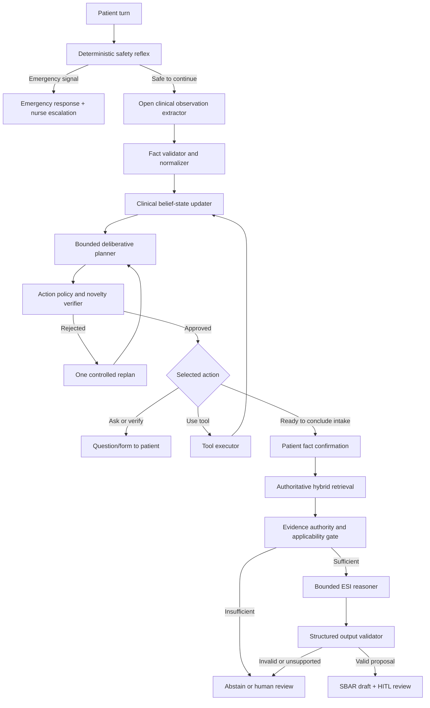

# Kế hoạch tiến hóa Triage Agent sang suy luận chủ động có kiểm soát

> **Tài liệu lịch sử:** Nội dung dưới đây mô tả kiến trúc hoặc kế hoạch trước khi MedTriage chuyển sang tool-gated DeepAgent. Không dùng tài liệu này làm source of truth cho runtime hiện tại; xem [`ARCHITECTURE.md`](../ARCHITECTURE.md).

## 1. Trạng thái và phạm vi tài liệu

- Trạng thái: **PROPOSED — PLAN ONLY**.
- Ngày lập kế hoạch: 2026-08-14.
- Phạm vi: kiến trúc agent, trạng thái hội thoại, chiến lược dùng LLM, công cụ, RAG, kiểm định và lộ trình triển khai.
- Ngoài phạm vi hiện tại: chưa sửa code, chưa đổi schema cơ sở dữ liệu, chưa đổi model production và chưa thay đổi quyền của điều dưỡng/bác sĩ.
- Tài liệu liên quan:
  - [`TRIAGE_AGENT_ADAPTIVE_CONVERSATION_PLAN.md`](./TRIAGE_AGENT_ADAPTIVE_CONVERSATION_PLAN.md)
  - [`TRIAGE_AGENT_CONVERSATION_FAILURE_AUDIT_AND_FIX_PLAN.md`](./TRIAGE_AGENT_CONVERSATION_FAILURE_AUDIT_AND_FIX_PLAN.md)

## 2. Kết luận điều hành

Agent hiện tại chưa thật sự tự quyết định bước tiếp theo. Graph đang đi theo chuỗi tương đối cố định:

```text
red flag → intent → validate answer → extract → contradiction
→ readiness → question/confirmation → retrieve → reasoner → summary
```

Trong chuỗi này:

- `intake_analyzer` phụ thuộc nhiều vào từ khóa, regex và danh sách triệu chứng hữu hạn;
- `readiness_evaluator` suy ra nhóm triệu chứng bằng các tuple hard-code và dùng bộ điều kiện thiếu trường cố định;
- `question_engine` chọn câu hỏi bằng chuỗi `if/elif` theo tên trường còn thiếu;
- LLM chủ yếu được dùng ở giai đoạn cuối để diễn giải đề xuất, chưa đóng vai trò một bộ lập kế hoạch hội thoại;
- vì vậy, khi người bệnh nói một biểu hiện mới ngoài các mảng đã biết, agent dễ bỏ sót, hỏi chung chung, hỏi lặp hoặc đi sai thứ tự.

Hướng cải tiến được đề xuất không phải là bỏ workflow và giao toàn bộ quyền cho LLM. Trong y tế, một agent tự do kiểu ReAct, được gọi công cụ không giới hạn và tự phát hành kết luận là không phù hợp. Kiến trúc nên là **Bounded Plan–Act–Verify Agent**:

1. hiểu mọi phát biểu dưới dạng dữ kiện mở, có nguồn gốc;
2. duy trì một “mô hình ca bệnh” có cấu trúc qua nhiều lượt;
3. tự chọn **một hành động tốt nhất tiếp theo** từ danh sách hành động được phép;
4. dùng công cụ khi cần, không đi qua một thứ tự câu hỏi cố định;
5. tự kiểm tra hành động trước khi gửi cho người bệnh;
6. chỉ đề xuất ESI khi cổng dữ liệu và bằng chứng đều đạt;
7. chuyển người thật khi không chắc, hết ngân sách vòng lặp hoặc có xung đột không giải quyết được.

### 2.1. “Biết suy nghĩ” được hiểu như thế nào

Không nên mô tả model là “suy nghĩ như bác sĩ” hoặc tin rằng model có phán đoán lâm sàng độc lập. Trong hệ thống này, năng lực agentic cần được định nghĩa bằng các hành vi có thể đo được:

- biết mục tiêu hiện tại của phiên;
- phân biệt dữ kiện đã xác nhận, dữ kiện nghi ngờ và thông tin chưa biết;
- nhận ra câu trả lời mới làm thay đổi điều gì;
- chọn đúng hành động tiếp theo dựa trên rủi ro và giá trị thông tin;
- biết khi nào cần tra cứu, hỏi lại, xác nhận, dừng hoặc chuyển nhân viên y tế;
- không hỏi lại điều đã có câu trả lời;
- không tạo kết luận khi thiếu bằng chứng;
- đưa ra **tóm tắt lý do có thể kiểm toán**, nhưng không lưu hoặc hiển thị chain-of-thought nội bộ.

## 3. Mục tiêu sản phẩm

### 3.1. Mục tiêu chính

1. Tiếp nhận được triệu chứng, cách nói dân gian, lỗi chính tả và tổ hợp triệu chứng chưa có trong danh sách code.
2. Hỏi theo nội dung người bệnh vừa nói và theo dữ kiện còn thiếu có giá trị cao nhất, không theo thứ tự form cố định.
3. Có thể đổi kế hoạch khi người bệnh bổ sung triệu chứng mới, sửa câu trả lời hoặc nói không chắc.
4. Không lặp lại câu hỏi đã được trả lời trực tiếp hoặc gián tiếp.
5. Dùng LLM để hiểu, lập kế hoạch và giải thích; dùng code xác định để kiểm tra an toàn và tính hợp lệ.
6. Tách rõ case tương tự, phác đồ có thẩm quyền và dữ liệu EHR.
7. Mọi ESI sơ bộ phải có lý do ngắn gọn, tiêu chí khớp, nguồn bằng chứng và độ không chắc chắn.
8. Luôn giữ con người ở bước phê duyệt/override quyết định lâm sàng.

### 3.2. Không phải mục tiêu

- Không xây agent tự chẩn đoán bệnh.
- Không để LLM tự kê đơn hoặc tự ghi dữ liệu đã suy diễn vào EHR.
- Không biến `metadata.esi_level` của case tương tự thành kết luận trực tiếp.
- Không dùng case MIETIC như phác đồ có thẩm quyền.
- Không xóa toàn bộ rule xác định; một số rule an toàn bắt buộc phải tồn tại.
- Không hiển thị “suy nghĩ từng bước” nội bộ của model cho bệnh nhân hoặc nhân viên y tế.

## 4. Nguyên tắc: giảm hard-code, không loại bỏ rào chắn

Không thể và cũng không nên làm agent “không có hard-code”. Cần phân loại đúng nơi nào được mềm hóa và nơi nào phải là bất biến.

| Nhóm | Cách xử lý | Ví dụ |
|---|---|---|
| Bất biến an toàn | Giữ deterministic, được review lâm sàng và version hóa | red flag, giới hạn sinh hiệu, quyền truy cập, cấm chẩn đoán/kê đơn, HITL, giới hạn vòng lặp |
| Chính sách có thể thay đổi | Chuyển khỏi `if/elif` trong code sang registry/config có version và người duyệt | bộ discriminator theo dân số, synonym đã duyệt, metadata phác đồ, phạm vi áp dụng |
| Hiểu ngôn ngữ mở | Giao LLM structured output, sau đó validator kiểm tra | trích xuất triệu chứng, phủ định, diễn tiến, cách nói dân gian, ý định theo ngữ cảnh |
| Chọn bước tiếp theo | Giao planner LLM chọn từ action whitelist | hỏi làm rõ, yêu cầu sinh hiệu, kiểm tra mâu thuẫn, tra cứu, xác nhận, chuyển người thật |
| Quyết định lâm sàng cuối | LLM đề xuất có bằng chứng; validator và nhân viên y tế quyết định | ESI sơ bộ, SBAR draft, approve/override |

Điểm quan trọng: ngay cả một ontology lớn cũng không bao giờ chứa hết mọi cách nói. Vì vậy hệ thống cần **open-world schema**: nếu chưa chuẩn hóa được khái niệm, vẫn giữ nguyên câu người bệnh và đánh dấu `UNMAPPED`; không bỏ dữ kiện chỉ vì nó không nằm trong danh sách.

## 5. Kiến trúc mục tiêu



Đây là một vòng lặp có giới hạn, không phải graph tự do:

```text
OBSERVE → UPDATE BELIEF → PLAN ONE ACTION → VERIFY → ACT → STOP/WAIT
```

Mỗi lượt người bệnh chỉ nên tạo một hành động đối thoại chính. Công cụ nội bộ có thể chạy trước khi trả lời, nhưng phải có ngân sách thời gian và số lần gọi rõ ràng.

## 6. Các thành phần cần bổ sung

### 6.1. Clinical Observation Extractor — hiểu dữ liệu mở

Thay vì cố biến câu nói thành vài mảng `chief_complaint`, `associated_symptoms`, extractor nên trả danh sách observation độc lập.

Schema khái niệm đề xuất:

```json
{
  "observation_id": "obs_...",
  "category": "SYMPTOM | SIGN | VITAL | MEDICATION | ALLERGY | HISTORY | CONTEXT",
  "raw_text": "tôi cứ lâng lâng như sắp ngã",
  "concept_text": "cảm giác lâng lâng, sắp ngã",
  "normalized_concept": "dizziness_or_presyncope",
  "normalization_status": "NORMALIZED | CANDIDATE | UNMAPPED",
  "presence": "PRESENT | ABSENT | UNCERTAIN",
  "subject": "PATIENT | FAMILY_MEMBER | UNKNOWN",
  "temporality": {
    "onset": "từ sáng nay",
    "duration": null,
    "course": "intermittent"
  },
  "attributes": {
    "severity": null,
    "body_site": null,
    "laterality": null,
    "frequency": null,
    "trigger": null,
    "relieving_factor": null
  },
  "source_turn_id": "turn_...",
  "raw_span": "lâng lâng như sắp ngã",
  "confidence": 0.86
}
```

Yêu cầu bắt buộc:

- LLM phải dùng structured output/Pydantic, không trả JSON tùy ý.
- Mọi observation phải có `source_turn_id` và `raw_span`.
- Không tự đổi `UNCERTAIN` thành `ABSENT`.
- Không tự thêm một fact không có trong lời người bệnh hoặc EHR.
- Nếu không chuẩn hóa được, giữ `raw_text` với trạng thái `UNMAPPED`.
- Validator xác định kiểm tra enum, range, đơn vị, subject, thời gian và provenance.
- Dữ kiện đã được xác nhận và dữ kiện model suy ra phải nằm ở hai trạng thái khác nhau.

Có thể giữ extractor deterministic hiện tại như một kênh bổ sung nhanh, nhưng nó không được là nguồn duy nhất. Kết quả deterministic và LLM được merge theo provenance; bất đồng quan trọng phải đi vào contradiction state.

### 6.2. Clinical Belief State — agent biết mình đang biết gì

State hiện tại chủ yếu là các slot và cờ workflow. State mục tiêu cần mô tả hiểu biết của agent về ca bệnh:

```text
confirmed_observations       Dữ kiện đã được người bệnh xác nhận
candidate_observations       Dữ kiện vừa trích xuất, chưa xác nhận nếu độ chắc thấp
negated_observations         Dấu hiệu người bệnh phủ nhận
disputed_observations        Hai hoặc nhiều khai báo xung đột
unknown_observations         Khái niệm chưa chuẩn hóa nhưng không được làm mất
risk_signals                 Dấu hiệu cần ưu tiên kiểm tra
missing_discriminators       Thông tin giúp phân biệt hướng xử lý
available_ehr_context        EHR đã được phép dùng trong phiên
evidence_state               Case support và protocol evidence tách riêng
asked_questions              Câu hỏi đã hỏi và trạng thái câu trả lời
active_goal                  Mục tiêu ngắn hạn hiện tại
loop_budget                  Số lần hỏi/replan/tool call còn lại
```

Belief state phải được cập nhật bằng hàm thuần và checkpoint sau mỗi lượt. Không node nào được tự sửa trực tiếp state cũ.

### 6.3. Deliberative Planner — chọn hành động, không phát hành ESI

Planner nhận:

- belief state đã rút gọn;
- mục tiêu hệ thống;
- chính sách hành động được phép;
- danh sách công cụ và điều kiện sử dụng;
- các câu hỏi đã hỏi;
- ngân sách còn lại;
- cờ an toàn và bằng chứng hiện tại.

Planner chỉ được chọn đúng một action từ whitelist:

| Action | Khi dùng |
|---|---|
| `ASK_CLARIFICATION` | Cần một chi tiết có giá trị phân biệt cao |
| `REQUEST_VITALS` | Sinh hiệu có thể làm thay đổi mức ưu tiên và hiện chưa có |
| `VERIFY_CONTRADICTION` | Có hai dữ kiện xung đột |
| `CONFIRM_INTERPRETATION` | Model không chắc đã hiểu đúng cách nói của người bệnh |
| `RETRIEVE_GUIDANCE` | Cần phác đồ đã duyệt để biết discriminator/evidence cần thiết |
| `SUMMARIZE_FOR_CONFIRMATION` | Bộ dữ kiện intake đã đủ để người bệnh kiểm tra |
| `ABSTAIN_TO_HUMAN` | Không thể tiến thêm an toàn hoặc hết ngân sách |
| `EMERGENCY_ESCALATE` | Chỉ được thực thi khi deterministic safety gate cũng xác nhận |

Output planner đề xuất:

```json
{
  "action": "ASK_CLARIFICATION",
  "target": "dizziness_character",
  "public_reason": "Cần phân biệt cảm giác quay cuồng với cảm giác sắp ngất.",
  "expected_information_gain": "HIGH",
  "question": {
    "type": "SINGLE_CHOICE",
    "prompt": "Bạn thấy mọi vật quay quanh hay cảm giác tối sầm, sắp ngất?",
    "options": []
  },
  "required_tool": null,
  "uncertainty": ["Chưa xác định loại chóng mặt"],
  "stop_condition": "Đã xác nhận đặc điểm chóng mặt"
}
```

`public_reason` là lý do ngắn để audit hoặc hiển thị cho nhân viên y tế. Nó không phải chain-of-thought và không được yêu cầu model tiết lộ suy luận bí mật từng bước.

### 6.4. Action Policy Guard — kiểm tra planner trước khi hành động

Planner có thể hiểu ngôn ngữ tốt nhưng vẫn có thể chọn sai. Một validator xác định cần từ chối action nếu:

- câu hỏi tương đương ngữ nghĩa đã được trả lời;
- action không nằm trong whitelist;
- planner yêu cầu công cụ không được phép;
- câu hỏi có nhiều mục tiêu cùng lúc hoặc vượt quá tải nhận thức;
- câu hỏi đề nghị tự chẩn đoán/kê đơn;
- planner muốn kết luận ESI trước confirmation/evidence gate;
- planner dựa vào case-example như protocol;
- action không liên quan đến active goal;
- đã vượt ngân sách replan hoặc số lượt làm rõ.

Nếu action bị từ chối, cho phép tối đa một lần replan trong cùng lượt. Nếu vẫn không hợp lệ, dùng phản hồi an toàn và chuyển nhân viên y tế; không lặp vô hạn.

### 6.5. Question Novelty Guard — chống hỏi lặp

Mỗi câu hỏi cần có một semantic key, không chỉ so sánh nguyên văn:

```text
question_key: onset.primary_symptom
target_observation: obs_123
asked_turn_id: turn_4
answer_status: ANSWERED | PARTIAL | DECLINED | UNCERTAIN | SUPERSEDED
resolved_by_turn_id: turn_5
```

Trước khi gửi câu hỏi mới:

1. kiểm tra cùng `question_key` đã được giải quyết chưa;
2. kiểm tra câu trả lời tự do ở lượt mới có trả lời gián tiếp hay không;
3. so khớp semantic similarity với các câu đã hỏi;
4. nếu người bệnh thêm triệu chứng mới trong khi trả lời, cập nhật cả câu trả lời cũ và observation mới;
5. chỉ hỏi lại khi có mâu thuẫn, câu trả lời không chắc hoặc dữ kiện đã thay đổi; phải nói rõ lý do hỏi lại.

### 6.6. Tool Layer — cho agent khả năng làm việc, không chỉ trò chuyện

Tool nên nhỏ, có input/output schema và quyền rõ ràng:

| Tool | Quyền | Ghi chú |
|---|---|---|
| `extract_clinical_observations` | Đọc text, trả facts | Không ghi EHR |
| `normalize_clinical_concept` | Đề xuất mã/khái niệm chuẩn | Giữ raw term nếu không khớp |
| `read_verified_ehr_snapshot` | Chỉ đọc EHR của đúng profile/phiên | Phải qua auth và consent |
| `calculate_clinical_derived_value` | Tính BMI hoặc phép tính xác định | Không dùng LLM cho số học |
| `find_case_examples` | Tìm ca tương tự | Chỉ hỗ trợ diễn giải/demo, không mở evidence gate |
| `retrieve_validated_protocols` | Tìm protocol đã duyệt | Có authority/version/section/hash |
| `check_contradictions` | So sánh observations | Không tự chọn dữ kiện nào đúng |
| `request_clinician_review` | Tạo yêu cầu HITL | Idempotent, có audit log |

Không cho agent:

- duyệt web tự do trong luồng khám;
- chạy SQL tùy ý;
- ghi thẳng EHR;
- tự sửa protocol registry;
- tự công bố ESI cuối;
- gọi tool không giới hạn.

### 6.7. Completion Gate — biết khi nào dừng hỏi

Không nên thay danh sách hard-code hiện tại bằng một câu prompt kiểu “hãy tự quyết định đã đủ chưa”. Completion gate nên kết hợp:

1. **planner assessment**: còn discriminator nào có khả năng thay đổi hướng xử lý hay không;
2. **deterministic invariants**: không có contradiction chưa giải quyết, đã xử lý EHR status, đã xử lý vital status, không có red flag bỏ qua;
3. **policy registry**: nếu protocol/dân số yêu cầu một dữ kiện bắt buộc, dữ kiện đó phải có hoặc được đánh dấu unavailable;
4. **loop budget**: nếu tiếp tục hỏi có ít giá trị hoặc người bệnh không thể trả lời, dừng và chuyển human review;
5. **patient confirmation**: người bệnh nhìn thấy và xác nhận bản tóm tắt trước retrieval cuối.

Completion không đồng nghĩa “đủ để ra ESI”. Nó chỉ có nghĩa “đã thu thập hợp lý; có thể thử tìm bằng chứng”. Evidence gate vẫn có quyền từ chối.

### 6.8. Bounded ESI Reasoner — LLM lý giải dựa trên bằng chứng

Reasoner chỉ chạy sau khi:

- không có red flag unresolved;
- facts đã được người bệnh xác nhận hoặc gắn uncertainty rõ ràng;
- evidence retrieval đã chạy;
- có validated protocol phù hợp về authority, population, version và section.

Output bắt buộc:

```text
decision: PROPOSE | NEEDS_MORE_INFO | ABSTAIN | HUMAN_REVIEW
esi_level: 1..5 | null
matched_facts: observation IDs
matched_criteria: protocol decision points
citations: protocol IDs/sections
preliminary_reason: lý do ngắn, dễ kiểm toán
uncertainties: thông tin còn thiếu hoặc giới hạn
recommended_next_action: hành động phi chẩn đoán
```

`metadata.esi_level` của MIETIC/case tương tự có thể là một tín hiệu tham khảo để so sánh hoặc đánh giá offline, nhưng không được tự động trở thành `esi_level` của bệnh nhân. LLM phải đối chiếu dữ kiện bệnh nhân với tiêu chí trong nguồn đã duyệt; output validator kiểm tra mọi claim có nguồn hỗ trợ.

## 7. Data strategy để không phụ thuộc một danh sách vô hạn

### 7.1. Ba tầng dữ liệu riêng biệt

| Tầng | Mục đích | Có được dùng để mở cổng ESI không? |
|---|---|---|
| Clinical concept registry | Chuẩn hóa thuật ngữ, synonym và cách nói | Không, chỉ hỗ trợ hiểu |
| Case-example corpus, gồm MIETIC | Tìm ca tương tự, tạo paraphrase, eval, demo explanation | Không |
| Validated protocol corpus | Tiêu chí phân luồng đã duyệt, có version và provenance | Có, sau applicability gate |

Không được trộn ba tầng này trong một bảng rồi fallback trường `case_id` thành `protocol_code`.

### 7.2. Unknown Concept Queue

Mỗi cụm từ không ánh xạ được cần được lưu ở hàng đợi kiểm duyệt với dữ liệu đã loại PHI phù hợp:

```text
raw phrase → context category → frequency → proposed normalization
→ reviewer status → registry version
```

Lợi ích:

- agent vẫn tiếp tục được với cách nói mới;
- đội ngũ biết danh sách nào đang thiếu dựa trên dữ liệu thực tế;
- có thể cập nhật registry mà không sửa logic graph;
- không cần đoán trước mọi triệu chứng trên thế giới.

### 7.3. Bộ dữ liệu tiếng Việt cần ưu tiên

Xây một bộ eval có review lâm sàng, tập trung vào:

- cách nói dân gian, viết tắt, không dấu và lỗi chính tả;
- phủ định: “không khó thở”, “chưa từng ngất”;
- không chắc: “hình như”, “tôi không nhớ rõ”;
- nhiều triệu chứng trong một câu;
- triệu chứng mới xuất hiện khi đang trả lời form khác;
- sửa lời khai và mâu thuẫn thời gian;
- khác biệt giữa bản thân và triệu chứng của người nhà;
- mixed Vietnamese/English;
- EHR cũ, EHR thay đổi và người bệnh từ chối xác nhận;
- câu ngoài phạm vi xen giữa hội thoại.

LLM có thể tạo biến thể/paraphrase để tăng độ phủ, nhưng dữ liệu dùng làm gold label phải được con người duyệt. Không dùng dữ liệu có PHI cho training/evaluation nếu chưa có quy trình quản trị phù hợp.

## 8. Chiến lược model và chi phí

Không cần dùng model mạnh nhất cho mọi node. Nên chia tầng theo độ khó:

| Tầng | Nhiệm vụ | Chiến lược |
|---|---|---|
| Tier 0 | red flag, range, auth, idempotency, validator | Không dùng LLM |
| Tier 1 | extraction, intent, normalization, question wording | Model nhỏ, rẻ, structured output tốt |
| Tier 2 | planner chọn action | Model nhỏ trước; nâng model nếu benchmark không đạt |
| Tier 3 | ESI reasoning có evidence | Model chất lượng cao hơn, chỉ gọi khi gate đạt |
| Fallback | provider timeout/schema invalid | Fail-safe + human review; không dùng mock để tạo kết luận |

Nguyên tắc chọn model:

1. không hard-code model name trong factory; dùng capability/tier từ environment;
2. benchmark trên gold set nội bộ trước khi chọn;
3. đo accuracy, schema-valid rate, latency và cost trên cùng tập;
4. model nhỏ chỉ được production khi qua threshold được clinical/product owner phê duyệt;
5. cache dữ liệu không chứa PHI khi an toàn; tuyệt đối không reuse fact giữa hai bệnh nhân;
6. giới hạn token bằng cách đưa belief summary có cấu trúc thay vì toàn bộ lịch sử;
7. log model/revision/prompt version cho mỗi quyết định có ảnh hưởng lâm sàng.

Cấu hình model hiện tại nên được sửa ở giai đoạn implementation sau vì cả tier OpenAI đang dùng cùng một model. Việc đổi này không cần làm trước khi planner shadow mode hoàn tất.

## 9. Lộ trình triển khai từng bước

### Phase 0 — Đóng băng baseline và xây bộ đo

Mục tiêu: biết agent mới tốt hơn ở đâu, không đánh giá bằng cảm giác.

Việc cần làm:

1. Chọn 50–100 transcript đại diện từ lỗi đã gặp và case tổng hợp an toàn.
2. Ẩn/loại PHI theo chính sách trước khi đưa vào eval.
3. Gắn nhãn observation, negation, contradiction, câu hỏi tốt tiếp theo và stop/abstain.
4. Ghi baseline của graph hiện tại:
   - tỷ lệ bỏ sót symptom;
   - tỷ lệ hỏi lặp;
   - số lượt đến confirmation;
   - tỷ lệ readiness quá sớm;
   - tỷ lệ ESI không đủ citation;
   - latency và chi phí mỗi phiên.
5. Định nghĩa zero-tolerance invariants: fabricated fact, fabricated citation và unauthorized ESI phải bằng 0.

Điều kiện hoàn tất: có dataset versioned và script eval tái lập được. Chưa thay đổi hành vi production.

### Phase 1 — Chuẩn hóa contract và belief state

Mục tiêu: tách dữ kiện lâm sàng khỏi trạng thái workflow.

Việc cần làm:

1. Thiết kế Pydantic models cho `ClinicalObservation`, `BeliefState`, `AskedQuestion`, `AgentAction`, `PlannerDecision`, `ToolResult`.
2. Thiết kế provenance và lifecycle `CANDIDATE → CONFIRMED/DISPUTED/SUPERSEDED`.
3. Tạo state migration tương thích checkpoint cũ.
4. Xác định reducer cho observations, audit events và tool results.
5. Không xóa `clinical_blueprint` ngay; tạo adapter để graph cũ vẫn chạy.

Điều kiện hoàn tất: state mới serialize/checkpoint/replay được và không mất dữ kiện cũ.

### Phase 2 — Hybrid observation extraction

Mục tiêu: tiếp nhận ngôn ngữ mở mà không mất safety.

Việc cần làm:

1. Thêm structured LLM extractor chạy song song hoặc sau deterministic extractor.
2. Merge kết quả theo span/provenance, chống duplicate substring như `buồn nôn` và `nôn`.
3. Thêm validator cho negation, temporality, unit, subject và unsupported fact.
4. Giữ raw observation khi normalization thất bại.
5. Đưa unknown phrase vào review queue.
6. Chạy offline và shadow trước, không dùng output mới để route production.

Điều kiện hoàn tất: recall tăng trên gold set, unsupported fact vẫn bằng 0 trong regression được duyệt.

### Phase 3 — Planner ở shadow mode

Mục tiêu: kiểm tra khả năng chọn hành động mà chưa tác động người dùng.

Việc cần làm:

1. Planner đọc belief state và trả một `AgentAction`.
2. Workflow cũ vẫn chọn câu hỏi thực tế.
3. Log so sánh `legacy_action` và `planner_action`, không log raw PHI.
4. Clinician/product reviewer đánh giá action nào phù hợp hơn.
5. Phân tích các lần planner muốn hỏi lại, kết luận sớm hoặc dùng sai tool.

Điều kiện hoàn tất: planner đạt ngưỡng action agreement, schema-valid rate, latency và safety đã được chủ sở hữu phê duyệt.

### Phase 4 — Planner điều khiển câu hỏi có guard

Mục tiêu: loại bỏ phần lớn chuỗi `if/elif` trong `question_engine`.

Việc cần làm:

1. Cho planner điều khiển `ASK_CLARIFICATION`, `REQUEST_VITALS`, `VERIFY_CONTRADICTION` và `CONFIRM_INTERPRETATION`.
2. Bắt mọi action qua policy/novelty guard.
3. Chỉ cho một replan trong một turn.
4. Đặt question budget cấu hình được; hết budget thì human review.
5. Giữ readiness cũ như safety backstop trong giai đoạn canary.
6. Feature flag theo phiên để rollback tức thì.

Điều kiện hoàn tất: không còn vòng lặp câu hỏi trong regression; agent xử lý đúng symptom ngoài registry và correction giữa các lượt.

### Phase 5 — Tool-aware planning và retrieval sớm có giới hạn

Mục tiêu: agent biết tra cứu để đặt câu hỏi đúng, không chỉ tra cứu sau khi hỏi xong.

Việc cần làm:

1. Tách tool `find_case_examples` và `retrieve_validated_protocols`.
2. Cho planner dùng protocol đã duyệt để tìm discriminator cần hỏi.
3. Retrieval sớm chỉ hướng dẫn **câu hỏi tiếp theo**, không được sinh ESI.
4. Áp authority, applicability, population và version gate cho mọi protocol result.
5. Ghi tool input hash, result IDs, latency và degraded mode.

Điều kiện hoàn tất: planner chứng minh được câu hỏi dựa trên nguồn phù hợp; case-example không thể mở evidence gate.

### Phase 6 — Thay readiness cố định bằng completion gate kết hợp

Mục tiêu: agent biết lúc nào tiếp tục, lúc nào dừng và lúc nào chuyển người thật.

Việc cần làm:

1. Kết hợp planner assessment, deterministic invariants, policy registry và loop budget.
2. Thêm `NEEDS_MORE_INFO`, `ABSTAIN` và `HUMAN_REVIEW` thành đường đi bình thường.
3. Yêu cầu patient confirmation cho đúng facts được dùng.
4. Không coi `UNAVAILABLE` là `NORMAL`.
5. Không bắt người bệnh trả lời vô hạn để đạt một checklist.

Điều kiện hoàn tất: các case thiếu dữ liệu dừng an toàn; các case đủ dữ liệu không bị hỏi thêm không cần thiết.

### Phase 7 — Bounded reasoner, verifier và HITL

Mục tiêu: LLM đưa kết luận sơ bộ có lý giải và nguồn, không chỉ sao chép metadata.

Việc cần làm:

1. Reasoner đối chiếu confirmed observations với decision points của protocol.
2. Output hỗ trợ `PROPOSE/ABSTAIN/HUMAN_REVIEW` và `esi_level=null`.
3. Verifier kiểm tra citation hỗ trợ từng matched criterion.
4. SBAR chỉ lấy facts có provenance.
5. Điều dưỡng nhìn thấy: đề xuất AI, lý do sơ bộ, dữ kiện còn thiếu, nguồn và quyền approve/override.
6. Chỉ final clinical decision đã ký mới được hiển thị là verified.

Điều kiện hoàn tất: 100% ESI proposal có evidence hợp lệ; mọi override được audit và replay được.

### Phase 8 — Rollout có kiểm soát

Thứ tự khuyến nghị:

```text
offline eval → shadow → internal users → small canary → staged rollout
```

Mỗi bước cần:

- feature flag;
- dashboard safety/cost/latency;
- rollback về graph fail-closed hiện tại;
- review lỗi định kỳ;
- không tự mở rộng rollout khi chưa có clinical sign-off.

## 10. Feature flags đề xuất

Tên chỉ là gợi ý cho giai đoạn code:

```text
LLM_OBSERVATION_EXTRACTION_ENABLED
AGENTIC_PLANNER_ENABLED
AGENTIC_PLANNER_SHADOW_MODE
AGENTIC_QUESTION_SELECTION_ENABLED
AGENTIC_EARLY_PROTOCOL_RETRIEVAL_ENABLED
AGENTIC_MAX_REPLANS_PER_TURN
AGENTIC_MAX_CLARIFICATION_TURNS
AGENTIC_HUMAN_FALLBACK_ENABLED
```

Mọi flag mới mặc định tắt cho tới khi có eval và phê duyệt phù hợp.

## 11. Chỉ số đánh giá

### 11.1. Safety invariants

- unsupported/fabricated clinical fact: 0;
- fabricated citation: 0;
- ESI proposal không qua evidence gate: 0;
- case-example được gắn nhãn protocol: 0;
- ghi EHR không có xác nhận/quyền: 0;
- red flag recall không được giảm so với baseline đã duyệt.

### 11.2. Chất lượng hội thoại

- tỷ lệ câu hỏi lặp theo semantic key;
- tỷ lệ symptom mới được giữ lại dù chưa normalize;
- observation precision/recall/F1 trên gold set;
- negation và subject attribution accuracy;
- contradiction detection/resolve rate;
- action agreement giữa planner và reviewer;
- tỷ lệ câu hỏi được đánh giá có liên quan;
- trung vị số lượt đến confirmation;
- tỷ lệ bỏ cuộc của người bệnh;
- tỷ lệ thoát loop thành công.

### 11.3. Chất lượng quyết định và vận hành

- tỷ lệ `PROPOSE`, `ABSTAIN`, `HUMAN_REVIEW` phù hợp;
- citation coverage trên matched criteria;
- clinician agreement và override rate, bao gồm hướng override;
- latency p50/p95 theo node và toàn turn;
- token/cost trung bình và p95 mỗi phiên;
- schema-invalid rate, timeout rate và degraded-mode rate.

Không đặt ngưỡng lâm sàng cuối trong tài liệu kỹ thuật này. Clinical owner, product owner và đội vận hành phải duyệt threshold dựa trên benchmark thật.

## 12. Bộ acceptance tests tối thiểu

1. Triệu chứng chưa xuất hiện trong mọi mảng hard-code.
2. Cách nói dân gian: “lâng lâng như sắp ngã”.
3. Lỗi chính tả/không dấu: “toi chong mat dau dau”.
4. Phủ định và triệu chứng dương tính trong cùng câu.
5. Người bệnh trả lời câu onset nhưng đồng thời thêm triệu chứng mới.
6. Người bệnh sửa `từ hôm qua` thành `hơn một tuần`.
7. Người bệnh trả lời “không chắc” nhiều lần.
8. Agent đã biết mức đau nhưng planner định hỏi lại mức đau.
9. EHR nói không có dị ứng, người bệnh báo có dị ứng mới.
10. Sinh hiệu không có sẵn; hệ thống không được coi là bình thường.
11. Chỉ tìm được MIETIC case có `metadata.esi_level`; ESI output phải vẫn null nếu không có protocol hợp lệ.
12. Protocol retrieval trả nguồn sai population hoặc hết hiệu lực.
13. Planner output sai schema hoặc gọi tool không được phép.
14. Provider timeout giữa lượt.
15. Replan hai lần vẫn thất bại; hệ thống chuyển human review, không loop.
16. Red flag xuất hiện ở lượt giữa phiên; reflex phải ngắt planner ngay.
17. Người dùng hỏi ngoài phạm vi xen giữa intake; clinical state không bị nhiễm.
18. Hai profile gia đình dùng cùng thiết bị; facts không được lẫn nhau.

## 13. Ảnh hưởng dự kiến tới code ở giai đoạn sau

Các tên file dưới đây chỉ là cấu trúc đề xuất, chưa phải yêu cầu tạo ngay:

```text
src/agents/
├── schemas/
│   ├── observations.py
│   ├── belief_state.py
│   └── planner.py
├── nodes/
│   ├── clinical_observation_extractor.py
│   ├── belief_state_updater.py
│   ├── deliberative_planner.py
│   ├── action_policy_guard.py
│   ├── question_novelty_guard.py
│   └── completion_gate.py
├── tools/
│   ├── concept_normalizer.py
│   ├── case_example_retriever.py
│   └── validated_protocol_retriever.py
└── policies/
    ├── action_registry.py
    └── clinical_concept_registry.py
```

Những phần hiện tại cần adapter/thay dần, không nên xóa một lần:

- `intake_analyzer.py` → hybrid observation extractor;
- `readiness_evaluator.py` → completion gate kết hợp;
- `question_engine.py` → planner + renderer;
- `graph.py` → bounded planner loop;
- `state.py` → belief state và action/tool audit;
- `llm_provider.py` → model tier/capability cấu hình được;
- `triage_reasoner.py` → evidence-linked proposal/abstain contract.

## 14. MVP được khuyến nghị

Không nên bắt đầu bằng cách cho LLM điều khiển toàn bộ graph. MVP ít rủi ro và tạo giá trị sớm nhất gồm:

1. thêm structured observation extractor để không bỏ symptom lạ;
2. thêm belief state và question semantic key;
3. chạy planner ở shadow mode;
4. sau khi eval đạt, chỉ giao cho planner quyền chọn câu hỏi tiếp theo;
5. giữ nguyên red flag, evidence gate, reasoner và HITL;
6. sau đó mới mở tool-aware planning và completion gate.

MVP này giải quyết trực tiếp hai lỗi người dùng đang thấy — bỏ sót triệu chứng mới và hỏi lặp — mà chưa trao quyền kết luận lâm sàng rộng hơn cho model.

## 15. Các quyết định cần được duyệt trước khi viết code

1. Chấp nhận kiến trúc **Bounded Plan–Act–Verify**, không dùng autonomous ReAct tự do.
2. Chấp nhận giữ deterministic safety shell và HITL.
3. Chọn clinical owner chịu trách nhiệm duyệt protocol/policy registry.
4. Chọn tập transcript được phép dùng cho eval và quy trình loại PHI.
5. Chốt giới hạn latency/cost mong muốn cho một lượt và một phiên.
6. Chốt ngân sách câu hỏi/replan ban đầu để benchmark, chưa coi đây là chuẩn lâm sàng.
7. Chốt cơ chế review unknown concept queue.
8. Chốt tiêu chí planner được đi từ shadow sang canary.

## 16. Khuyến nghị cuối

Giải pháp phù hợp nhất không phải “thêm thật nhiều từ khóa” và cũng không phải “để LLM tự làm tất cả”. Nên để:

- **LLM hiểu ngôn ngữ mở, duy trì ngữ cảnh, chọn hành động và giải thích**;
- **tool cung cấp dữ liệu và phép tính có nguồn**;
- **code xác định bảo vệ các bất biến an toàn**;
- **RAG cung cấp bằng chứng có thẩm quyền**;
- **verifier chặn hành động không hợp lệ hoặc lặp lại**;
- **nhân viên y tế quyết định cuối**.

Đó là mức tự chủ đủ để agent linh hoạt trước dữ liệu không bao giờ đầy đủ, nhưng vẫn có thể kiểm thử, kiểm toán, rollback và triển khai an toàn trong một hệ thống phân luồng lâm sàng.
