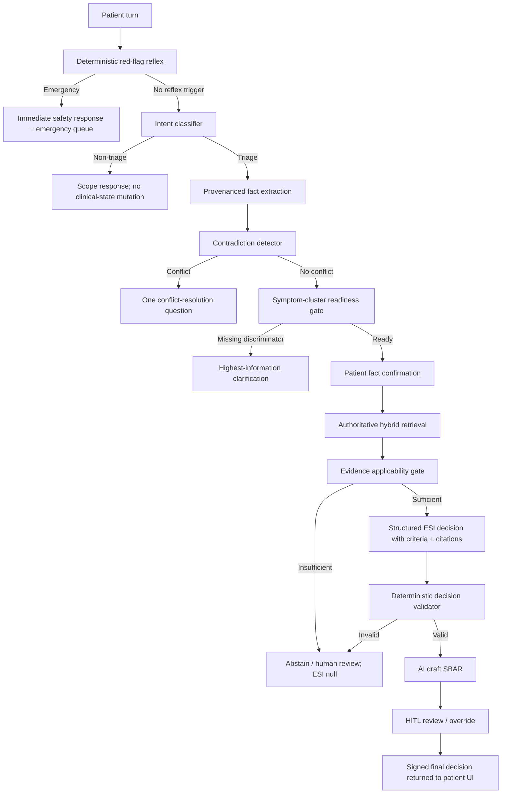

# Kế hoạch khắc phục Triage Agent sau audit hội thoại thực tế

> **Tài liệu lịch sử:** Nội dung dưới đây mô tả kiến trúc hoặc kế hoạch trước khi MedTriage chuyển sang tool-gated DeepAgent. Không dùng tài liệu này làm source of truth cho runtime hiện tại; xem [`ARCHITECTURE.md`](../ARCHITECTURE.md).

## 1. Trạng thái tài liệu

- Ngày audit: 2026-08-13.
- Trạng thái: **PROPOSED — PLAN ONLY**.
- Phạm vi thay đổi hiện tại: chỉ tạo tài liệu phân tích và kế hoạch; **chưa sửa code production**.
- Hội thoại nguồn: ảnh do người dùng cung cấp, gồm các lượt ngoài phạm vi, một mô tả đau/tiêu chảy/buồn nôn, các câu trả lời bổ sung, bước xác nhận intake và kết quả ESI 2/HITL.
- Phạm vi kỹ thuật: LangGraph state/routing, intake, readiness, question engine, RAG, ESI reasoner, SBAR, HITL contract, patient UI và regression tests.

## 2. Kết luận điều hành

Không đủ căn cứ để nói riêng mức **ESI 2 chắc chắn sai** chỉ từ ảnh. ESI 2 có thể phù hợp với một số biểu hiện đau nặng, distress hoặc high-risk. Tuy nhiên, kết quả hiện tại **không đáng tin và không kiểm toán được**, vì hệ thống đã đi đến ESI 2 qua một chuỗi lỗi dữ liệu và lỗi hiển thị:

1. Cụm thời gian `hơn 1 tuần` bị bỏ sót.
2. Câu trả lời sau đó `Từ hôm qua` ghi đè thành thời điểm duy nhất; mâu thuẫn không được phát hiện.
3. Cụm `đau dữ dội` không có vị trí vẫn được xem là chief complaint đủ cụ thể.
4. `buồn nôn` bị tách lặp thành cả `buồn nôn` và `nôn`.
5. Readiness gate đánh dấu `READY_FOR_REASONING` dù chưa biết vị trí đau và chưa giải quyết mâu thuẫn thời gian.
6. RAG chỉ tìm theo chuỗi triệu chứng, không dùng đầy đủ onset/severity/associated symptoms/vital status, và không thực sự triển khai Hybrid Retrieval như tài liệu yêu cầu.
7. Evidence gate có thể chấp nhận một ca dữ liệu tương tự như thể đó là phác đồ có thẩm quyền.
8. Reasoner bắt buộc model phải trả một ESI 1-5; không có nhánh `ABSTAIN` hợp lệ trong schema.
9. UI kết quả chứa dữ liệu hard-code về đau ngực, stent, Penicillin, hội chứng mạch vành, mã phác đồ, ECG và Troponin — không xuất phát từ hội thoại hiện tại.
10. UI dùng `ai_proposed_esi` làm mức hiển thị và suy diễn trạng thái HITL từ trạng thái phiên, nên không thể hiện đúng trường hợp điều dưỡng override.

Vì vậy, hướng sửa đúng không phải là “tinh chỉnh prompt để ESI khác đi”. Cần sửa theo chuỗi: **truthful UI containment → dữ liệu có provenance → contradiction/readiness gate → evidence authority → reasoner có quyền từ chối → HITL contract thật**.

## 3. Tái hiện kỹ thuật từ đúng câu hội thoại

Input chính:

```text
Tôi bị đau dữ dội liên miên, đã thế còn tiêu chảy, tần suất một giờ một lần,
đau mức độ 7/10 và hiện hơi buồn nôn, giảm nhẹ khi uống nước và đã bị được
hơn 1 tuần rồi
```

Khi chạy trực tiếp extractor hiện tại, state thu được:

```json
{
  "chief_complaint": [
    "buồn nôn",
    "tiêu chảy",
    "nôn",
    "đau dữ dội liên miên đã",
    "đau mức độ 7 10"
  ],
  "onset_time": null,
  "severity_score": 7,
  "associated_symptoms": ["buồn nôn", "nôn"],
  "confidence_score": 0.7
}
```

Sau lượt `Từ hôm qua`, state trở thành:

```json
{
  "onset_time": "Từ hôm qua",
  "confidence_score": 1.0
}
```

Khi EHR đã được xác nhận và người dùng chọn không có số đo sinh hiệu, readiness hiện trả:

```json
{
  "ready": true,
  "decision_status": "READY_FOR_REASONING",
  "missing_critical_fields": [],
  "uncertainty_reasons": []
}
```

Đây là bằng chứng trực tiếp cho thấy lỗi nằm ở state/extraction/readiness, không chỉ ở cách model diễn đạt.

## 4. Audit theo diễn biến hội thoại

| Lượt | Hành vi quan sát | Hành vi đúng cần có | Lỗi hiện tại |
|---|---|---|---|
| Câu bóng đá, `Tôi là luật`, `1` | Agent từ chối ngoài phạm vi và mời mô tả triệu chứng | Không làm thay đổi clinical state; phản hồi ngắn, tự nhiên | Nhánh intent cơ bản hoạt động, nhưng chưa có test đảm bảo clinical state không bị nhiễm qua nhiều lượt rác |
| Mô tả đau + tiêu chảy + buồn nôn + `hơn 1 tuần` | Agent hỏi lại onset | Ghi nhận duration đã nêu; ưu tiên làm rõ vị trí đau hoặc mâu thuẫn nếu có | Extractor không hiểu `được hơn 1 tuần` |
| `Từ hôm qua` | Agent nhận làm onset mới | Phát hiện xung đột `hơn 1 tuần` và `từ hôm qua`; hỏi người bệnh xác nhận mốc đúng | Scalar onset bị ghi đè, không có fact history/provenance |
| `Không rõ chỉ số sinh hiệu` | Agent coi bước sinh hiệu đã hoàn tất | Ghi đúng là `UNAVAILABLE`, tuyệt đối không suy ra bình thường/ổn định | Trạng thái “đã hỏi” đang bị trộn với “đủ bằng chứng để phân loại” |
| Xác nhận EHR | Agent chuyển sang intake review | Chỉ chuyển khi bộ dữ kiện theo symptom cluster đã đủ và không còn contradiction | Readiness gate chung quá nông |
| Xác nhận bản tóm tắt | Agent bắt đầu RAG/ESI | Patient confirmation chỉ xác nhận dữ liệu đã trình bày; không được che mất dữ kiện bị extractor làm rơi | Bản tóm tắt không giúp người dùng thấy mâu thuẫn đã mất |
| Kết quả ESI 2 | Có nhận định nguy cơ và điều hướng | Mọi ESI phải chỉ ra decision point, tiêu chí khớp, nguồn phác đồ và uncertainty | Reasoner chỉ trả `esi_level + reasoning`, không có đường quyết định kiểm chứng được |
| `HITL VERIFIED` + SBAR | Hiển thị ca tim mạch và hành động chuyên môn | Chỉ render dữ liệu server đã ký duyệt của đúng phiên | Frontend hard-code clinical facts và suy diễn sai final decision |

## 5. Root-cause map theo code hiện tại

### 5.1. P0 — Dữ liệu lâm sàng bị mất, méo hoặc ghi đè

1. [`intake_analyzer.py`](../src/agents/nodes/intake_analyzer.py) dùng `term in text`, nên `buồn nôn` đồng thời khớp `nôn`; phrase extractor còn tạo các cụm như `đau dữ dội liên miên đã` và `đau mức độ 7 10`.
2. Regex onset chỉ hỗ trợ một số dạng hạn chế như `từ hôm qua`, `mới 2 ngày`; không hỗ trợ tốt `được hơn 1 tuần`, `khoảng một tuần`, `tầm ba hôm`.
3. `onset_time` là scalar. State không lưu source turn, raw span, confidence theo field hoặc danh sách claim cạnh tranh.
4. Không có contradiction detector giữa các lượt nói.

Hậu quả: dữ liệu sai vẫn được gắn confidence 1.0 và đi tiếp.

### 5.2. P0 — Readiness gate xác nhận quá sớm

[`readiness_evaluator.py`](../src/agents/nodes/readiness_evaluator.py) chỉ yêu cầu:

- có một chief complaint không nằm trong danh sách vague rất ngắn;
- có onset;
- có severity **hoặc** associated symptom;
- đã hỏi sinh hiệu;
- đã xác nhận EHR.

Gate không kiểm tra:

- vị trí đau;
- diễn tiến/đặc tính đau;
- contradiction chưa giải quyết;
- symptom cluster và bộ discriminator tương ứng;
- độ phủ dữ liệu để phân biệt high-risk với resource-based ESI;
- sự khác nhau giữa `vital_signs_status=UNAVAILABLE` và sinh hiệu bình thường.

### 5.3. P0 — Evidence không đủ thẩm quyền vẫn có thể mở cổng ESI

1. [`rag_retriever.py`](../src/agents/tools/rag_retriever.py) chỉ tạo query từ `chief_complaint` và `clinical_keywords_en`.
2. [`hybrid_retriever.py`](../src/services/rag/hybrid_retriever.py) hiện chỉ chạy một truy vấn dense pgvector; chưa có BM25/Postgres FTS và RRF đúng nghĩa.
3. Retriever cho phép dùng `case_id` thay `protocol_code`.
4. [`evidence_gate.py`](../src/agents/nodes/evidence_gate.py) chỉ kiểm tra code, content và similarity `>= 0.55`; không kiểm tra:
   - loại tài liệu `validated_protocol` hay `case_example`;
   - tổ chức ban hành, version, ngày hiệu lực;
   - tài liệu có thật sự chứa tiêu chí ESI áp dụng cho ca này hay không;
   - citation có hỗ trợ đúng claim hay chỉ tương tự về ngữ nghĩa.

Hậu quả: một ca MIETIC/synthetic tương tự có thể bị dùng như phác đồ ra quyết định.

### 5.4. P0 — Reasoner không có đường từ chối hợp lệ

[`triage_reasoner.py`](../src/agents/nodes/triage_reasoner.py) yêu cầu output schema có `esi_level: int` bắt buộc. Prompt nói “nếu mơ hồ hãy để structured output thất bại”, nhưng failure của parser không phải là một quyết định lâm sàng có chủ đích.

Schema còn thiếu:

- `decision = PROPOSED | ABSTAIN | NEEDS_MORE_INFO | HUMAN_REVIEW`;
- ESI decision point đã đi qua;
- tiêu chí high-risk/life-saving/resource/vital nào đã khớp;
- citation ID hỗ trợ từng tiêu chí;
- dữ kiện còn thiếu và uncertainty;
- kiểm tra business rule sau model.

### 5.5. P0 — UI đang phát hành dữ liệu y khoa hard-code

[`SbarSummaryAccordion.tsx`](../frontend/src/components/chat/SbarSummaryAccordion.tsx) hard-code:

- tuổi/giới tính fallback;
- stent và tăng huyết áp;
- dị ứng Penicillin;
- đau ngực, vã mồ hôi, nhịp tim nhanh;
- nghi hội chứng mạch vành;
- `[PRO_CP_001 - AHA/ACC ACS Guideline 2024]`;
- ECG, Troponin và quyết định điều hướng.

[`VerifiedRecommendationCard.tsx`](../frontend/src/components/chat/VerifiedRecommendationCard.tsx) hard-code khung `2 - 4 giờ`, địa điểm, hành động và câu “bảo chứng pháp lý”. Trong khi đó, AHRQ lưu ý ESI không quy định một khung giờ chuẩn cho room placement/evaluation; không được biến ESI thành một deadline hard-code cho mọi ca.

Đây là lỗi phát hành thông tin, không phải lỗi thẩm mỹ.

### 5.6. P0 — Hợp đồng HITL/final ESI không đủ để UI nói thật

[`page.tsx`](../frontend/src/app/(patient)/triage/page.tsx) hiện:

- lấy `ai_proposed_esi` làm `esiLevel` hiển thị;
- đổi `COMPLETED` thành local `approved`;
- không nhận `final_clinical_esi`, `decision_type`, reviewer, reviewed_at hoặc signature trong session status.

Nếu điều dưỡng override AI từ ESI 2 sang ESI 3, patient UI vẫn có nguy cơ hiển thị ESI 2 dưới nhãn HITL verified. Local state có giá trị `overridden`, nhưng không có contract server đầy đủ để thiết lập nó đáng tin cậy.

### 5.7. P1 — SBAR và HITL orchestration chưa khớp kiến trúc bắt buộc

1. [`summary_creator.py`](../src/agents/nodes/summary_creator.py) gắn câu `Trạng thái tiếp nhận lâm sàng ổn định theo phác đồ` cho mọi ca không phải red flag, kể cả khi không có sinh hiệu.
2. Summary node đồng thời gọi queue pusher, làm lẫn trách nhiệm tạo draft và phát hành workflow.
3. [`graph.py`](../src/agents/graph.py) compile checkpointer nhưng không cấu hình `interrupt_before=["summary_creator", "queue_pusher"]`; thậm chí chưa có `queue_pusher` như một graph node độc lập.

### 5.8. P1 — Test hiện tại kiểm tra happy path nhưng bỏ lọt lỗi thực tế

Test suite có coverage tốt hơn trước cho intent, vitals provenance, patient confirmation và no-fake-empty-RAG. Tuy nhiên còn thiếu:

- transcript regression đúng như ảnh;
- duration tiếng Việt có `hơn/được hơn`;
- contradiction giữa hai lượt;
- duplicate/substring symptom extraction;
- yêu cầu vị trí đau trước readiness;
- source authority và document type của RAG;
- reasoner abstention;
- HITL override hiển thị final ESI;
- test đảm bảo UI không chứa clinical content hard-code.

Lệnh test hiện chưa chạy được trong môi trường hiện tại vì thiếu package runtime `pytest_asyncio`, dù `requirements.txt` đã khai báo `pytest-asyncio>=0.24.0`.

## 6. Kiến trúc mục tiêu



Nguyên tắc trung tâm: **Không unresolved contradiction → không RAG. Không authoritative evidence → không ESI. Không HITL signature → không nhãn verified.**

## 7. State contract đề xuất

Không tiếp tục lưu các fact quan trọng chỉ dưới dạng scalar không nguồn. State mục tiêu cần các khối sau:

```text
clinical_facts
  chief_complaint[]
  onset_claims[]
  severity_claims[]
  associated_symptoms[]
  vital_signs[]

ClinicalFact
  normalized_value
  raw_value
  source_turn_id
  source_text_span
  captured_at
  extraction_method
  confidence
  status: ACTIVE | SUPERSEDED | CONTRADICTED | REJECTED

intake_quality
  symptom_cluster
  missing_required_fields[]
  missing_discriminators[]
  contradictions[]
  unresolved_uncertainties[]
  readiness_status

evidence_bundle
  document_id
  document_type
  authority
  version
  effective_date
  matched_section
  supported_criteria[]
  retrieval_scores

triage_decision
  status: PROPOSED | ABSTAIN | NEEDS_MORE_INFO | HUMAN_REVIEW
  esi_level: optional
  decision_point
  matched_criteria[]
  citation_ids[]
  uncertainty[]

hitl_decision
  review_status
  ai_proposed_esi
  final_clinical_esi
  decision_type
  reviewer
  reviewed_at
  audit_event_id
```

## 8. Kế hoạch triển khai theo phase

### Phase 0 — Safety containment trước khi refactor

Mục tiêu: ngừng phát hành thông tin lâm sàng giả ngay cả khi pipeline cũ vẫn còn.

- Bỏ hoặc feature-flag toàn bộ clinical content hard-code trong `SbarSummaryAccordion` và `VerifiedRecommendationCard`.
- Chỉ render dữ liệu lấy từ DTO server đã validate; nếu thiếu thì hiển thị “chưa có dữ liệu đã thẩm định”.
- Không hiển thị `HITL VERIFIED`, “bảo chứng pháp lý”, reviewer hoặc final recommendation nếu response không có HITL decision/signature thật.
- Không dùng `ai_proposed_esi` dưới nhãn final/verified.
- Tạm fail closed với intake có pain nhưng thiếu body site hoặc có contradiction: ESI `null`, không tạo SBAR, không đẩy proposal thường.
- Gỡ câu “ổn định theo phác đồ” khi sinh hiệu chưa được đo/xác minh.

Nghiệm thu:

- Hội thoại mẫu không thể xuất hiện đau ngực, stent, Penicillin, AHA/ACC, ECG hoặc Troponin nếu backend không trả đúng các dữ kiện đó.
- Không có nhãn verified nếu chưa có `final_clinical_esi + reviewer + reviewed_at/audit proof`.

### Phase 1 — Characterization tests khóa lỗi hiện tại

Tạo regression fixture đúng từng lượt trong ảnh, trước khi đổi logic.

Kỳ vọng bắt buộc sau fix:

1. Các câu ngoài phạm vi không thay đổi clinical facts.
2. Câu mô tả chính trích được duration `hơn 1 tuần`.
3. `buồn nôn` không sinh thêm fact `nôn` trùng lặp.
4. Pain không có body site được đánh dấu thiếu `pain_location`.
5. `Từ hôm qua` tạo contradiction với `hơn 1 tuần`, không silent overwrite.
6. Khi contradiction chưa giải quyết: `NEEDS_CLARIFICATION`, RAG call count = 0, ESI = null, SBAR = null, queue call count = 0.
7. Câu hỏi kế tiếp yêu cầu giải quyết mốc thời gian hoặc vị trí đau theo policy đã được clinician phê duyệt.

### Phase 2 — Provenanced extraction và contradiction gate

Tệp dự kiến:

- `src/agents/state.py`
- `src/agents/nodes/intake_analyzer.py`
- tạo `src/agents/nodes/contradiction_detector.py`
- `src/agents/nodes/answer_validator.py`
- `src/agents/graph.py`

Thay đổi:

- Token/phrase matching theo boundary và longest-match-first để tránh `nôn` nằm trong `buồn nôn`.
- Parser duration tiếng Việt hỗ trợ số chữ/số digit và qualifier `hơn`, `gần`, `khoảng`, `từ`, `được`.
- Mọi fact có source turn và raw span.
- Follow-up không ghi đè fact cũ; tạo candidate mới rồi reconcile.
- Contradiction detector deterministic cho thời gian, severity, phủ định/khẳng định, medication/EHR và vital values.
- Route contradiction trước readiness.

### Phase 3 — Symptom-cluster readiness và adaptive questioning

Tệp dự kiến:

- `src/agents/nodes/readiness_evaluator.py`
- `src/agents/nodes/question_engine.py`
- có thể tạo `src/agents/policies/intake_requirements.py`

Thay đổi:

- Tách minimum intake chung khỏi discriminator theo symptom cluster.
- Với pain, tối thiểu phải có body site, onset/duration, severity/course và các danger discriminator phù hợp vị trí.
- Với GI symptoms, bộ field bắt buộc phải lấy từ protocol matrix đã được clinician duyệt; không tự sáng tác checklist trong prompt.
- `UNAVAILABLE_CONFIRMED` nghĩa là đã xác nhận không có số đo, không đồng nghĩa sinh hiệu bình thường.
- Mỗi lượt chỉ hỏi một câu có information gain cao nhất.
- Có giới hạn số lượt và nhánh `HUMAN_REVIEW` khi người dùng không thể cung cấp thông tin an toàn.

Nghiệm thu:

- Readiness không còn là một checklist chung cho mọi triệu chứng.
- Không unresolved contradiction nào có thể đạt `READY_FOR_REASONING`.

### Phase 4 — RAG authority và Hybrid Retrieval thật

Tệp dự kiến:

- `src/agents/tools/rag_retriever.py`
- `src/services/rag/hybrid_retriever.py`
- `src/agents/nodes/evidence_gate.py`
- metadata/index migration cho knowledge base

Thay đổi:

- Dense và sparse retrieval chạy độc lập, hợp nhất bằng RRF/reranker có log điểm thành phần.
- Query dùng structured facts đã xác nhận: cluster, site, onset, course, severity, associated signs, age group, verified history, vital availability/values.
- Bắt buộc metadata: `document_type`, `authority`, `version`, `effective_date`, `protocol_code`, `section`, `clinical_scope`, `validation_status`.
- `case_example`/MIETIC/synthetic chỉ dùng eval hoặc similarity aid; không được mở evidence gate cho ESI.
- Không fallback `case_id -> protocol_code`.
- Evidence gate kiểm tra applicability và criterion coverage, không chỉ similarity.

Nghiệm thu:

- Một kết quả case-example có similarity cao vẫn trả `INSUFFICIENT_EVIDENCE` cho quyết định ESI.
- Mỗi matched criterion có citation tới section thật của tài liệu được whitelist.

### Phase 5 — Reasoner có abstention và output validator

Tệp dự kiến:

- `src/agents/nodes/triage_reasoner.py`
- `src/agents/guardrails.py`
- `src/agents/nodes/summary_creator.py`
- `src/models/patient_schemas.py`

Thay đổi:

- Schema cho phép `ABSTAIN`, không ép model phải chọn ESI.
- Model phải trả decision point, matched criteria và citation IDs; không trả chain-of-thought.
- Deterministic validator kiểm tra:
  - ESI thuộc 1-5 khi và chỉ khi status là `PROPOSED`;
  - citation tồn tại trong evidence bundle;
  - criterion được source hỗ trợ;
  - không còn missing/contradiction;
  - không dùng vital unavailable như normal.
- SBAR chỉ ghép fact có provenance; tuyệt đối không thêm diagnosis, lịch sử, thuốc, xét nghiệm hoặc trạng thái ổn định không có nguồn.
- Output firewall chuyển từ regex văn xuôi đơn lẻ sang validation trên structured claims trước khi render.

### Phase 6 — HITL lifecycle và API contract thật

Tệp dự kiến:

- `src/agents/graph.py`
- tạo/đưa `queue_pusher` thành graph node riêng nếu tiếp tục theo kiến trúc LangGraph HITL
- `src/api/routes_patient.py`
- `src/api/routes_nurse.py`
- `src/models/patient_schemas.py`
- `src/models/nurse_schemas.py`

Thay đổi:

- Chốt lifecycle rõ ràng: `AI_DRAFT -> WAITING_REVIEW -> IN_REVIEW -> TRIAGE_DECIDED -> HANDED_OFF`.
- Thực thi persistent checkpoint/interrupt theo kiến trúc dự án hoặc cập nhật kiến trúc chính thức nếu HITL nằm hoàn toàn ở API/DB; không để hai mô hình cùng tồn tại mơ hồ.
- Patient session DTO trả riêng:
  - `ai_proposed_esi`;
  - `final_clinical_esi`;
  - `review_status`;
  - `decision_type`;
  - `reviewer_display_name/role`;
  - `reviewed_at`;
  - `audit_event_id`;
  - signed/approved SBAR.
- Override phải hiển thị final ESI và lưu rõ original AI ESI.

### Phase 7 — Patient UI data binding và truthful states

Tệp dự kiến:

- `frontend/src/types/triage-chat.ts`
- `frontend/src/schemas/triage-stream.schema.ts`
- `frontend/src/services/triage.service.ts`
- `frontend/src/app/(patient)/triage/page.tsx`
- `frontend/src/components/chat/VerifiedRecommendationCard.tsx`
- `frontend/src/components/chat/SbarSummaryAccordion.tsx`
- `frontend/src/store/useTriageStore.ts`

Thay đổi:

- Server data thuộc TanStack Query; Zustand chỉ giữ UI state.
- Không suy `approved` chỉ từ `COMPLETED`; map từ review DTO đã validate.
- Component nhận typed props từ đúng phiên, không đọc fallback clinical data.
- Phân biệt rõ:
  - AI draft — chưa được thẩm định;
  - đang chờ HITL;
  - clinician confirmed;
  - clinician overridden.
- Không hard-code khung giờ từ ESI. Chỉ hiển thị action text đã được clinician/protocol contract cho phép.
- Không dùng ngôn ngữ “bảo chứng pháp lý” nếu hệ thống không có artefact pháp lý tương ứng.

### Phase 8 — Evaluation, observability và rollout

- Chạy unit, graph integration, API, component và E2E tests.
- Shadow-run graph mới trên transcript cũ; không phát hành ESI cho người dùng trong shadow mode.
- Log cấu trúc không chứa PHI thô:
  - extraction misses;
  - contradiction count;
  - readiness reason;
  - retrieval source types;
  - abstention rate;
  - AI/HITL concordance;
  - override direction;
  - final-card provenance completeness.
- Rollout bằng feature flag theo profile/test cohort.
- Có rollback về chế độ `HUMAN_REVIEW_ONLY`, không rollback về UI hard-code.

## 9. Ma trận test bắt buộc

| Nhóm | Case | Kỳ vọng |
|---|---|---|
| Transcript regression | Toàn bộ hội thoại trong ảnh | Dừng ở clarification sau contradiction; chưa gọi RAG/ESI |
| Vietnamese duration | `được hơn 1 tuần`, `khoảng một tuần`, `tầm 3 hôm` | Chuẩn hóa đúng, giữ raw span |
| Contradiction | `hơn 1 tuần` rồi `từ hôm qua` | Hai claims + conflict; không overwrite |
| Symptom extraction | `hơi buồn nôn` | Một fact `nausea`, không sinh duplicate `vomiting` |
| Pain readiness | `đau dữ dội 7/10` không vị trí | Thiếu `pain_location`; ESI null |
| Vital provenance | `không rõ chỉ số sinh hiệu` | Availability unknown; không gắn stable/normal |
| Patient confirmation | Người dùng xác nhận summary thiếu fact | Backend vẫn chặn nếu quality gate/contradiction chưa đạt |
| Evidence type | Top hit là MIETIC case | Không đủ điều kiện proposal |
| Evidence applicability | Protocol đúng chủ đề nhưng không hỗ trợ criterion | Citation bị loại khỏi decision support |
| Reasoner ambiguity | Evidence hoặc facts chưa đủ | Structured `ABSTAIN`, ESI null |
| HITL confirm | AI ESI 2, clinician confirm 2 | Final card ESI 2 + reviewer thật |
| HITL override | AI ESI 2, clinician override 3 | Final card ESI 3; vẫn audit original 2 |
| UI truthfulness | Session không có cardiac facts | Không có đau ngực/stent/Penicillin/ECG/Troponin |
| UI timing | ESI 2 | Không tự thêm deadline `2-4 giờ` |
| Cross-session isolation | Hai profile khác nhau | Không rò clinical facts/default giữa phiên |

## 10. Chỉ số nghiệm thu

- 0 unresolved contradiction đi vào RAG.
- 0 ESI proposal khi readiness hoặc evidence gate chưa đạt.
- 0 clinical fact trong SBAR/final card không có provenance.
- 0 `case_example` hoặc synthetic case được dùng làm protocol authority.
- 100% ESI proposal có decision point, matched criteria và citation hợp lệ.
- 100% nhãn HITL verified có final decision + reviewer + timestamp/audit proof.
- 100% override hiển thị `final_clinical_esi`, không hiển thị nhầm AI proposal.
- Transcript trong ảnh phải trả `NEEDS_CLARIFICATION` cho đến khi giải quyết thời gian và pain location/cluster requirements.
- Backend targeted tests, frontend typecheck/lint/component tests và E2E đều pass.
- Clinical review sign-off cho symptom requirement matrix, source whitelist và patient-facing action copy trước production rollout.

## 11. Thứ tự PR khuyến nghị

1. **PR-1: Safety containment + failing regression tests** — bỏ hard-code, khóa false verified, thêm transcript fixture.
2. **PR-2: Provenanced facts + contradiction/readiness** — state migration, extractor, router và question policy.
3. **PR-3: RAG authority + abstaining reasoner** — source metadata, hybrid retrieval, evidence/decision validator.
4. **PR-4: HITL/API/UI contract** — final ESI, signature, override và data-bound result components.
5. **PR-5: Eval/observability/documentation** — benchmark, shadow rollout, dashboards và architecture records.

Mỗi PR phải độc lập fail closed; không merge một PR khiến hệ thống phát hành dữ liệu lâm sàng rộng hơn trong khi các gate sau chưa hoàn tất.

## 12. Các quyết định cần chốt trước khi bắt đầu sửa code

### A. Có hiển thị AI proposal trước HITL không?

Khuyến nghị: có thể hiển thị nhưng phải ghi rõ `AI DRAFT — CHƯA ĐƯỢC NHÂN VIÊN Y TẾ THẨM ĐỊNH`, không dùng ngôn ngữ chỉ định, bảo chứng hoặc kết luận cuối.

### B. Vai trò của MIETIC/synthetic cases trong RAG?

Khuyến nghị: chỉ dùng cho eval/case similarity hoặc training support; không được xem là authoritative protocol và không đủ sức mở evidence gate.

### C. Không có số đo sinh hiệu xử lý thế nào?

Khuyến nghị: giữ trạng thái `UNAVAILABLE`, không coi là normal. Khả năng tiếp tục tới proposal phải phụ thuộc symptom-cluster policy đã được clinician duyệt; nếu high-risk ambiguity còn tồn tại thì chuyển human review.

### D. Kiến trúc HITL nằm trong LangGraph interrupt hay API/DB workflow?

Khuyến nghị: chọn một mô hình chính thức và đồng bộ tài liệu/code. Theo rule hiện tại của repository, ưu tiên persistent LangGraph checkpoint + interrupt trước publish, còn API/DB là cơ chế resume/audit.

## 13. Khoảng trống tài liệu cần xử lý

Các tài liệu bắt buộc được `AGENTS.md` tham chiếu nhưng hiện không tìm thấy trong repository:

- `TRIAGE_AGENT_SOLUTION_DESIGN.md`
- `UI_REDESIGN_SYSTEM.md`
- `UI_SCREENS_AND_WORKFLOW_MAP.md`
- `UI_UX_FUNCTIONAL_GROUPS_AND_ROADMAP.md`

Ngoài ra, [`TRIAGE_AGENT_ADAPTIVE_CONVERSATION_PLAN.md`](./TRIAGE_AGENT_ADAPTIVE_CONVERSATION_PLAN.md) ghi Phase 0-5 đã hoàn tất, nhưng audit này chứng minh các invariant cốt lõi vẫn chưa đạt. Trước khi sửa code cần:

1. khôi phục các tài liệu chuẩn hoặc tuyên bố rõ tài liệu thay thế;
2. cập nhật trạng thái plan cũ từ “đã hoàn tất” sang “implemented but failed acceptance” nếu đúng;
3. tạo một Architecture Decision Record cho HITL và evidence authority;
4. không dùng tài liệu `docs/guide/architecture/system-design.md` chung chung làm thay thế cho clinical solution design.

## 14. Nguồn lâm sàng dùng để kiểm tra hướng plan

- [ACEP/ENA Joint Policy Statement — Emergency Department Triage (2025)](https://www.ena.org/sites/default/files/2025-08/Emergency%20Department%20Triage.pdf): triage là quy trình ưu tiên do nhân sự được đào tạo thực hiện; câu hỏi ban đầu nên tập trung vào thông tin liên quan trực tiếp và không làm chậm chăm sóc.
- [ENA Triage Portfolio / ESI Handbook](https://www.ena.org/education/emergency-nursing-triage-education-program/triage-portfolio): ESI cần được áp dụng với đào tạo và giải thích từng decision point, không chỉ dựa trên một điểm similarity.
- [AHRQ PSNet — Some Patients Can't Wait](https://psnet.ahrq.gov/web-mm/some-patients-cant-wait-improving-timeliness-emergency-department-care): ESI dựa trên acuity/resource needs; ESI 2 liên quan high-risk, severe pain/distress và không tự quy định một deadline room placement/evaluation cố định.

## 15. Definition of Done

Việc sửa agent chỉ được coi là hoàn thành khi đồng thời đạt đủ năm điều kiện:

1. Hội thoại mẫu không còn đi tới ESI trước khi mâu thuẫn và dữ kiện trọng yếu được làm rõ.
2. RAG chỉ dùng nguồn có thẩm quyền và mọi ESI có đường quyết định/citation kiểm toán được.
3. Reasoner có thể chủ động abstain mà không cần làm parser thất bại.
4. HITL final decision được truyền end-to-end, bao gồm override và audit identity.
5. Patient UI không còn bất kỳ clinical fact, diagnosis hypothesis, protocol, timeframe, test hoặc treatment action hard-code nào.

