# Hướng dẫn xây dựng bộ Protocol/Triage Guideline và tích hợp vào Clinical RAG

## 1. Trạng thái và phạm vi

- Trạng thái: **PROPOSED — DATA AND INTEGRATION PLAN ONLY**.
- Ngày khảo sát nguồn: 2026-08-14.
- Phạm vi: tìm nguồn, kiểm tra quyền sử dụng, xử lý PDF, dùng LLM tạo dữ liệu nháp, kiểm duyệt lâm sàng, chunking, embedding, calibration, ingest và kết nối với DeepAgent evidence tools hiện tại.
- Chưa thực hiện: chưa tải hoặc sao chép tài liệu có bản quyền vào repository, chưa sửa code, chưa ghi cơ sở dữ liệu và chưa thay đổi cấu hình production.
- Đây là hướng dẫn kỹ thuật và quản trị dữ liệu, không thay thế tư vấn pháp lý hoặc phê duyệt của hội đồng chuyên môn.

Tài liệu liên quan trong repository:

- [`TRIAGE_AGENT_BOUNDED_AGENTIC_REASONING_PLAN.md`](./TRIAGE_AGENT_BOUNDED_AGENTIC_REASONING_PLAN.md)
- [`TRIAGE_AGENT_ADAPTIVE_CONVERSATION_PLAN.md`](./TRIAGE_AGENT_ADAPTIVE_CONVERSATION_PLAN.md)
- [`TRIAGE_AGENT_CONVERSATION_FAILURE_AUDIT_AND_FIX_PLAN.md`](./TRIAGE_AGENT_CONVERSATION_FAILURE_AUDIT_AND_FIX_PLAN.md)
- [`ingest_validated_protocols.py`](../scripts/ingest_validated_protocols.py)
- [`evaluate_protocol_retrieval.py`](../scripts/evaluate_protocol_retrieval.py)
- [`test_rag_retrieval_case.py`](../scripts/test_rag_retrieval_case.py)

## 2. Kết luận quan trọng trước khi bắt đầu

### 2.1. Không thể dùng LLM để tự sáng tác phác đồ

LLM được phép:

- trích xuất nội dung từ tài liệu mà dự án có quyền sử dụng;
- chuyển nội dung thành JSON nháp;
- đề xuất keywords, clinical scope và decision criteria;
- dịch nháp sang tiếng Việt;
- tạo câu truy vấn tổng hợp và ca kiểm thử;
- phát hiện các trường có thể thiếu hoặc mâu thuẫn.

LLM không được phép:

- tự tạo ngưỡng sinh hiệu hoặc tiêu chí ESI mới;
- hợp nhất hai guideline khác nhau thành một “phác đồ chuẩn” mà không có clinician phê duyệt;
- biến `metadata.esi_level` của case MIETIC thành protocol criterion;
- tự gắn `validation_status=approved`;
- tự điền tên người duyệt, giấy phép, ngày hiệu lực hoặc nguồn;
- tự dịch rồi xem bản dịch là nguồn có thẩm quyền;
- tạo citation không trỏ được tới đúng trang/section của tài liệu gốc.

Nguyên tắc trung tâm:

> LLM chỉ tạo **bản nháp chuyển đổi dữ liệu**. Protocol có hiệu lực phải bắt nguồn từ tài liệu được phép sử dụng và được người có chuyên môn phê duyệt.

### 2.2. Phải chọn một hệ phân loại chính

Hiện có hai hướng phù hợp nhưng không tương đương:

| Hướng | Kết quả | Tác động tới hệ thống |
|---|---|---|
| Emergency Severity Index, ESI v5 | 5 mức ESI 1–5 | Phù hợp UI/state hiện tại, nhưng phải xin quyền ENA trước khi lưu/chunk/embed/retrieve |
| WHO Interagency Integrated Triage Tool, IITT | Đỏ/Vàng/Xanh | Có thể phù hợp dự án phi thương mại theo giấy phép, nhưng phải đổi contract/UI; không được tự ánh xạ thành ESI 1–5 |
| Protocol nội bộ bệnh viện | Theo thang của đơn vị | Cần văn bản ban hành, clinical owner và quyền sử dụng rõ ràng; không gọi là ESI nếu không được phép |

Không nên trộn IITT, Quyết định Bộ Y tế và ESI thành một thang điểm lai. Có thể dùng nhiều nguồn trong cùng corpus, nhưng mỗi nguồn phải có `clinical_use` riêng, ví dụ:

- `ESI_DECISION_SUPPORT`;
- `EMERGENCY_RED_FLAG`;
- `QUESTION_GUIDANCE`;
- `PEDIATRIC_TRIAGE`;
- `EDUCATION_ONLY`.

Một tài liệu hỗ trợ red flag không mặc nhiên có quyền hỗ trợ kết luận ESI.

### 2.3. Khuyến nghị cho dự án hiện tại

Vì hệ thống hiện tại đã dùng `current_esi_level: 1..5`, hướng ít thay đổi sản phẩm nhất là:

1. xin ENA cấp quyền bằng văn bản cho việc lưu, chunk, embedding, truy xuất và sử dụng ESI v5 trong ứng dụng;
2. dùng protocol nội bộ bệnh viện và văn bản Bộ Y tế làm nguồn bản địa bổ sung;
3. dùng WHO IITT/BEC để tham khảo thiết kế red flag, câu hỏi và eval nếu giấy phép phù hợp với mô hình sử dụng;
4. tuyệt đối giữ MIETIC trong `triage_case_examples`, không đưa sang `triage_protocol_documents`;
5. nếu chưa có quyền ESI, không gọi một kết quả tạo từ IITT hoặc MIETIC là “ESI đã được phác đồ xác nhận”.

## 3. Danh mục nguồn nên khảo sát

### 3.1. Nguồn ưu tiên mức A

#### A. Emergency Severity Index Handbook, Fifth Edition

- Chủ sở hữu/phát hành: Emergency Nurses Association, ENA.
- Trang chính thức: [ENA Triage Portfolio](https://www.ena.org/education/emergency-nursing-triage-education-program/triage-portfolio).
- Lịch sử cập nhật được ENA công bố: [List of updates to ESI Handbook](https://enau.ena.org/AssetListing/Emergency-Severity-Index-Handbook-5th-Edition-85744/List-of-updates-to-ESI-Handbook-9-2-2025-16512).
- Trang liên hệ: [Contact ENA](https://www.ena.org/about-us/contact-ena).
- Email xin phép được nêu trong điều khoản ENA: `contact@ena.org`.
- Giá trị: nguồn phù hợp nhất nếu sản phẩm tiếp tục dùng đúng nhãn ESI 1–5.
- Hạn chế pháp lý: handbook v5 ghi bản quyền ENA, bảo lưu mọi quyền và cấm đưa nội dung vào hệ thống lưu trữ/truy xuất nếu chưa có văn bản cho phép.
- Quyết định: **không ingest trước khi có giấy phép bằng văn bản áp dụng đúng cho RAG/embedding và môi trường demo/production dự kiến**.

Nội dung nên ghi trong yêu cầu xin phép ENA:

```text
- Tên tổ chức/dự án và mục đích sử dụng.
- Phi thương mại, nghiên cứu hay thương mại.
- Có lưu bản sao PDF hay không.
- Có trích xuất/chunk nội dung không.
- Có tạo embedding và lưu trong PostgreSQL/pgvector không.
- Có dùng nội dung làm context cho LLM không.
- Có dịch sang tiếng Việt không.
- Nội dung được hiển thị cho bệnh nhân hay chỉ cho điều dưỡng.
- Phạm vi người dùng, thời hạn và quốc gia triển khai.
- Cơ chế citation, access control và xóa dữ liệu khi giấy phép hết hạn.
```

Không nên chỉ hỏi “được dùng handbook miễn phí không”. Cần hỏi rõ quyền **information storage, retrieval, embedding, translation và AI-assisted decision support**.

#### B. WHO Interagency Integrated Triage Tool, IITT

- Trang chính thức: [WHO Interagency Integrated Triage Tool](https://www.who.int/tools/triage).
- [IITT cho người từ 12 tuổi trở lên](https://cdn.who.int/media/docs/default-source/integrated-health-services-%28ihs%29/csy/iitt/iitt_adult.pdf).
- [IITT cho trẻ dưới 12 tuổi](https://cdn.who.int/media/docs/default-source/integrated-health-services-%28ihs%29/csy/iitt/iitt_pediatric.pdf).
- [IITT Reference Card](https://cdn.who.int/media/docs/default-source/integrated-health-services-%28ihs%29/csy/iitt/iitt_reference-card09165e1c-0df5-472d-ab53-45506191a7bd.pdf).
- [WHO copyright, licensing and permissions](https://www.who.int/about/policies/publishing/copyright).
- [WHO permissions request](https://www.who.int/about/policies/publishing/permissions).
- Giá trị: có luồng routine triage cho người lớn/trẻ em, high-risk signs và mass-casualty resources.
- Giấy phép được ghi trên tài liệu: CC BY-NC-SA 3.0 IGO.
- Hạn chế: chỉ cho mục đích phi thương mại nếu không xin quyền bổ sung; bản dịch/adaptation phải ghi attribution, disclaimer và dùng giấy phép tương thích.
- Hạn chế lâm sàng: IITT là hệ ba màu, không phải ESI.

Nếu ứng dụng có yếu tố thương mại, tài trợ thương mại hoặc tích hợp vào sản phẩm bán cho bệnh viện, phải gửi permission request cho WHO trước khi dùng corpus.

#### C. Quyết định 79/QĐ-BYT năm 2026

- Tên: tài liệu chuyên môn “Hướng dẫn chỉ định nhập viện đối với người bệnh trong tình trạng cấp cứu”.
- Văn bản nhận diện: [Quyết định 79/QĐ-BYT 2026](https://thuvienphapluat.vn/van-ban/The-thao-Y-te/Quyet-dinh-79-QD-BYT-2026-Tai-lieu-Huong-dan-chi-dinh-nhap-vien-nguoi-benh-tinh-trang-cap-cuu-689138.aspx).
- Bản tài liệu từ hệ thống Bộ Y tế: [tệp đính kèm chính thức](https://emohbackup.moh.gov.vn/publish/attach/getfile/413616).
- Giá trị: nguồn Việt Nam hiện hành để xác định tình trạng cấp cứu/nhập viện và xây local red-flag evidence.
- Hạn chế: không phải thuật toán ESI và không cung cấp phép ánh xạ tự động thành ESI 1–5.
- Quyết định: có thể đưa vào source review cho `EMERGENCY_RED_FLAG` sau khi xác minh tình trạng hiệu lực, quyền tái sử dụng và clinical owner duyệt.

Vì trang Bộ Y tế đôi khi chậm hoặc timeout, cần lưu cả landing/reference URL, thời điểm tải, SHA-256 của tệp và bằng chứng xác minh từ nguồn chính thức.

### 3.2. Nguồn mức B — hỗ trợ đào tạo và đặt câu hỏi

#### WHO–ICRC Basic Emergency Care, BEC

- Trang chính thức: [WHO–ICRC Basic Emergency Care](https://www.who.int/publications/i/item/basic-emergency-care-approach-to-the-acutely-ill-and-injured).
- Giá trị: ABCDE, SAMPLE history, trauma, breathing, shock, altered mental status và handover.
- Cách dùng phù hợp: hỗ trợ thiết kế câu hỏi, red flags, SBAR và eval.
- Không tự động dùng để gắn ESI nếu section không phải ESI decision criterion.
- Phải đọc copyright page của đúng tệp tải về; “open access” không tự động đồng nghĩa được dùng thương mại hoặc đưa vào vector database.

#### WHO Emergency Triage Assessment and Treatment, ETAT

- Trang chính thức: [ETAT course](https://www.who.int/publications/i/item/9241546875).
- Giá trị: nguồn nhi khoa/training lịch sử.
- Hạn chế: xuất bản năm 2005, trang chính thức ghi all rights reserved; WHO IITT hiện đã tích hợp và cập nhật một phần hướng dẫn triage trước đây.
- Cách dùng: nguồn tham khảo lịch sử hoặc training sau khi kiểm tra quyền; không ưu tiên hơn IITT hiện tại.

### 3.3. Nguồn không nên ingest trực tiếp ở MVP

- Nội dung từ blog, Wikipedia, diễn đàn hoặc website SEO y tế.
- Sách thương mại, UpToDate, NICE, AHA/ACC hoặc tài liệu hội chuyên ngành khi chưa có license rõ cho electronic database/AI use.
- PDF được chia sẻ lại trên Drive, Scribd hoặc website không phải đơn vị phát hành.
- Paper mô tả độ chính xác của ESI nhưng không phải source của algorithm.
- Dữ liệu case có nhãn ESI nhưng thiếu quy trình gán nhãn và reviewer.
- Tài liệu đã hết hiệu lực hoặc bị thay thế nhưng không có thông tin version.

Các nguồn này có thể giúp tìm đầu mối, nhưng không được tự động trở thành `validated_protocol`.

## 4. Cách tìm thêm guideline đúng cách

### 4.1. Thứ tự tìm kiếm

1. Cơ quan quản lý nhà nước và Bộ Y tế.
2. Tổ chức phát hành/chủ sở hữu thuật toán.
3. WHO và các tổ chức liên chính phủ.
4. Hội chuyên ngành chính thức.
5. Protocol nội bộ bệnh viện đã ban hành.
6. Thư viện chính phủ hoặc institutional repository để lưu trữ phiên bản cũ.
7. Paper khoa học chỉ dùng để đánh giá validation, không thay thế protocol gốc.

### 4.2. Mẫu truy vấn tìm kiếm

```text
site:moh.gov.vn "phân loại người bệnh cấp cứu" filetype:pdf
site:moh.gov.vn "hướng dẫn" "tình trạng cấp cứu" quyết định
site:who.int/tools triage adult pediatric official
site:who.int/publications emergency triage guideline
site:ena.org Emergency Severity Index handbook official
site:govinfo.gov Emergency Severity Index implementation handbook
site:<hospital-domain> triage protocol emergency department pdf
```

Luôn truy cập landing page của đơn vị ban hành trước khi tải PDF. URL PDF đơn lẻ không đủ để xác minh version, trạng thái hiện hành hoặc giấy phép.

### 4.3. Checklist đánh giá một nguồn

Mỗi nguồn chỉ được đưa vào hàng đợi xử lý khi trả lời được:

```text
[ ] Ai là issuing body?
[ ] Tài liệu có phải protocol/guideline chính thức không?
[ ] Phiên bản và ngày ban hành là gì?
[ ] Có ngày hiệu lực/hết hiệu lực không?
[ ] Có tài liệu thay thế hoặc errata không?
[ ] Đối tượng áp dụng: adult/pediatric/obstetric/trauma nào?
[ ] Áp dụng ở ED, pre-hospital, outpatient hay mass casualty?
[ ] Đây là ESI, IITT hay thang phân loại khác?
[ ] Quyền lưu, chunk, embedding và retrieval có được cho phép không?
[ ] Quyền dịch/adapt có được cho phép không?
[ ] Có được dùng thương mại không?
[ ] Có thành phần bên thứ ba trong tài liệu không?
[ ] Clinical owner nào chịu trách nhiệm duyệt?
```

Nếu thiếu bất kỳ câu trả lời nào về authority, version hoặc license, trạng thái nguồn phải là `QUARANTINED`, không phải `APPROVED`.

## 5. Source registry — lập sổ nguồn trước khi xử lý

Không tải PDF xong rồi đưa thẳng vào embedding. Bước đầu tiên là tạo source registry có version.

Schema đề xuất:

```json
{
  "source_id": "WHO_IITT_ADULT_<SOURCE_VERSION_OR_HASH>",
  "title": "Interagency Integrated Triage Tool: Age >= 12",
  "issuing_body": "WHO/ICRC/MSF",
  "landing_page_uri": "https://www.who.int/tools/triage",
  "download_uri": "https://cdn.who.int/.../iitt_adult.pdf",
  "triage_system": "IITT_3_COLOR",
  "clinical_use": ["EMERGENCY_RED_FLAG", "ROUTINE_TRIAGE"],
  "jurisdiction": "international",
  "population": ["adult", "age_12_plus"],
  "version": "source-declared version",
  "publication_date": null,
  "effective_date": null,
  "expires_at": null,
  "superseded_by": null,
  "rights_holder": "WHO/ICRC/MSF",
  "license_id": "CC-BY-NC-SA-3.0-IGO",
  "license_uri": "https://creativecommons.org/licenses/by-nc-sa/3.0/igo/",
  "commercial_use_allowed": false,
  "translation_allowed": true,
  "embedding_retrieval_allowed": "REQUIRES_USE_CASE_REVIEW",
  "license_review_status": "PENDING_LEGAL_REVIEW",
  "retrieved_at": "2026-08-14T00:00:00Z",
  "source_sha256": "<sha256-of-downloaded-file>",
  "source_owner": "<clinical-owner>",
  "notes": []
}
```

Không suy diễn ngày hiệu lực nếu nguồn không ghi. Dùng `null` và yêu cầu reviewer quyết định applicability.

### 5.1. Vị trí lưu dữ liệu

Khuyến nghị:

```text
data/protocol_corpus/
├── source_registry/
│   └── protocol_sources.json
├── manifests/
│   ├── candidate/
│   └── approved/
├── extracted/
├── review/
└── README.md
```

Tuy nhiên:

- không commit PDF có bản quyền nếu giấy phép không cho phép;
- raw PDF nên nằm trong object storage/private document store có access control;
- repository chỉ lưu manifest, hash, license evidence và đường dẫn nội bộ khi được phép;
- không để API key, signed URL hoặc thông tin reviewer nhạy cảm trong Git.

## 6. Pipeline xử lý dữ liệu từng bước

```mermaid
flowchart LR
    A[Discover official source] --> B[Authority and license review]
    B -->|Rejected or unknown| C[Quarantine]
    B -->|Allowed| D[Immutable download + SHA-256]
    D --> E[PDF/OCR extraction]
    E --> F[Page and section QA]
    F --> G[LLM structured draft]
    G --> H[Clinical and translation review]
    H --> I[Decision-point chunking]
    I --> J[Offline embedding and calibration]
    J --> K[Approved manifest]
    K --> L[Validation-only ingest]
    L --> M[Database snapshot + apply]
    M --> N[Retrieval/evidence/agent tests]
    N --> O[Feature-flag rollout]
```



### Step 0 — Quyết định governance và thang triage

Đầu ra bắt buộc:

- `triage_system`: ESI v5, IITT hoặc local;
- clinical owner;
- legal/license reviewer;
- data engineer;
- người review bản dịch;
- phạm vi: demo phi thương mại hay production/thương mại;
- population và cơ sở áp dụng;
- definition of done.

Không bắt đầu parsing trước khi quyết định ESI/IITT/local vì schema kết quả và UI khác nhau.

### Step 1 — Tải và đóng băng nguồn

Đối với mỗi tài liệu được phép:

1. tải từ URL chính thức;
2. lưu URL landing page và download URL;
3. ghi timestamp UTC;
4. tính SHA-256;
5. lưu HTTP metadata nếu có: ETag, Last-Modified;
6. lưu ảnh/chứng cứ trang copyright và license;
7. không sửa raw file;
8. đặt tên file bằng source/version/hash ngắn.

Ví dụ lệnh dự kiến, chỉ chạy sau khi quyền sử dụng đã được duyệt:

```bash
triage_source_file="WHO_IITT_ADULT_ab12cd34.pdf"
sha256sum "$triage_source_file"
pdfinfo "$triage_source_file"
```

### Step 2 — Trích xuất PDF/OCR

Luồng xử lý:

1. thử text extraction gốc;
2. nếu PDF scan, chạy OCR;
3. giữ page number, heading, table và footnote;
4. không loại bỏ ký hiệu so sánh như `<`, `>`, `≤`, `≥`;
5. không tự chuẩn hóa đơn vị trước khi reviewer nhìn bản gốc;
6. tạo báo cáo OCR quality.

Công cụ có thể dùng:

```text
pdftotext -layout        PDF có text layer
ocrmypdf                 PDF scan, deskew/OCR
PyMuPDF                  extraction có page coordinates
Camelot/Tabula           bảng đơn giản, vẫn phải review thủ công
```

Không dùng OCR output chưa kiểm tra để tạo threshold. Một lỗi mất dấu `<` có thể đảo ngược nghĩa lâm sàng.

### Step 3 — Chuẩn hóa cấu trúc, không sửa nội dung lâm sàng

Mỗi đoạn nguồn cần tối thiểu:

```text
source_id
source_document_hash
page_start/page_end
section_heading
original_text
language
table_or_figure_reference
extraction_method
ocr_confidence
extraction_review_status
```

`original_text` phải giữ nguyên sau khi loại noise thuần trình bày. Mọi chỉnh sửa phải có diff/audit record.

### Step 4 — Dùng LLM tạo candidate JSON

LLM đọc từng section nhỏ, không đọc một lúc toàn bộ sách. Prompt phải buộc model chỉ trích xuất.

Prompt khung:

```text
SYSTEM:
Bạn là bộ chuyển đổi dữ liệu protocol, không phải người viết guideline.
Chỉ sử dụng SOURCE_TEXT được cung cấp.
Không bổ sung kiến thức bên ngoài, không sửa ngưỡng, không suy ra ESI.
Mỗi decision criterion phải kèm nguyên văn evidence_span và page/section.
Nếu trường không có trong nguồn, trả null hoặc danh sách rỗng.
Nếu có mâu thuẫn hoặc OCR đáng ngờ, đặt review_flags; không tự sửa.
Trả đúng JSON schema.

USER:
SOURCE_METADATA: {...}
SOURCE_TEXT: ...
```

Candidate output:

```json
{
  "source_id": "...",
  "section": "...",
  "clinical_scope_candidates": [],
  "population_candidates": [],
  "decision_criteria_candidates": [
    {
      "criterion": "<structured draft>",
      "evidence_span": "<exact source span>",
      "page": 0,
      "confidence": 0.0,
      "review_flags": []
    }
  ],
  "keyword_candidates": [],
  "cross_references": [],
  "ambiguous_items": [],
  "unsupported_fields": []
}
```

Candidate này không được ingest. Nó phải qua deterministic validation và review.

### Step 5 — Tạo bản dịch tiếng Việt có kiểm soát

Khuyến nghị lưu hai chunk liên kết:

```text
original English chunk          Nguồn có thẩm quyền
reviewed Vietnamese translation Hỗ trợ dense retrieval và hiển thị
```

Quy trình:

1. LLM tạo bản dịch nháp.
2. Người dịch y khoa kiểm tra thuật ngữ và dấu so sánh.
3. Clinician kiểm tra nghĩa lâm sàng.
4. Back-translation chỉ là công cụ QA, không thay thế review.
5. Lưu `translation_of`, `translation_model`, `translation_prompt_version`, `translation_reviewed_by` và `translation_status`.
6. Gắn disclaimer theo license của nguồn.
7. Bản gốc vẫn là binding version.

Schema `TriageProtocolDocument` hiện chưa có trường language/translation lineage. Đây là schema gap cần bổ sung trước khi dùng bản dịch trong production; không nhét lineage vào `page_content`.

### Step 6 — Chunk theo decision point

Không chunk bằng số token cố định một cách mù quáng. Một chunk tốt là một đơn vị quyết định có thể citation độc lập:

- một decision point;
- một nhóm tiêu chí cùng outcome;
- một bảng high-risk vital signs kèm population;
- một định nghĩa resource;
- một ngoại lệ hoặc special population rule;
- một section escalation/handoff.

Mỗi chunk phải:

- có đủ parent context để không đổi nghĩa;
- không tách ngưỡng khỏi đơn vị và population;
- không trộn hai outcome khác nhau;
- có `section` và page anchor;
- có stable `citation_id`;
- không chứa header/footer lặp;
- nằm trong giới hạn `page_content` mà ingest schema hỗ trợ.

Ví dụ stable ID:

```text
WHO_IITT_ADULT_<VERSION>__RED_AIRWAY__P1__V1
BYT_QD79_2026__ADULT_EMERGENCY_SIGNS__S4__V1
ENA_ESI5_2023__DECISION_POINT_B__P11_18__V1
```

ID ví dụ không xác nhận rằng các nguồn đã được cấp phép hoặc duyệt.

### Step 7 — Tạo `decision_criteria`, `keywords`, `clinical_scope`

#### `decision_criteria`

- Là biểu diễn ngắn, có cấu trúc của đúng source section.
- Mỗi criterion phải liên kết tới evidence span.
- Không dùng câu model tự suy luận.
- Không trộn criterion của hai hệ triage.

Nên có cấu trúc nội bộ trước khi render thành chuỗi:

```json
{
  "criterion_id": "...",
  "observation": "...",
  "operator": "< | <= | == | >= | > | PRESENT | ABSENT",
  "value": null,
  "unit": null,
  "population": "adult",
  "outcome_system": "ESI_V5 | IITT",
  "outcome": "...",
  "source_anchor": "page/section",
  "review_status": "PENDING"
}
```

Schema hiện tại chỉ lưu `list[str]`. Có thể render chuỗi ổn định để tương thích MVP, nhưng production nên có JSON criteria table/schema riêng để validator so sánh chính xác hơn.

#### `keywords`

Current ingest chỉ cho controlled terms ASCII theo regex. Dùng dạng:

```text
chest_pain
altered_mental_status
respiratory_distress
vital:spo2
population:adult
triage_system:esi_v5
```

Không đưa nguyên câu tiếng Việt vào `keywords`; tiếng Việt được phục vụ bởi dense channel và query builder.

#### `clinical_scope`

Phải có population hợp lệ theo code hiện tại:

```text
adult | pediatric | geriatric | all_populations
```

Và symptom/functional cluster, ví dụ:

```text
general
abdominal_pain
dyspnea
neurologic
trauma
```

Danh sách cluster phải là registry có version và clinical review, không phát triển tự do theo từng manifest.

### Step 8 — Review ba lớp

| Lớp | Người duyệt | Nội dung |
|---|---|---|
| Legal/license | Người phụ trách quyền dữ liệu | Được lưu, dịch, chunk, embed, retrieve và dùng trong bối cảnh hiện tại không |
| Data QA | Data engineer/information specialist | Hash, page, OCR, chunk, lineage, stable ID, không mất ký hiệu |
| Clinical | Điều dưỡng/bác sĩ có thẩm quyền | Criterion, scope, population, outcome, bản dịch và applicability |

Khuyến nghị hai người clinical review độc lập cho chunk có thể mở cổng ESI. Khi bất đồng, trạng thái là `DISPUTED`, không `APPROVED`.

Không dùng email/name giả để điền `reviewed_by`. Production nên dùng reviewer ID hoặc identity đã xác thực và lưu audit trail.

### Step 9 — Tạo gold set retrieval

Không chọn threshold bằng cách nhìn vài similarity score. Mỗi symptom cluster/population cần bộ query có relevance judgment.

Một benchmark case hiện tại yêu cầu:

```json
{
  "case_id": "...",
  "symptom_cluster": "abdominal_pain",
  "population": "adult",
  "query_vi": "...",
  "query_en": "...",
  "sparse_terms": [],
  "relevance_judgments": [
    {
      "citation_id": "...",
      "relevance": 2,
      "reviewer": "...",
      "reviewed_at": "..."
    }
  ]
}
```

Mỗi cluster nên có:

- positive query rõ ràng;
- paraphrase tiếng Việt;
- không dấu/lỗi chính tả;
- mixed-language;
- exact numeric threshold query;
- near-negative dễ nhầm;
- query thiếu dữ kiện;
- special population;
- contradiction;
- source không phù hợp population/version.

LLM có thể tạo query nháp. Reviewer phải gán relevance độc lập, không cho model tự gán ground truth.

Metrics hiện có:

- Recall@K;
- MRR;
- nDCG@K;
- zero-result rate;
- cross-language rank delta;
- latency theo channel.

### Step 10 — Calibration đúng quy trình

`CalibrationProfile` hiện yêu cầu threshold riêng cho `vi_dense` và `en_dense`, cùng `symptom_cluster` và `population`.

Quy trình:

1. embed candidate corpus trong môi trường offline/staging cô lập;
2. chạy gold queries;
3. lưu phân phối score positive/negative cho từng channel;
4. chọn candidate threshold theo safety objective;
5. clinician/information specialist review các false negative/false positive;
6. phê duyệt `calibration_id`, threshold và ngày duyệt;
7. đưa profile đã duyệt vào manifest cuối.

Không dùng `0.55` hoặc một global threshold cho mọi cluster/language.

#### Khoảng trống trong tooling hiện tại

`ingest_validated_protocols.py` yêu cầu calibration đã duyệt trước khi ghi bảng production, trong khi `evaluate_protocol_retrieval.py` lại đọc corpus đã có trong bảng production. Đây là vòng phụ thuộc cần được giải quyết bằng một trong hai cách ở giai đoạn code sau:

1. thêm evaluator offline đọc candidate manifest và lập index tạm trong memory/staging; **khuyến nghị**;
2. thêm bảng/index staging không được production retriever truy cập.

Không dùng threshold giả để vượt validator chỉ nhằm ingest trước.

### Step 11 — Tạo approved manifest

Manifest hiện tại dùng `validated-protocol-manifest-v1`.

Template an toàn, không chứa criterion lâm sàng giả:

```json
{
  "manifest_version": "validated-protocol-manifest-v1",
  "clinical_owner": "<verified-clinical-owner>",
  "export_approved_at": "2026-08-14T00:00:00Z",
  "chunks": [
    {
      "citation_id": "<stable-citation-id>",
      "chunk_id": "<stable-chunk-id>",
      "protocol_code": "<official-or-local-protocol-code>",
      "title": "<official-title>",
      "issuing_body": "<issuing-body>",
      "source": "<source-id-matching-env-whitelist>",
      "source_uri": "https://official.example/document",
      "license_reference": "<license-id-or-written-permission-reference>",
      "version": "<version>",
      "effective_date": "<timestamp-with-timezone>",
      "expires_at": null,
      "section": "<page-and-section-anchor>",
      "document_type": "validated_protocol",
      "clinical_scope": ["<symptom-cluster>", "adult"],
      "validation_status": "approved",
      "reviewed_by": "<verified-reviewer-id>",
      "reviewed_at": "<timestamp-with-timezone>",
      "parser_version": "protocol-parser-v1",
      "page_content": "<exact-authorized-source-section-or-reviewed-translation>",
      "decision_criteria": ["<clinician-verified-source-derived-criterion>"],
      "keywords": ["<controlled_term>"],
      "calibration_id": "<approved-calibration-id>",
      "calibration_profile": {
        "symptom_cluster": "<symptom-cluster>",
        "population": "adult",
        "thresholds": {
          "vi_dense": 0.0,
          "en_dense": 0.0
        },
        "min_passing_dense_channels": 1,
        "approved_by": "<calibration-reviewer-id>",
        "approved_at": "<timestamp-with-timezone>"
      },
      "content_hash": "<sha256-normalized-page-content>"
    }
  ]
}
```

Các threshold `0.0` trong template chỉ là placeholder minh họa schema, không được dùng khi ingest.

### Step 12 — Validate-only

Script mặc định không ghi DB:

```bash
python scripts/ingest_validated_protocols.py data/protocol_corpus/manifests/approved/protocol_manifest.json
```

Kiểm tra output:

```text
mode: VALIDATE_ONLY
manifest valid
inferred_clinical_metadata: none
database_mutation: none
```

Nếu validator lỗi, sửa manifest/review; không sửa code để bỏ gate.

### Step 13 — Cấu hình environment

Các biến hiện có trong `src/config.py` nhưng một số chưa được ghi đầy đủ trong `.env.example`:

```dotenv
EMBEDDING_MODEL_NAME=BAAI/bge-m3
EMBEDDING_MODEL_REVISION=5617a9f61b028005a4858fdac845db406aefb181

RAG_PROTOCOL_SOURCE_WHITELIST=WHO_IITT,BYT_QD79_2026
RAG_PROTOCOL_RETRIEVAL_ENABLED=false
RAG_RETRIEVAL_TOP_K=5

RAG_DEMO_LEGACY_MIETIC_ENABLED=false
```

Lưu ý:

- whitelist ví dụ không phải phê duyệt pháp lý;
- chỉ thêm source sau khi license và clinical review đạt;
- pin immutable Hugging Face commit SHA, không dùng `main` hoặc revision trống;
- giữ protocol retrieval tắt trong lúc staging;
- MIETIC demo mặc định tắt khi kiểm thử production evidence.

Khi triển khai code sau, cần bổ sung các biến thiếu vào `.env.example` kèm comment rõ demo/production.

### Step 14 — Snapshot và apply

Trước `--apply`:

```text
[ ] Database backup/snapshot hoàn tất
[ ] Manifest validate-only thành công
[ ] Source hash khớp registry
[ ] License status APPROVED
[ ] Clinical review APPROVED
[ ] Calibration APPROVED
[ ] Embedding model/revision đã pin
[ ] Source nằm trong whitelist
[ ] Staging retrieval tests đạt
```

Sau đó mới chạy:

```bash
python scripts/ingest_validated_protocols.py data/protocol_corpus/manifests/approved/protocol_manifest.json --apply
```

Script hiện có các đặc tính tốt:

- fail nếu thiếu dependency embedding;
- cấm dummy vector;
- kiểm tra dimension 1024 cho BGE-M3;
- idempotent theo citation ID/content hash;
- không overwrite content đã tồn tại dưới cùng citation ID;
- yêu cầu PostgreSQL/pgvector;
- yêu cầu whitelist và immutable embedding revision.

### Step 15 — Kiểm thử retrieval

Chạy production mode:

```bash
python scripts/test_rag_retrieval_case.py
```

Chạy benchmark đã được reviewer phê duyệt:

```bash
python scripts/evaluate_protocol_retrieval.py \
  eval/triage_retrieval_benchmark.json \
  --top-k 5 \
  --output eval/reports/triage_protocol_retrieval_v1.json
```

File benchmark hiện tại đang là `PENDING_CLINICAL_REVIEW` và chưa có relevance judgments, nên evaluator chủ động từ chối chạy. Đây là hành vi đúng; cần bổ sung reviewer labels, không bỏ validator.

### Step 16 — Kết nối vào DeepAgent evidence tools hiện tại

Đây là khoảng trống quan trọng nhất:

- `TriageProtocolDocument` đã tồn tại;
- `ClinicalHybridRetriever` đã tồn tại;
- `search_validated_protocols()` đã tồn tại;
- `evaluate_evidence()` đã tồn tại;
- nhưng `retrieve_evidence_node()` hiện chỉ gọi `search_demo_case_examples()` khi bật MIETIC demo.

Vì vậy ingest xong vẫn chưa khiến DeepAgent evidence tool dùng protocol production.

Thay đổi code cần làm ở giai đoạn sau:

```text
retrieve_clinical_evidence tool
└── retrieve_evidence_node
    ├── protocol retrieval enabled
    │   ├── search_validated_protocols
    │   ├── evaluate_evidence
    │   └── SUFFICIENT/AUTHORIZED → reason_and_prepare_handoff tool
    ├── protocol insufficient
    │   └── ESI null / nurse HITL review
    └── optional demo case retrieval
        ├── search_demo_case_examples
        └── chỉ cấp CASE_EXAMPLE_SUPPORT/DEMO_ONLY
```

Không được fallback tự động từ “không có protocol” sang MIETIC rồi vẫn ra ESI production.

`evaluate_demo_case_support()` hiện trả `eligible_for_esi=True` cho demo branch để phục vụ demo hiện tại. Trước production rollout cần tách rõ:

- `demo_preliminary_case_estimate`;
- `protocol_supported_esi_proposal`.

Chỉ loại thứ hai được đi qua clinical evidence gate và hiển thị là có phác đồ hỗ trợ.

### Step 17 — Kiểm thử end-to-end

Phải có regression cho:

1. source không nằm whitelist → zero results;
2. source hết hạn → zero results;
3. embedding revision không khớp → zero results;
4. `case_example` → không đi vào production retriever;
5. document thiếu license/reviewer/hash → evidence rejected;
6. scope đúng symptom nhưng sai population → rejected;
7. similarity cao nhưng không có matched criterion → rejected;
8. sparse exact threshold và dense semantic query đều tìm đúng chunk;
9. query tiếng Việt và tiếng Anh có relevance label;
10. không có protocol phù hợp → ESI null/human review;
11. protocol phù hợp → reasoner phải cite đúng chunk/section;
12. citation content hash phải replay được;
13. protocol update không overwrite version cũ;
14. MIETIC không bao giờ được render là `validated_protocol`;
15. patient confirmation và unresolved contradiction vẫn chặn retrieval;
16. nurse override vẫn là quyết định cuối.

## 7. Cách “gen dữ liệu” an toàn bằng LLM

### 7.1. Dữ liệu được phép sinh

| Loại dữ liệu | LLM sinh được? | Nơi lưu |
|---|---:|---|
| Candidate chunk boundaries | Có, cần review | candidate manifest |
| Candidate keywords/scope | Có, cần review | candidate manifest |
| Candidate decision criteria | Có, phải có source span và clinical review | candidate manifest |
| Bản dịch tiếng Việt | Có, cần medical translator + clinician | translation candidate |
| Paraphrase query tiếng Việt | Có | eval fixture |
| Typo/không dấu/mixed-language query | Có | eval fixture |
| Negative/near-miss retrieval cases | Có | eval fixture |
| Synthetic patient conversations | Có, không PHI | eval/case-example corpus |
| Ground-truth relevance | Không | clinician/information specialist |
| Protocol threshold/ESI rule mới | Không | không được tạo |
| License/version/reviewer metadata | Không | lấy từ nguồn và hệ thống phê duyệt |

### 7.2. Hai-pass extraction

Khuyến nghị chạy hai pass độc lập:

```text
Pass A: extract source-grounded candidate JSON
Pass B: verify every field against source spans and report unsupported claims
```

Sau đó deterministic code kiểm tra:

- mọi criterion có evidence span;
- span tồn tại trong extracted source;
- số và operator khớp;
- page/section tồn tại;
- không có field ngoài schema;
- không có `approved` do model tạo;
- content hash không đổi.

### 7.3. Sinh dữ liệu eval, không sinh bằng chứng

Từ một criterion đã được duyệt, LLM có thể tạo:

- 5–10 cách nói tiếng Việt;
- phiên bản không dấu/lỗi chính tả;
- cách nói tránh thuật ngữ y khoa;
- query có cùng symptom nhưng sai age/population;
- query gần giống nhưng không khớp criterion;
- query có mâu thuẫn hoặc phủ định.

Tất cả phải mang nhãn `synthetic=true` và không được lưu vào `triage_protocol_documents`.

### 7.4. Không fine-tune từ protocol ngay ở MVP

RAG có provenance phù hợp hơn fine-tuning vì:

- protocol có version và có thể hết hiệu lực;
- cần citation/replay;
- có thể xóa hoặc thu hồi source;
- dễ kiểm soát license;
- dễ sửa chunk hoặc calibration mà không huấn luyện lại model.

Fine-tuning chỉ nên xem xét cho extraction/query generation sau khi có dataset đủ lớn, de-identified, được phép sử dụng và có benchmark. Không dùng fine-tuning để “nhớ” guideline nhằm thay thế evidence retrieval.

## 8. Schema gap cần xử lý trước production

`TriageProtocolDocument` hiện có nền tảng tốt nhưng nên bổ sung hoặc tạo source registry/table riêng cho:

```text
source_document_hash
source_page_start/source_page_end
language
translation_of
translation_status
translation_reviewed_by
rights_holder
license_status
license_scope
commercial_use_allowed
clinical_use
triage_system
jurisdiction
supersedes/superseded_by
source_last_checked_at
```

Không nhất thiết phải thêm tất cả vào cùng bảng chunk. Thiết kế sạch hơn:

```text
protocol_sources 1 ─── N protocol_versions 1 ─── N protocol_chunks
                                      └────── N protocol_reviews
                                      └────── N calibration_profiles
```

MVP có thể dùng manifest hiện tại, nhưng license evidence và translation lineage phải được quản lý ở nơi truy vết được trước khi gọi corpus là production-ready.

## 9. Versioning, cập nhật và thu hồi

### 9.1. Không overwrite protocol

Khi nguồn thay đổi:

1. tải version mới và tạo source hash mới;
2. xác minh errata/supersession;
3. tạo citation/chunk ID version mới;
4. clinical review lại;
5. re-embed với cùng pinned model hoặc tạo index version mới;
6. rerun gold set/calibration;
7. đặt `expires_at`/superseded status cho version cũ;
8. rollout qua feature flag;
9. giữ khả năng replay quyết định cũ bằng content hash/version cũ.

### 9.2. Theo dõi cập nhật

Ít nhất hàng tháng hoặc theo cadence của clinical owner:

- kiểm tra landing page;
- so ETag/Last-Modified/hash;
- kiểm tra errata;
- kiểm tra license thay đổi;
- kiểm tra source hết hiệu lực;
- chạy regression retrieval;
- review query zero-result và human override trends.

Không tự động ingest version mới chỉ vì hash thay đổi.

## 10. Ma trận go/no-go

| Gate | Điều kiện GO | Nếu NO |
|---|---|---|
| G0 — Framework | Đã chọn ESI/IITT/local | Dừng thiết kế output |
| G1 — Authority | Nguồn chính thức và version rõ | Quarantine |
| G2 — License | Quyền RAG/embedding/translation phù hợp | Không tải vào corpus |
| G3 — Extraction | Page/section/operator được QA | Sửa OCR/parser |
| G4 — Clinical review | Criteria/scope được duyệt | Candidate only |
| G5 — Calibration | Gold set và channel thresholds được duyệt | Không production ingest |
| G6 — Retrieval | Recall/rank/safety tests đạt | Tuning/rechunk |
| G7 — Evidence | Citation/criterion/applicability gate đạt | ESI null/human review |
| G8 — HITL | Nurse review/override/audit hoạt động | Không rollout |

## 11. Bộ file/thông tin cần cung cấp để bắt đầu

### 11.1. Tối thiểu

1. Quyết định giữ **ESI 1–5** hay chuyển sang **IITT Đỏ/Vàng/Xanh**.
2. Mô hình sử dụng: nghiên cứu/phi thương mại hay sản phẩm thương mại.
3. PDF/URL landing page của guideline muốn dùng.
4. Giấy phép hoặc email cho phép lưu, chunk, embedding, retrieval và translation.
5. Protocol/quy trình phân loại hiện hành của bệnh viện nếu có.
6. Clinical owner và reviewer có thẩm quyền.
7. Population: adult, pediatric, geriatric, obstetric, trauma.
8. 30–50 query/case đầu tiên có clinician relevance judgment hoặc người có thể thực hiện review.

### 11.2. File nên gửi vào workspace sau khi có quyền

```text
<official-source>.pdf
license-or-permission.pdf/email-export
local-triage-policy.pdf
source-registry.json
reviewer-roster.json hoặc reviewer IDs từ hệ thống nội bộ
retrieval-gold-set.xlsx/json
translation-glossary.xlsx nếu có
```

Không gửi API key trong file hoặc chat. Không gửi hồ sơ bệnh nhân thật chưa de-identify.

## 12. Thứ tự thực hiện được khuyến nghị cho dự án này

### Milestone 1 — Quyền và nguồn

1. Chốt ESI hay IITT.
2. Nếu ESI: gửi yêu cầu permission tới ENA.
3. Xác minh Quyết định 79/QĐ-BYT và local hospital protocol.
4. Chốt commercial/non-commercial status cho WHO content.
5. Lập source registry.

### Milestone 2 — Candidate corpus nhỏ

1. Chọn 10–20 decision sections có giá trị cao, không cố làm toàn bộ ngay.
2. Extract có page anchor.
3. LLM tạo candidate JSON.
4. Data QA + clinical review + translation review.
5. Tạo candidate manifest và gold queries.

### Milestone 3 — Offline calibration

1. Bổ sung offline calibration tool hoặc staging index.
2. Embed bằng `BAAI/bge-m3` pinned revision.
3. Đánh giá VI/EN/sparse/fused.
4. Review false positives/negatives.
5. Phê duyệt calibration profile.

### Milestone 4 — Ingest và kết nối

1. Tạo approved manifest.
2. Validate-only.
3. Snapshot DB.
4. `--apply` vào `triage_protocol_documents`.
5. Sửa `retrieve_evidence_node` dùng `search_validated_protocols` theo mặc định.
6. Giữ MIETIC là demo-only.
7. Chạy end-to-end regression.

### Milestone 5 — Shadow và rollout

1. Protocol retrieval chạy shadow, chưa ảnh hưởng ESI hiển thị.
2. Clinician so sánh retrieved criteria và quyết định thủ công.
3. Sửa chunk/query/calibration.
4. Canary theo feature flag.
5. Chỉ mở proposal khi evidence gate và HITL đạt.

## 13. Ước lượng công việc sơ bộ

Không tính thời gian chờ giấy phép và clinician review:

| Hạng mục | Ước lượng kỹ thuật |
|---|---:|
| Source registry + license checklist | 0.5–1 ngày |
| Parser/OCR + lineage cho một guideline ngắn | 1–2 ngày |
| Candidate extraction/translation pipeline | 1–2 ngày |
| Chunk/manifest tooling | 1–2 ngày |
| Gold set ban đầu | 1–3 ngày kỹ thuật, chưa tính clinical labeling |
| Offline calibration tooling | 1–2 ngày |
| Kết nối production retriever vào graph | 0.5–1 ngày |
| Regression, shadow telemetry và tài liệu vận hành | 1–2 ngày |

Clinical review và permission có thể là critical path dài nhất. Không nên rút ngắn hai bước này bằng cách cho LLM tự phê duyệt.

## 14. Definition of Done cho corpus đầu tiên

Corpus chỉ được gọi là `validated_protocol` khi:

```text
[ ] Hệ triage được xác định rõ.
[ ] Nguồn chính thức, version và hiệu lực rõ.
[ ] Quyền lưu/chunk/embed/retrieve/translate phù hợp.
[ ] Raw source có immutable hash.
[ ] Mỗi chunk có page/section anchor.
[ ] Mọi criterion truy về được source span.
[ ] OCR và bản dịch được review.
[ ] Clinical scope/population được duyệt.
[ ] Gold set có reviewer labels.
[ ] Calibration profile được duyệt theo channel/cluster/population.
[ ] Manifest validation-only đạt.
[ ] Database snapshot trước apply.
[ ] Production retriever không truy cập MIETIC.
[ ] Evidence gate reject source/scope/criterion không phù hợp.
[ ] ESI proposal có citation hoặc trả null/human review.
[ ] HITL approve/override và audit hoạt động.
[ ] Rollback flag đã được kiểm tra.
```

## 15. Quyết định đề xuất ngay lúc này

1. **Chưa ingest ESI v5** cho tới khi ENA cho phép bằng văn bản.
2. **Không ánh xạ IITT ba màu sang ESI năm mức**.
3. Dùng Quyết định 79/QĐ-BYT và protocol bệnh viện cho local emergency/red-flag layer, sau review.
4. Xây source registry và candidate pipeline trước; LLM chỉ tạo draft.
5. Bổ sung offline calibration path trước khi tạo approved manifest.
6. Sau khi corpus sẵn sàng, kết nối `retrieve_evidence_node` với `search_validated_protocols`.
7. Giữ `MIETIC_v1` làm case-example/demo/eval, không làm protocol authority.

Với cách này, corpus nhỏ ban đầu vẫn có giá trị thật, có thể mở rộng dần theo version mà không phải giả định rằng dữ liệu case tương tự chính là phác đồ lâm sàng.
