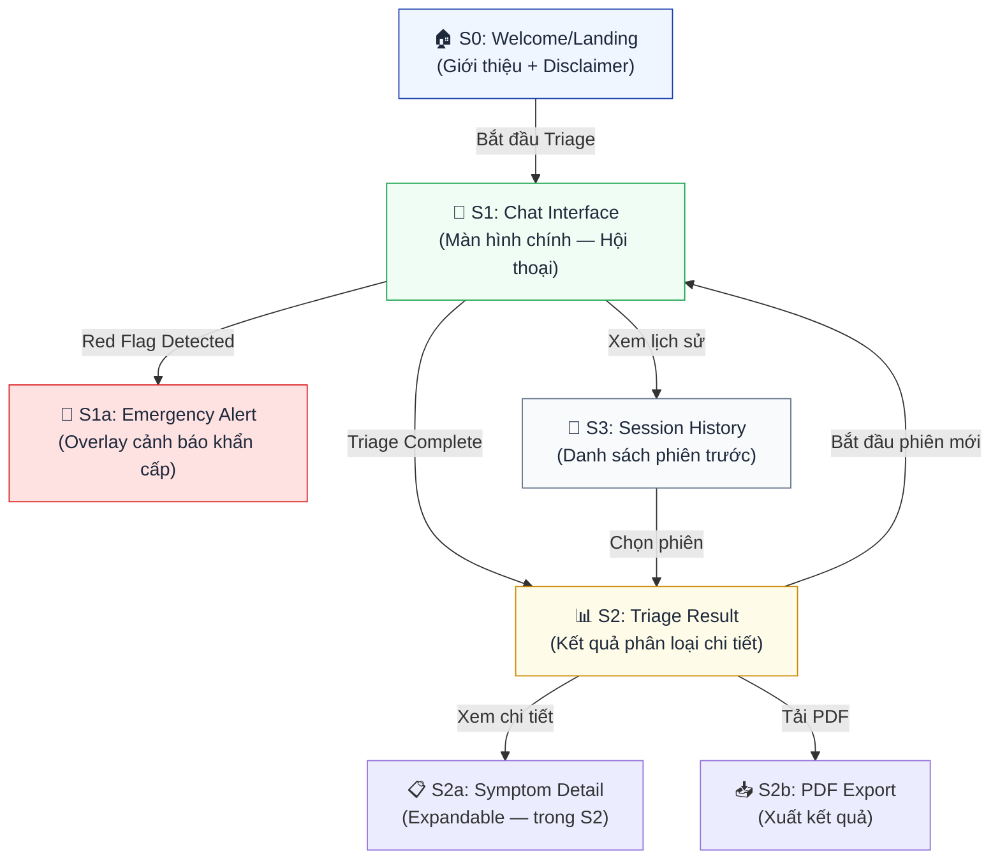
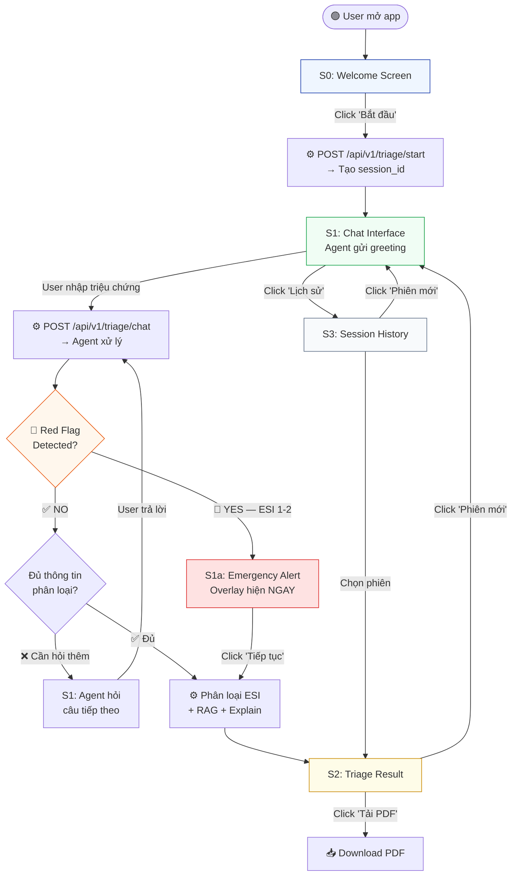
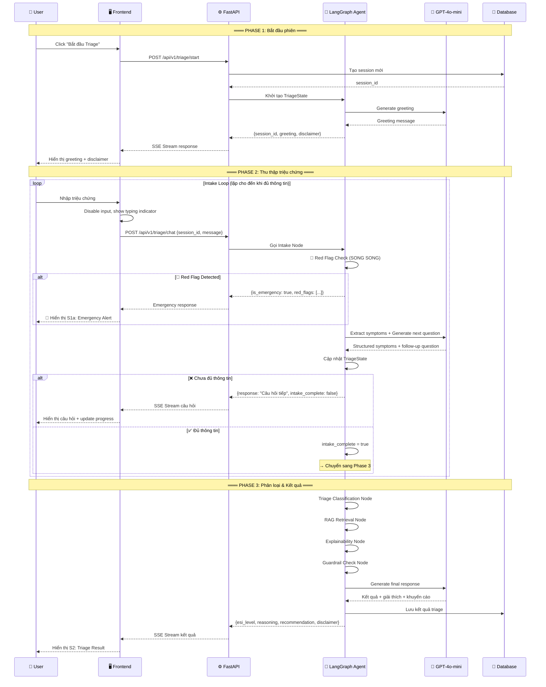
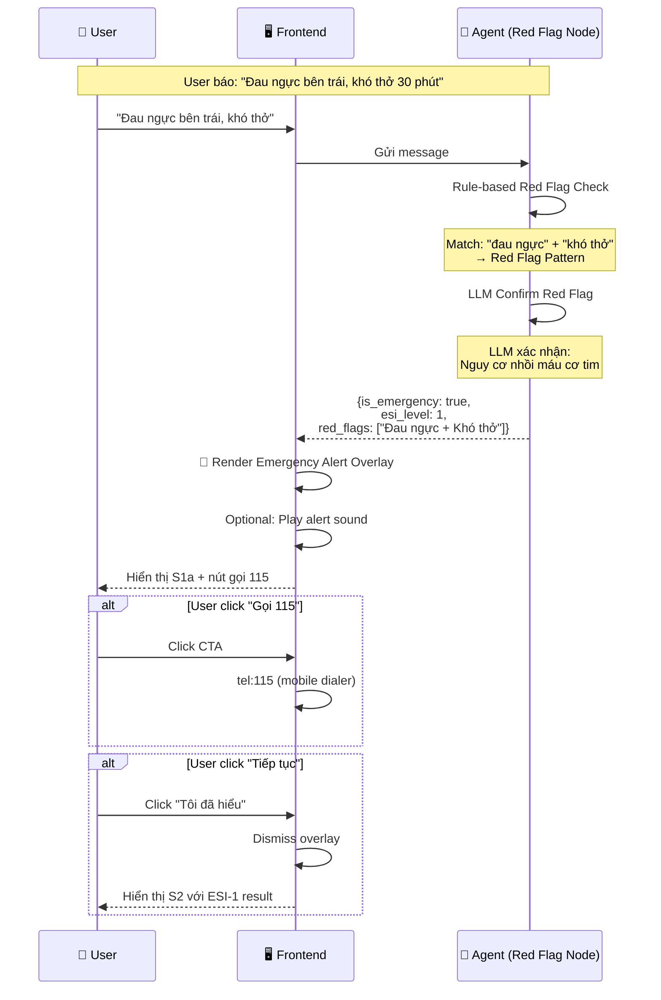
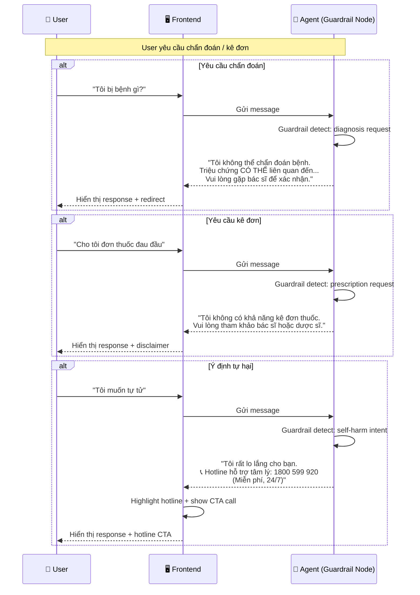
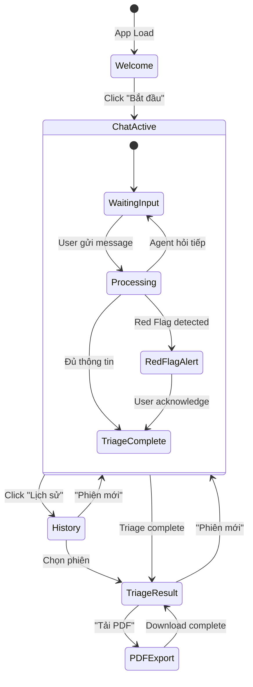

# 🎨 Wireframe & UI Flow — MedTriage AI

> **Tài liệu lịch sử:** Nội dung dưới đây mô tả kiến trúc hoặc kế hoạch trước khi MedTriage chuyển sang tool-gated DeepAgent. Không dùng tài liệu này làm source of truth cho runtime hiện tại; xem [`ARCHITECTURE.md`](../ARCHITECTURE.md).

## Intelligent Symptom Classification & Triage Agent

| Trường | Giá trị |
|--------|---------|
| **Sản phẩm** | MedTriage AI — Intelligent Symptom Classification & Triage Agent |
| **Team** | TEAM159 (P-159) |
| **Phiên bản** | 1.0 |
| **Ngày tạo** | 2026-08-01 |
| **Vai trò tạo** | UX Designer (BMAD Phase 2: Planning) |
| **Tham chiếu PRD** | [PRD.md](file:///d:/TEAM159/P-159/docs/PRD.md) §7 Frontend Design |

---

## 1. Tổng quan Thiết kế (Design Overview)

### 1.1. Triết lý Thiết kế

| Nguyên tắc | Mô tả | Áp dụng |
|------------|--------|---------|
| **Medical-first** | Tông màu, typography truyền tải sự tin cậy y tế | Xanh dương/trắng chủ đạo, serif headings |
| **Safety by design** | Cảnh báo, disclaimer luôn hiện, không bỏ qua được | Banner cố định, ESI color-coded |
| **Conversational** | Giao diện chat quen thuộc, tự nhiên như nhắn tin | Bubble messages, real-time typing |
| **Accessibility** | Đọc được, dễ hiểu cho mọi đối tượng | Font lớn, contrast cao, WCAG AA |
| **Progressive disclosure** | Thông tin hiện dần, không overwhelm người dùng | Step-by-step intake, expandable results |

### 1.2. Design System — Bảng Token

#### 🎨 Color Palette

| Token | Hex | Sử dụng |
|-------|-----|---------|
| `--primary` | `#1E40AF` | Brand chính, buttons, links |
| `--primary-light` | `#3B82F6` | Hover states, active elements |
| `--primary-bg` | `#EFF6FF` | Background nhẹ, cards |
| `--surface` | `#FFFFFF` | Card background, chat area |
| `--surface-dark` | `#F8FAFC` | Page background |
| `--text-primary` | `#1E293B` | Heading, body text |
| `--text-secondary` | `#64748B` | Subtitle, helper text |
| `--text-muted` | `#94A3B8` | Placeholder, disabled |
| `--success` | `#16A34A` | ESI-4, positive states |
| `--warning` | `#CA8A04` | ESI-3, attention states |
| `--danger` | `#DC2626` | ESI-1, emergency, errors |
| `--orange` | `#EA580C` | ESI-2, high urgency |
| `--info` | `#2563EB` | ESI-5, informational |

#### ESI Level Color System

| Level | Label | Foreground | Background | Border | Badge |
|:-----:|-------|:----------:|:----------:|:------:|:-----:|
| **1** | Resuscitation | `#FFFFFF` | `#DC2626` | `#B91C1C` | 🔴 |
| **2** | Emergent | `#FFFFFF` | `#EA580C` | `#C2410C` | 🟠 |
| **3** | Urgent | `#FFFFFF` | `#CA8A04` | `#A16207` | 🟡 |
| **4** | Less Urgent | `#FFFFFF` | `#16A34A` | `#15803D` | 🟢 |
| **5** | Non-Urgent | `#FFFFFF` | `#2563EB` | `#1D4ED8` | 🔵 |

#### 📐 Typography

| Element | Font | Size | Weight | Line Height |
|---------|------|:----:|:------:|:-----------:|
| H1 (Page Title) | Inter | 28px | 700 (Bold) | 1.3 |
| H2 (Section) | Inter | 22px | 600 (Semibold) | 1.3 |
| H3 (Card Title) | Inter | 18px | 600 (Semibold) | 1.4 |
| Body | Inter | 15px | 400 (Regular) | 1.6 |
| Small / Caption | Inter | 13px | 400 (Regular) | 1.5 |
| Chat Message | Inter | 15px | 400 (Regular) | 1.6 |
| ESI Badge | Inter | 14px | 700 (Bold) | 1.0 |
| Disclaimer | Inter | 12px | 400 (Regular) | 1.5 |

#### 📦 Spacing & Layout

| Token | Value | Sử dụng |
|-------|:-----:|---------|
| `--spacing-xs` | 4px | Icon gaps, inline spacing |
| `--spacing-sm` | 8px | Tight groups |
| `--spacing-md` | 16px | Card padding, element gaps |
| `--spacing-lg` | 24px | Section spacing |
| `--spacing-xl` | 32px | Page sections |
| `--radius-sm` | 8px | Buttons, inputs |
| `--radius-md` | 12px | Cards, modals |
| `--radius-lg` | 16px | Chat bubbles |
| `--radius-full` | 9999px | Avatars, badges |
| `--shadow-sm` | `0 1px 3px rgba(0,0,0,0.1)` | Cards, inputs |
| `--shadow-md` | `0 4px 12px rgba(0,0,0,0.1)` | Dropdowns, floating |
| `--shadow-lg` | `0 8px 24px rgba(0,0,0,0.12)` | Modals, alerts |

---

## 2. Site Map & Screen Inventory

### 2.1. Bản đồ Màn hình



### 2.2. Danh sách Màn hình

| ID | Tên màn hình | Loại | Mô tả | PRD Section |
|:--:|-------------|:----:|-------|:-----------:|
| S0 | Welcome / Landing | Page | Giới thiệu sản phẩm, disclaimer, nút bắt đầu | §7.1 |
| S1 | Chat Interface | Page (Main) | Hội thoại chính với AI Agent | §7.1 |
| S1a | Emergency Alert | Overlay | Cảnh báo khẩn cấp khi phát hiện Red Flag | §7.1 |
| S2 | Triage Result | Page/Section | Kết quả phân loại ESI chi tiết | §7.2 |
| S2a | Symptom Detail | Expandable | Chi tiết triệu chứng đã thu thập | §7.2 |
| S2b | PDF Export | Action | Xuất kết quả triage dạng PDF | §7.2 |
| S3 | Session History | Page/Panel | Danh sách phiên triage trước đó | P2 Feature |

---

## 3. Wireframe Chi tiết Từng Màn hình

### 3.1. S0: Welcome / Landing Screen

```
┌──────────────────────────────────────────────────────────────────┐
│                                                                  │
│  ┌────────────────────────────────────────────────────────────┐  │
│  │  🏥  MedTriage AI            [Lịch sử] [Giới thiệu] [🌙] │  │
│  └────────────────────────────────────────────────────────────┘  │
│                                                                  │
│                                                                  │
│                    🏥                                            │
│              MedTriage AI                                        │
│    Phân Loại Triệu Chứng Thông Minh                            │
│                                                                  │
│    ─────────────────────────────────                             │
│                                                                  │
│    Trợ lý AI giúp bạn đánh giá sơ bộ mức độ                    │
│    cấp thiết của triệu chứng. Nhận khuyến cáo                  │
│    hành động trong vòng 2 phút.                                  │
│                                                                  │
│                                                                  │
│    ┌──────────────────────────────────────────────┐              │
│    │  ✅ Phân loại mức độ ưu tiên ESI 1–5        │              │
│    │  ✅ Phát hiện triệu chứng nguy hiểm          │              │
│    │  ✅ Giải thích lý do rõ ràng                  │              │
│    │  ✅ Khuyến cáo hành động cụ thể               │              │
│    └──────────────────────────────────────────────┘              │
│                                                                  │
│                                                                  │
│         ┌────────────────────────────────────┐                   │
│         │    🩺  Bắt Đầu Đánh Giá Triệu Chứng    │             │
│         └────────────────────────────────────┘                   │
│                  (Primary Button — Blue)                          │
│                                                                  │
│                                                                  │
│  ┌────────────────────────────────────────────────────────────┐  │
│  │  ⚠️ TUYÊN BỐ MIỄN TRỪ Y TẾ                               │  │
│  │                                                            │  │
│  │  Kết quả từ MedTriage AI chỉ mang tính THAM KHẢO.        │  │
│  │  Hệ thống KHÔNG thay thế chẩn đoán bác sĩ, KHÔNG phải   │  │
│  │  thiết bị y tế, KHÔNG kê đơn thuốc.                       │  │
│  │                                                            │  │
│  │  🚑 Trường hợp KHẨN CẤP: Gọi 115 ngay                   │  │
│  └────────────────────────────────────────────────────────────┘  │
│                                                                  │
└──────────────────────────────────────────────────────────────────┘
```

**Thành phần & Hành vi:**

| # | Component | Loại | Hành vi |
|---|-----------|------|---------|
| 1 | Header | Navbar | Logo + nav links + dark mode toggle |
| 2 | Hero Section | Content | Tên sản phẩm + mô tả + feature list |
| 3 | CTA Button | Button (Primary) | Click → Tạo session mới → Chuyển đến S1 |
| 4 | Disclaimer Banner | Alert (Warning) | Luôn hiển thị, không dismiss được |
| 5 | Dark Mode Toggle | Icon Button | Switch light/dark theme |

---

### 3.2. S1: Chat Interface (Màn hình Chính)

```
┌──────────────────────────────────────────────────────────────────┐
│  ┌────────────────────────────────────────────────────────────┐  │
│  │  🏥 MedTriage AI    [📊 Triage Progress]  [📝 History] [🌙]│  │
│  └────────────────────────────────────────────────────────────┘  │
│                                                                  │
│  ┌──── Disclaimer Strip (persistent) ────────────────────────┐  │
│  │  ⚠️ Hỗ trợ phân loại sơ bộ — KHÔNG thay thế bác sĩ      │  │
│  └───────────────────────────────────────────────────────────┘  │
│                                                                  │
│  ┌─── Chat Area (scrollable) ────────────────────────────────┐  │
│  │                                                            │  │
│  │  ┌───────────────────────────────────────────┐             │  │
│  │  │ 🤖 MedTriage AI                 10:30 AM  │             │  │
│  │  │                                            │             │  │
│  │  │ Xin chào! Tôi là MedTriage AI — trợ lý    │             │  │
│  │  │ phân loại triệu chứng.                     │             │  │
│  │  │                                            │             │  │
│  │  │ Tôi sẽ hỏi bạn một số câu hỏi để đánh    │             │  │
│  │  │ giá sơ bộ tình trạng. Lưu ý: Tôi KHÔNG   │             │  │
│  │  │ thay thế bác sĩ.                           │             │  │
│  │  │                                            │             │  │
│  │  │ 🩺 Bạn đang gặp triệu chứng gì?          │             │  │
│  │  └───────────────────────────────────────────┘             │  │
│  │                                                            │  │
│  │                  ┌───────────────────────────────────┐     │  │
│  │                  │ Tôi bị đau đầu rất nặng từ sáng  │     │  │
│  │                  │ tới giờ, kèm buồn nôn.    10:31  │ 👤  │  │
│  │                  └───────────────────────────────────┘     │  │
│  │                                                            │  │
│  │  ┌───────────────────────────────────────────┐             │  │
│  │  │ 🤖 MedTriage AI                 10:31 AM  │             │  │
│  │  │                                            │             │  │
│  │  │ Cảm ơn bạn đã chia sẻ. Để tôi hiểu rõ    │             │  │
│  │  │ hơn:                                       │             │  │
│  │  │                                            │             │  │
│  │  │ 📍 Đau ở vị trí nào trên đầu?             │             │  │
│  │  │ (trán, thái dương, sau gáy, toàn bộ...)   │             │  │
│  │  └───────────────────────────────────────────┘             │  │
│  │                                                            │  │
│  │              ┌─ Triage Progress Indicator ─────────┐       │  │
│  │              │  ● Triệu chứng  ○ Vị trí           │       │  │
│  │              │  ○ Mức độ  ○ Thời gian  ○ Tiền sử  │       │  │
│  │              └─────────────────────────────────────┘       │  │
│  │                                                            │  │
│  └────────────────────────────────────────────────────────────┘  │
│                                                                  │
│  ┌────────────────────────────────────────────────────────────┐  │
│  │  ┌──────────────────────────────────────────┐   ┌───────┐ │  │
│  │  │  💬 Nhập mô tả triệu chứng...           │   │ Gửi ▶ │ │  │
│  │  └──────────────────────────────────────────┘   └───────┘ │  │
│  └────────────────────────────────────────────────────────────┘  │
│                                                                  │
└──────────────────────────────────────────────────────────────────┘
```

**Thành phần & Hành vi:**

| # | Component | Loại | Hành vi |
|---|-----------|------|---------|
| 1 | Header | Navbar | Logo + progress indicator + history + dark mode |
| 2 | Disclaimer Strip | Banner (fixed) | Luôn hiển thị ở top chat area, không dismiss |
| 3 | Chat Area | Scrollable Container | Auto-scroll to bottom, lazy load history |
| 4 | AI Message Bubble | Card (left-aligned) | Avatar 🤖 + message + timestamp, background `#EFF6FF` |
| 5 | User Message Bubble | Card (right-aligned) | Avatar 👤 + message + timestamp, background `#F0FDF4` |
| 6 | Triage Progress | Step Indicator | Hiển thị bước hiện tại trong kịch bản intake |
| 7 | Input Area | Text Input + Button | Enter/Click gửi, disabled khi đang chờ response |
| 8 | Typing Indicator | Animation | Hiển thị "MedTriage AI đang phân tích..." khi chờ |

**Interaction Notes:**
- Streaming response: text hiện dần từng ký tự (SSE)
- Input auto-focus sau mỗi response
- Scroll tự động xuống message mới nhất
- Progress indicator update sau mỗi bước intake hoàn thành

---

### 3.3. S1a: Emergency Alert Overlay (Cảnh báo Khẩn cấp)

```
┌──────────────────────────────────────────────────────────────────┐
│                                                                  │
│  ┌─── Semi-transparent overlay (rgba(0,0,0,0.6)) ────────────┐ │
│  │                                                             │ │
│  │  ┌───────────────────────────────────────────────────────┐  │ │
│  │  │                                                       │  │ │
│  │  │          🚨 CẢNH BÁO KHẨN CẤP                       │  │ │
│  │  │          ━━━━━━━━━━━━━━━━━━━━━                       │  │ │
│  │  │                                                       │  │ │
│  │  │   ┌─────────────────────────────────────────────┐     │  │ │
│  │  │   │         ┌──────────────────────┐            │     │  │ │
│  │  │   │         │    ESI Level: 1      │            │     │  │ │
│  │  │   │         │  🔴 RESUSCITATION    │            │     │  │ │
│  │  │   │         │  Đe dọa tính mạng   │            │     │  │ │
│  │  │   │         └──────────────────────┘            │     │  │ │
│  │  │   └─────────────────────────────────────────────┘     │  │ │
│  │  │                                                       │  │ │
│  │  │   ⚠️ Triệu chứng NGUY HIỂM được phát hiện:          │  │ │
│  │  │                                                       │  │ │
│  │  │   • Đau ngực kết hợp khó thở                         │  │ │
│  │  │   • Nghi ngờ: Nhồi máu cơ tim / Thuyên tắc phổi     │  │ │
│  │  │                                                       │  │ │
│  │  │   ━━━━━━━━━━━━━━━━━━━━━━━━━━━━━━━━━━━━━━━━━━━━━━    │  │ │
│  │  │                                                       │  │ │
│  │  │   👉 HÀNH ĐỘNG NGAY LẬP TỨC:                        │  │ │
│  │  │                                                       │  │ │
│  │  │   ┌─────────────────────────────────────────────┐     │  │ │
│  │  │   │  📞  GỌI CẤP CỨU 115 NGAY                 │     │  │ │
│  │  │   └─────────────────────────────────────────────┘     │  │ │
│  │  │             (Button — Red, Large)                     │  │ │
│  │  │                                                       │  │ │
│  │  │   hoặc đến Phòng Cấp cứu gần nhất ngay lập tức.     │  │ │
│  │  │                                                       │  │ │
│  │  │   💡 Lý do: Kết hợp đau ngực và khó thở là          │  │ │
│  │  │   triệu chứng cảnh báo cần can thiệp y tế           │  │ │
│  │  │   KHẨN CẤP trong vòng 0 phút.                       │  │ │
│  │  │                                                       │  │ │
│  │  │   ┌─────────────────────────────────────────────┐     │  │ │
│  │  │   │       Tôi đã hiểu — Tiếp tục ▶              │    │  │ │
│  │  │   └─────────────────────────────────────────────┘     │  │ │
│  │  │             (Button — Outlined, Secondary)            │  │ │
│  │  │                                                       │  │ │
│  │  │   ⚠️ Đây là đánh giá sơ bộ. Vui lòng gặp bác sĩ   │  │ │
│  │  │   để được thăm khám chính xác.                       │  │ │
│  │  │                                                       │  │ │
│  │  └───────────────────────────────────────────────────────┘  │ │
│  │                                                             │ │
│  └─────────────────────────────────────────────────────────────┘ │
│                                                                  │
└──────────────────────────────────────────────────────────────────┘
```

**Thành phần & Hành vi:**

| # | Component | Loại | Hành vi |
|---|-----------|------|---------|
| 1 | Overlay | Background | Semi-transparent, block tương tác chat phía sau |
| 2 | Alert Card | Modal Card | Center screen, shadow-lg, border-left red 4px |
| 3 | ESI Badge | Badge (Red) | Pulse animation, background `#DC2626` |
| 4 | Red Flag List | Bullet List | Icon ⚠️ + tên triệu chứng nguy hiểm |
| 5 | Emergency CTA | Button (Danger, Large) | Click → mở dialer (tel:115) trên mobile |
| 6 | Continue Button | Button (Outlined) | Dismiss overlay → quay lại chat với kết quả |
| 7 | Disclaimer | Small Text | Luôn hiển thị cuối alert |

**Trigger Conditions:**
- Red Flag Detection phát hiện triệu chứng ESI 1 hoặc 2
- Overlay hiển thị NGAY, không chờ triage hoàn thành
- Âm thanh cảnh báo (optional)

---

### 3.4. S2: Triage Result Screen (Kết quả Phân loại)

```
┌──────────────────────────────────────────────────────────────────┐
│  ┌────────────────────────────────────────────────────────────┐  │
│  │  🏥 MedTriage AI                        [← Quay lại Chat]│  │
│  └────────────────────────────────────────────────────────────┘  │
│                                                                  │
│  ┌──── Result Header ────────────────────────────────────────┐  │
│  │                                                            │  │
│  │            📊 KẾT QUẢ PHÂN LOẠI TRIAGE                   │  │
│  │            Phiên #TRG-20260801-001                         │  │
│  │            01/08/2026 — 10:35 AM                          │  │
│  │                                                            │  │
│  └────────────────────────────────────────────────────────────┘  │
│                                                                  │
│  ┌──── ESI Level Card ───────────────────────────────────────┐  │
│  │                                                            │  │
│  │      ┌──────────────────────────────────────────────┐      │  │
│  │      │                                              │      │  │
│  │      │              ESI Level: 3                    │      │  │
│  │      │          🟡 URGENT (Cần khám sớm)           │      │  │
│  │      │                                              │      │  │
│  │      │       Thời gian chờ khuyến cáo: ≤ 30 phút   │      │  │
│  │      │                                              │      │  │
│  │      └──────────────────────────────────────────────┘      │  │
│  │       (Card with left border = ESI color, background tint) │  │
│  │                                                            │  │
│  │  ┌─── ESI Scale Visual ─────────────────────────────────┐ │  │
│  │  │  🔴 1   🟠 2   ▶🟡 3◀   🟢 4   🔵 5               │ │  │
│  │  │  ━━━━   ━━━━   ████    ━━━━   ━━━━               │ │  │
│  │  └──────────────────────────────────────────────────────┘ │  │
│  │                                                            │  │
│  └────────────────────────────────────────────────────────────┘  │
│                                                                  │
│  ┌──── Collected Symptoms Card ──────────────────────────────┐  │
│  │                                                            │  │
│  │  📋 Triệu chứng đã ghi nhận                              │  │
│  │  ─────────────────────────                                │  │
│  │                                                            │  │
│  │  ┌────────────────────────────────────────────────────┐   │  │
│  │  │ 🩺 Triệu chứng chính                              │   │  │
│  │  │    Đau đầu                                         │   │  │
│  │  │                                                     │   │  │
│  │  │ 📍 Vị trí: Thái dương phải, lan ra sau gáy         │   │  │
│  │  │ ⚡ Mức độ: 8/10 (Nặng)  ████████░░                 │   │  │
│  │  │ ⏰ Khởi phát: 6 giờ trước, tăng dần                │   │  │
│  │  │ 🔗 Kèm theo: Buồn nôn, nhạy sáng, nhạy âm thanh  │   │  │
│  │  └────────────────────────────────────────────────────┘   │  │
│  │                                                            │  │
│  │  ┌────────────────────────────────────────────────────┐   │  │
│  │  │ 👤 Thông tin bệnh nhân                             │   │  │
│  │  │    Tuổi: 28 | Giới tính: Nữ                        │   │  │
│  │  │    Tiền sử: Migraine (đã chẩn đoán trước)         │   │  │
│  │  │    Thuốc đang dùng: Paracetamol (tự dùng)         │   │  │
│  │  └────────────────────────────────────────────────────┘   │  │
│  │                                                            │  │
│  │  🚩 Red Flags: Không phát hiện                            │  │
│  │                                                            │  │
│  └────────────────────────────────────────────────────────────┘  │
│                                                                  │
│  ┌──── Reasoning Card ───────────────────────────────────────┐  │
│  │                                                            │  │
│  │  💡 Lý do phân loại ESI-3                                 │  │
│  │  ─────────────────────                                    │  │
│  │                                                            │  │
│  │  Đau đầu mức độ nặng (8/10) kèm buồn nôn và nhạy sáng  │  │
│  │  gợi ý migraine nặng hoặc cần loại trừ nguyên nhân thần │  │
│  │  kinh nghiêm trọng hơn. Phân loại ESI Level 3 (Urgent)  │  │
│  │  vì:                                                      │  │
│  │                                                            │  │
│  │  • Mức đau ≥ 7/10 → Cần can thiệp giảm đau              │  │
│  │  • Triệu chứng kèm (buồn nôn, nhạy sáng) → Cần đánh   │  │
│  │    giá chuyên khoa                                        │  │
│  │  • Không có dấu hiệu Red Flag (đau đầu sét đánh, sốt   │  │
│  │    cao, cứng gáy, yếu liệt)                              │  │
│  │                                                            │  │
│  │  📚 Nguồn tham khảo:                                     │  │
│  │  • ESI Handbook v4 — Chapter 3: Triage Decision          │  │
│  │  • WHO Emergency Triage Assessment and Treatment (ETAT)  │  │
│  │                                                            │  │
│  └────────────────────────────────────────────────────────────┘  │
│                                                                  │
│  ┌──── Recommendation Card ──────────────────────────────────┐  │
│  │                                                            │  │
│  │  👉 Khuyến cáo Hành động                                 │  │
│  │  ──────────────────────                                   │  │
│  │                                                            │  │
│  │  ┌─────────────────────────────────────────────────────┐  │  │
│  │  │  🏥 Đặt lịch khám chuyên khoa Thần kinh            │  │  │
│  │  │     trong vòng 24 giờ.                               │  │  │
│  │  └─────────────────────────────────────────────────────┘  │  │
│  │                                                            │  │
│  │  ⚠️ Quay lại Cấp cứu NGAY nếu xuất hiện:               │  │
│  │  • Đau đầu tăng đột ngột, dữ dội nhất từ trước đến nay │  │
│  │  • Yếu liệt một bên cơ thể                              │  │
│  │  • Khó nói, méo miệng                                    │  │
│  │  • Sốt cao > 39°C + cứng gáy                            │  │
│  │  • Co giật                                                │  │
│  │                                                            │  │
│  └────────────────────────────────────────────────────────────┘  │
│                                                                  │
│  ┌──── Actions ──────────────────────────────────────────────┐  │
│  │                                                            │  │
│  │  ┌────────────────────┐   ┌──────────────────────────┐   │  │
│  │  │  🔄 Phiên Mới      │   │  📥 Tải Kết quả (PDF)   │   │  │
│  │  └────────────────────┘   └──────────────────────────┘   │  │
│  │    (Primary Button)         (Secondary Button)            │  │
│  │                                                            │  │
│  └────────────────────────────────────────────────────────────┘  │
│                                                                  │
│  ┌──── Disclaimer Footer ────────────────────────────────────┐  │
│  │  ⚠️ TUYÊN BỐ MIỄN TRỪ Y TẾ                              │  │
│  │  Kết quả chỉ mang tính THAM KHẢO. Hệ thống KHÔNG thay   │  │
│  │  thế bác sĩ, KHÔNG phải thiết bị y tế.                   │  │
│  │  Cấp cứu: 📞 115  |  Tâm lý: 📞 1800 599 920           │  │
│  └────────────────────────────────────────────────────────────┘  │
│                                                                  │
└──────────────────────────────────────────────────────────────────┘
```

**Thành phần & Hành vi:**

| # | Component | Loại | Hành vi |
|---|-----------|------|---------|
| 1 | Result Header | Section | Session ID + timestamp |
| 2 | ESI Level Card | Feature Card | Color-coded border + background tint, ESI badge lớn |
| 3 | ESI Scale Visual | Progress Indicator | 5 dots, highlight current level, scale visual |
| 4 | Symptoms Card | Detail Card | Expandable sections, severity progress bar |
| 5 | Reasoning Card | Info Card | Bullet list lý do + nguồn trích dẫn |
| 6 | Recommendation Card | Action Card | Highlighted action + warning signs |
| 7 | Action Buttons | Button Group | "Phiên mới" (Primary) + "Tải PDF" (Secondary) |
| 8 | Disclaimer Footer | Footer Banner | Luôn hiển thị, hotline numbers |

---

### 3.5. S3: Session History (Lịch sử Phiên — P2)

```
┌──────────────────────────────────────────────────────────────────┐
│  ┌────────────────────────────────────────────────────────────┐  │
│  │  🏥 MedTriage AI    📝 Lịch sử Phiên      [← Quay lại]  │  │
│  └────────────────────────────────────────────────────────────┘  │
│                                                                  │
│  ┌──── Session List ─────────────────────────────────────────┐  │
│  │                                                            │  │
│  │  ┌─────────────────────────────────────────────────────┐  │  │
│  │  │ 📋 Phiên #TRG-20260801-001          01/08/2026     │  │  │
│  │  │ 🟡 ESI-3 Urgent  |  Đau đầu nặng kèm buồn nôn    │  │  │
│  │  │                                          [Xem ▶]   │  │  │
│  │  └─────────────────────────────────────────────────────┘  │  │
│  │                                                            │  │
│  │  ┌─────────────────────────────────────────────────────┐  │  │
│  │  │ 📋 Phiên #TRG-20260731-003          31/07/2026     │  │  │
│  │  │ 🟢 ESI-4 Less Urgent  |  Đau họng + sổ mũi        │  │  │
│  │  │                                          [Xem ▶]   │  │  │
│  │  └─────────────────────────────────────────────────────┘  │  │
│  │                                                            │  │
│  │  ┌─────────────────────────────────────────────────────┐  │  │
│  │  │ 📋 Phiên #TRG-20260730-001          30/07/2026     │  │  │
│  │  │ 🔴 ESI-1 Emergency  |  Đau ngực + khó thở          │  │  │
│  │  │                                          [Xem ▶]   │  │  │
│  │  └─────────────────────────────────────────────────────┘  │  │
│  │                                                            │  │
│  │  ─ ─ ─ ─ ─ ─ ─ ─ ─ ─ ─ ─ ─ ─ ─ ─ ─ ─ ─ ─ ─ ─ ─ ─     │  │
│  │  Hiển thị 3/3 phiên                                       │  │
│  │                                                            │  │
│  └────────────────────────────────────────────────────────────┘  │
│                                                                  │
│  ┌────────────────────────────────────────────────────────────┐  │
│  │    ┌──────────────────────────────────────┐                │  │
│  │    │    🩺  Bắt Đầu Phiên Triage Mới     │                │  │
│  │    └──────────────────────────────────────┘                │  │
│  └────────────────────────────────────────────────────────────┘  │
│                                                                  │
└──────────────────────────────────────────────────────────────────┘
```

---

## 4. UI Flow — Luồng Tương tác Chi tiết

### 4.1. Flow Tổng quan (Master Flow)



### 4.2. Flow Chi tiết: Intake Conversation (Hội thoại Thu thập)



### 4.3. Flow Chi tiết: Red Flag Emergency Path



### 4.4. Flow Chi tiết: Guardrail Intervention



---

## 5. Responsive Design — Đa thiết bị

### 5.1. Breakpoints

| Breakpoint | Width | Layout | Đặc điểm |
|:----------:|:-----:|--------|-----------|
| **Mobile** | < 640px | 1 column, full-width | Chat bubbles full-width, input fixed bottom |
| **Tablet** | 640–1024px | Centered container, max-w-768px | Cards side-by-side trong result |
| **Desktop** | > 1024px | Centered container, max-w-800px | Sidebar history (optional) |

### 5.2. Mobile Wireframe — S1: Chat

```
┌──────────────────────┐
│ 🏥 MedTriage AI  [🌙]│
├──────────────────────┤
│ ⚠️ Hỗ trợ sơ bộ     │
├──────────────────────┤
│                      │
│ ┌──────────────────┐ │
│ │ 🤖 Xin chào!     │ │
│ │ Bạn đang gặp     │ │
│ │ triệu chứng gì?  │ │
│ └──────────────────┘ │
│                      │
│    ┌──────────────┐  │
│    │ Tôi bị đau   │  │
│    │ đầu nặng... │  │
│    └──────────────┘  │
│                      │
│ ┌──────────────────┐ │
│ │ 🤖 Đau ở vị trí │ │
│ │ nào trên đầu?    │ │
│ └──────────────────┘ │
│                      │
│ ● ○ ○ ○ ○  (2/8)    │
│                      │
├──────────────────────┤
│ [💬 Nhập...   ] [▶] │
└──────────────────────┘
```

### 5.3. Mobile Wireframe — S2: Result

```
┌──────────────────────┐
│ 🏥 MedTriage  [← ] │
├──────────────────────┤
│                      │
│  ┌────────────────┐  │
│  │  ESI Level: 3  │  │
│  │  🟡 URGENT     │  │
│  │  ≤ 30 phút     │  │
│  └────────────────┘  │
│                      │
│  🔴1 🟠2 ▶🟡3◀ 🟢4 🔵5│
│                      │
│  📋 Triệu chứng     │
│  ┌────────────────┐  │
│  │ Đau đầu 8/10   │  │
│  │ Thái dương phải │  │
│  │ Buồn nôn, nhạy │  │
│  │ sáng            │  │
│  └────────────────┘  │
│                      │
│  💡 Lý do           │
│  ┌────────────────┐  │
│  │ Đau đầu nặng   │  │
│  │ kèm buồn nôn...│  │
│  │ [Xem thêm ▼]   │  │
│  └────────────────┘  │
│                      │
│  👉 Khuyến cáo      │
│  ┌────────────────┐  │
│  │ 🏥 Khám Thần   │  │
│  │ kinh trong 24h │  │
│  └────────────────┘  │
│                      │
│ [🔄 Phiên mới] [📥] │
│                      │
│ ⚠️ Disclaimer...     │
│                      │
└──────────────────────┘
```

---

## 6. Component Library — Thư viện UI Components

### 6.1. Danh sách Components

| # | Component | Variants | Props chính | Sử dụng tại |
|---|-----------|----------|-------------|-------------|
| C1 | `ChatBubble` | `ai`, `user` | `message`, `timestamp`, `avatar` | S1 |
| C2 | `ESIBadge` | `level 1-5` | `esiLevel`, `size` | S1a, S2 |
| C3 | `ESIScaleBar` | `horizontal` | `activeLevel` | S2 |
| C4 | `DisclaimerBanner` | `compact`, `full` | `type` | S0, S1, S2 |
| C5 | `EmergencyAlert` | `modal` | `redFlags[]`, `esiLevel` | S1a |
| C6 | `TriageProgressBar` | `dots`, `bar` | `currentStep`, `totalSteps` | S1 |
| C7 | `SymptomCard` | `compact`, `expanded` | `symptoms[]` | S2 |
| C8 | `ReasoningCard` | — | `reasoning`, `sources[]` | S2 |
| C9 | `RecommendationCard` | `emergency`, `normal` | `action`, `warnings[]` | S2 |
| C10 | `SessionCard` | — | `sessionId`, `date`, `esiLevel`, `summary` | S3 |
| C11 | `TypingIndicator` | — | `isTyping` | S1 |
| C12 | `SeverityBar` | — | `value` (1-10) | S2 |
| C13 | `MessageInput` | — | `onSend`, `disabled`, `placeholder` | S1 |

### 6.2. Component Specifications

#### C1: ChatBubble

```
┌── AI Variant ──────────────────────────┐
│                                         │
│  🤖  ┌─────────────────────────────┐   │
│      │ Message text content here.   │   │
│      │ Can be multi-line.           │   │
│      └─────────────────────────────┘   │
│                            10:31 AM    │
│                                         │
│  Background: var(--primary-bg) #EFF6FF  │
│  Border-radius: 0 16px 16px 16px       │
│  Max-width: 80%                         │
│  Align: left                            │
└─────────────────────────────────────────┘

┌── User Variant ────────────────────────┐
│                                         │
│   ┌─────────────────────────────┐  👤  │
│   │ User message text here.     │      │
│   │ Right-aligned.              │      │
│   └─────────────────────────────┘      │
│   10:31 AM                              │
│                                         │
│  Background: var(--success-bg) #F0FDF4  │
│  Border-radius: 16px 0 16px 16px       │
│  Max-width: 80%                         │
│  Align: right                           │
└─────────────────────────────────────────┘
```

#### C2: ESIBadge

```
┌── Size: Large ─────────────────┐
│                                 │
│  ┌───────────────────────────┐ │
│  │     ESI Level: 3          │ │
│  │     🟡 URGENT             │ │
│  │     Cần khám sớm          │ │
│  └───────────────────────────┘ │
│                                 │
│  Width: 240px                   │
│  Padding: 24px                  │
│  Border-left: 4px solid         │
│  Background: ESI tint           │
│  Border-radius: 12px            │
└─────────────────────────────────┘

┌── Size: Small (inline) ────────┐
│                                 │
│  [🟡 ESI-3]                    │
│                                 │
│  Padding: 4px 12px              │
│  Border-radius: 9999px          │
│  Font-size: 12px bold           │
└─────────────────────────────────┘
```

#### C5: EmergencyAlert

```
States:
┌─ Entering ──────────────────────┐
│  Overlay: fade-in 300ms          │
│  Card: scale-in 300ms            │
│  ESI Badge: pulse animation      │
└──────────────────────────────────┘

┌─ Active ────────────────────────┐
│  ESI Badge: continuous pulse     │
│  Border: 2px solid #DC2626       │
│  Shadow: 0 0 20px rgba(DC,26,26) │
└──────────────────────────────────┘

┌─ Exiting ───────────────────────┐
│  Overlay: fade-out 200ms         │
│  Card: scale-out 200ms           │
└──────────────────────────────────┘
```

---

## 7. State Transitions — Ma trận Chuyển trạng thái

### 7.1. Application State Machine



### 7.2. Chat Input States

| State | Input Field | Send Button | Typing Indicator | Condition |
|-------|:----------:|:----------:|:----------------:|-----------|
| **Idle** | Enabled, placeholder text | Disabled (greyed) | Hidden | Chờ user nhập |
| **Typing** | Enabled, user text | Enabled (blue) | Hidden | User đang gõ |
| **Processing** | Disabled | Disabled (loading) | Visible ("Đang phân tích...") | Đang chờ API response |
| **Streaming** | Disabled | Disabled | Hidden | Đang nhận SSE stream |
| **Error** | Enabled | Enabled (retry) | Hidden | API lỗi → hiện retry |

---

## 8. Micro-interactions & Animations

### 8.1. Danh sách Animations

| # | Animation | Trigger | Duration | Easing | Mô tả |
|---|-----------|---------|:--------:|--------|--------|
| A1 | Message Appear | Tin nhắn mới | 300ms | ease-out | Slide-up + fade-in |
| A2 | Typing Dots | Agent đang xử lý | Loop | ease-in-out | 3 dots bounce sequentially |
| A3 | ESI Badge Pulse | Emergency alert | Loop | ease-in-out | Scale 1.0 → 1.05 → 1.0 |
| A4 | Progress Step Fill | Intake step complete | 400ms | ease-out | Dot fill + color change |
| A5 | Alert Overlay Enter | Red Flag detected | 300ms | ease-out | Backdrop fade + card scale |
| A6 | Streaming Text | SSE response | Per-char | linear | Character-by-character appear |
| A7 | Result Card Stagger | Triage complete | 200ms offset | ease-out | Cards appear one-by-one |
| A8 | Severity Bar Fill | Result display | 600ms | ease-out | Bar fills to severity value |

### 8.2. Animation Specs

```css
/* A1: Message Appear */
@keyframes messageAppear {
  from {
    opacity: 0;
    transform: translateY(12px);
  }
  to {
    opacity: 1;
    transform: translateY(0);
  }
}

/* A2: Typing Indicator */
@keyframes typingBounce {
  0%, 60%, 100% { transform: translateY(0); }
  30% { transform: translateY(-6px); }
}

/* A3: ESI Badge Pulse */
@keyframes esiPulse {
  0%, 100% { transform: scale(1); box-shadow: 0 0 0 0 currentColor; }
  50% { transform: scale(1.03); box-shadow: 0 0 12px 0 currentColor; }
}

/* A7: Stagger Cards */
.result-card:nth-child(1) { animation-delay: 0ms; }
.result-card:nth-child(2) { animation-delay: 150ms; }
.result-card:nth-child(3) { animation-delay: 300ms; }
.result-card:nth-child(4) { animation-delay: 450ms; }
```

---

## 9. Dark Mode Specification

### 9.1. Color Mapping

| Token | Light Mode | Dark Mode |
|-------|:----------:|:---------:|
| `--surface` | `#FFFFFF` | `#1E293B` |
| `--surface-dark` | `#F8FAFC` | `#0F172A` |
| `--text-primary` | `#1E293B` | `#F1F5F9` |
| `--text-secondary` | `#64748B` | `#94A3B8` |
| `--primary-bg` | `#EFF6FF` | `#1E3A5F` |
| `--border` | `#E2E8F0` | `#334155` |
| `--chat-ai-bg` | `#EFF6FF` | `#1E3A5F` |
| `--chat-user-bg` | `#F0FDF4` | `#14532D` |
| `--disclaimer-bg` | `#FFFBEB` | `#422006` |

### 9.2. Dark Mode Wireframe — S1: Chat

```
┌──────────────────────────────────────────────────────────────────┐
│  ┌─────────── bg: #0F172A ───────────────────────────────────┐  │
│  │  🏥 MedTriage AI              [📊] [📝] [☀️]             │  │
│  └───────────────────────────────────────────────────────────┘  │
│                                                                  │
│  ┌─── bg: #422006, text: #FDE68A ────────────────────────────┐  │
│  │  ⚠️ Hỗ trợ phân loại sơ bộ — KHÔNG thay thế bác sĩ      │  │
│  └───────────────────────────────────────────────────────────┘  │
│                                                                  │
│  ┌─── bg: #1E293B ──────────────────────────────────────────┐  │
│  │                                                            │  │
│  │  ┌─── bg: #1E3A5F ──────────────────────────┐             │  │
│  │  │ 🤖 Xin chào! Bạn đang gặp triệu chứng   │             │  │
│  │  │ gì?                          text: #E2E8F0│             │  │
│  │  └───────────────────────────────────────────┘             │  │
│  │                                                            │  │
│  │                  ┌─── bg: #14532D ───────────────────┐    │  │
│  │                  │ Tôi bị đau đầu nặng   text: #BBF7D0│   │  │
│  │                  └───────────────────────────────────┘    │  │
│  │                                                            │  │
│  └────────────────────────────────────────────────────────────┘  │
│                                                                  │
│  ┌─── bg: #334155 ──────────────────────────────────────────┐  │
│  │  [💬 Nhập...  text: #94A3B8        ]   [▶ bg: #3B82F6]   │  │
│  └───────────────────────────────────────────────────────────┘  │
│                                                                  │
└──────────────────────────────────────────────────────────────────┘
```

---

## 10. Error States & Edge Cases

### 10.1. Error Handling UI

| Scenario | UI Response | Wireframe |
|----------|-------------|-----------|
| **API Timeout** | Toast: "Kết nối chậm. Đang thử lại..." + retry button | Inline error in chat |
| **Network Offline** | Banner: "Mất kết nối. Kiểm tra mạng." | Top banner (red) |
| **LLM Error** | Bot message: "Xin lỗi, tôi gặp sự cố. Vui lòng thử lại." | Chat bubble with retry |
| **Empty Input** | Input border turns red, helper text | Inline validation |
| **Session Expired** | Modal: "Phiên đã hết hạn. Bắt đầu phiên mới?" | Modal dialog |
| **Rate Limited** | Toast: "Bạn gửi quá nhanh. Vui lòng chờ." | Toast notification |

### 10.2. Error State Wireframe

```
┌── API Error in Chat ───────────────────────────┐
│                                                  │
│  ┌───────────────────────────────────────────┐  │
│  │ ⚠️ MedTriage AI                           │  │
│  │                                            │  │
│  │ Xin lỗi, tôi gặp sự cố kỹ thuật.        │  │
│  │ Vui lòng thử lại sau ít giây.             │  │
│  │                                            │  │
│  │ ┌───────────────────────┐                  │  │
│  │ │  🔄 Thử lại           │                  │  │
│  │ └───────────────────────┘                  │  │
│  └───────────────────────────────────────────┘  │
│                                                  │
└──────────────────────────────────────────────────┘

┌── Network Offline Banner ──────────────────────┐
│  ┌─── bg: #FEE2E2 ──────────────────────────┐ │
│  │  📡 Mất kết nối mạng. Đang thử kết nối...│ │
│  └───────────────────────────────────────────┘ │
└────────────────────────────────────────────────┘
```

---

## 11. Accessibility (A11Y) Checklist

| # | Tiêu chí | Chuẩn | Áp dụng |
|---|---------|-------|---------|
| 1 | Color Contrast | WCAG AA (4.5:1) | Tất cả text trên background |
| 2 | Font Size Minimum | 14px body, 12px caption | Toàn bộ UI |
| 3 | Focus Indicators | 2px outline on focus | Input, buttons, links |
| 4 | Keyboard Navigation | Tab order logic | Tất cả interactive elements |
| 5 | Screen Reader Labels | aria-label trên icons | Buttons, badges, indicators |
| 6 | Alt Text | Mô tả cho hình ảnh | Icons, avatars |
| 7 | Error Announcements | aria-live="polite" | Error messages, alerts |
| 8 | Emergency Alert | aria-live="assertive" | S1a: Emergency overlay |
| 9 | Reduced Motion | prefers-reduced-motion | Tắt animations |
| 10 | Touch Target | ≥ 44x44px | Mobile buttons |

---

## 12. Tracing: Wireframe ↔ PRD ↔ API

| Screen | PRD Feature | API Endpoint | Agent Node |
|:------:|:-----------:|:------------:|:----------:|
| S0 | F7 (Disclaimer) | — | — |
| S1 | F1 (Intake), F8 (Streaming) | `POST /triage/start`, `POST /triage/chat`, `WS /ws/triage` | Intake Node |
| S1a | F3 (Red Flag) | `POST /triage/chat` (is_emergency=true) | Red Flag Node |
| S2 | F2 (Triage), F4 (Explain), F6 (Khuyến cáo) | `GET /triage/{id}/result` | Classify + RAG + Explain + Respond |
| S2b | — | `GET /triage/{id}/result` (PDF format) | — |
| S3 | F9 (History) | `GET /triage/{id}/history` | Session Manager |

---

> [!IMPORTANT]
> **Design Principle:** Mọi UI state đều phải hiển thị Disclaimer y tế. Không có flow nào cho phép người dùng nhận kết quả mà không thấy cảnh báo "KHÔNG thay thế bác sĩ".

---

*Tài liệu Wireframe & UI Flow được tạo bởi TEAM159 — MedTriage AI Project*  
*Tham chiếu: [PRD.md](file:///d:/TEAM159/P-159/docs/PRD.md) | Cập nhật: 2026-08-01*
