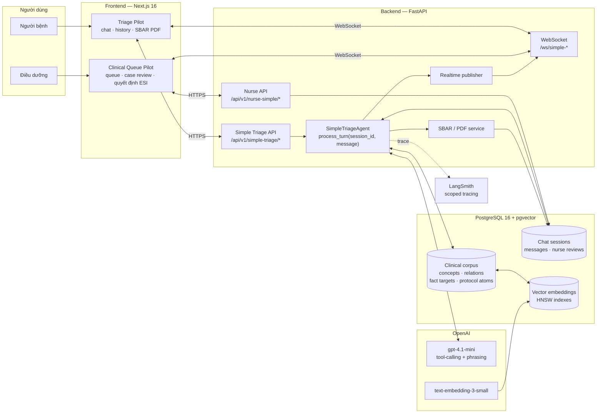
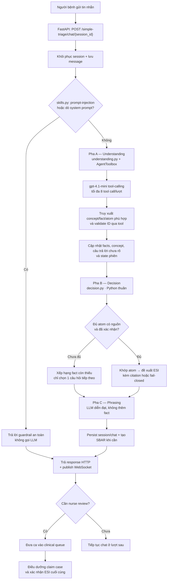
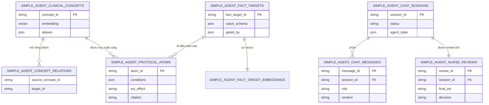
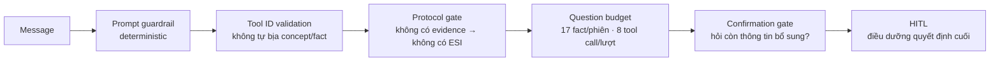

# Kiến trúc hệ thống MedTriage AI

> **Source of truth cho runtime hiện tại:** `SimpleTriageAgent` trong `src/simple_agent/`. Hệ thống là mô phỏng phục vụ học tập: AI hỗ trợ thu thập dữ kiện và đề xuất mức ưu tiên ESI; không chẩn đoán, không kê đơn và điều dưỡng là người xác nhận cuối cùng.

## 1. System diagram

## 2. Component descriptions

| Lớp | Component | Trách nhiệm chính |
|---|---|---|
| Người bệnh | **Triage Pilot** | Gửi triệu chứng bằng tiếng Việt qua chat, xem lịch sử, đề xuất triage, tin nhắn nhân viên và báo cáo SBAR/PDF. |
| Điều dưỡng | **Clinical Queue Pilot** | Nhận thông báo ca, lọc hàng đợi, xem replay hội thoại + bằng chứng, nhận ca và ghi quyết định ESI cuối cùng. |
| API | `routes_simple_triage.py` | Mở phiên triage, xử lý lượt chat, trả chi tiết phiên/PDF và hỗ trợ nhắn tin cho nhân viên. |
| API | `routes_nurse_simple.py` | Cung cấp queue, case review, nhận ca, quyết định điều dưỡng và trao đổi trong ca. |
| Realtime | `routes_ws_simple.py` + `realtime.py` | Phát thông báo queue, cập nhật case và tin nhắn hai chiều qua WebSocket. |
| Agent | `SimpleTriageAgent` | Điều phối một lượt chat theo thứ tự guardrail → hiểu → quyết định → diễn đạt → lưu trạng thái. |
| Agent data access | `tools.py`, `pg_corpus.py`, `persistence.py` | Là cổng kiểm soát duy nhất để agent truy xuất corpus, ghi fact/session và xác thực ID. |
| Decision engine | `decision.py` | Khớp protocol atom, xếp hạng fact cần hỏi và đưa ra đề xuất ESI bằng Python deterministic; **không gọi LLM**. |
| Clinical outputs | `sbar.py`, `sbar_pdf` service | Chuyển dữ kiện, evidence và đề xuất thành SBAR/PDF để điều dưỡng review. |
| Data | PostgreSQL + pgvector | Lưu corpus, embedding, chat session, message và nurse review. Corpus được nạp bằng migration SQL, không phụ thuộc file local lúc chạy. |
| AI services | OpenAI + LangSmith | OpenAI chỉ dùng cho tool-calling/diễn đạt và embedding; LangSmith chỉ quan sát trace theo lượt, không quyết định lâm sàng. |

## 3. Luồng xử lý một lượt chat

## 4. Ba pha của `SimpleTriageAgent`

| Pha | File chính | Dùng LLM? | Đầu vào → đầu ra |
|---|---|---:|---|
| **0. Guardrail** | `skills.py` | Không | Tin nhắn → chặn deterministic các yêu cầu prompt-injection/dò system prompt. |
| **A. Understanding** | `understanding.py`, `deepagent_understanding.py`, `tools.py` | Có | Tin nhắn tự do → concept, fact, mô tả định tính, chủ thể đang hỏi (`self`/`other`) và dữ liệu truy xuất hợp lệ. |
| **B. Decision** | `decision.py` | **Không** | Facts + protocol atoms → fact cần hỏi tiếp, yêu cầu xác nhận, đề xuất ESI có citation hoặc `INSUFFICIENT_EVIDENCE`. |
| **C. Phrasing** | `phrasing.py` | Có | Quyết định có cấu trúc → một câu tiếng Việt tự nhiên; không được thêm dữ kiện hoặc tự đổi ESI. |

Điểm quan trọng: LLM không được trả `concept_id` hoặc `fact_target_id` tuỳ ý. `AgentToolbox` chỉ chấp nhận ID đã được một tool thực sự trả về trong lượt hiện tại hoặc đã tồn tại trong session.

## 5. Clinical corpus và persistence

| Nhóm dữ liệu | Nội dung | Cách agent dùng |
|---|---|---|
| `simple_agent_clinical_concepts` | 1.132 concept có alias Việt/Anh và embedding. | Hiểu cách người bệnh diễn đạt triệu chứng/tiền sử. |
| `simple_agent_concept_relations` | 4.247 quan hệ concept → fact/concept. | Mở rộng các thông tin cần làm rõ từ context hiện tại. |
| `simple_agent_fact_targets` | 238 fact có schema giá trị, cách hỏi và điều kiện `gated_by`. | Chỉ hỏi dữ kiện có liên quan, tránh hỏi lại checklist cố định. |
| `simple_agent_fact_target_embeddings` | Vector của fact target. | Ghép câu trả lời tự do vào fact đã biết để giảm hỏi lại. |
| `simple_agent_protocol_atoms` | 1.768 điều kiện deterministic + tác động ESI + citation. | Là nguồn duy nhất để quyết định/hạn chế ESI. |
| Bảng vận hành | Session, message, nurse review. | Replay hội thoại, SBAR và quyết định HITL có thể truy vết. |

## 6. Guardrails và các bất biến an toàn

- **ESI do code quyết định:** chỉ `decision.py` được khớp điều kiện atom và gán/chặn ESI.
- **Fail-closed:** không truy xuất được atom/protocol phù hợp thì agent trả thiếu bằng chứng hoặc chuyển review, không đoán ESI.
- **Không lặp vô hạn:** giới hạn 17 fact trong một session, 8 tool call mỗi lượt và tối đa 2 lần lặp lại cùng một câu chưa được trả lời.
- **Không chốt vội:** khi đủ dữ kiện kỹ thuật, agent vẫn hỏi người bệnh còn muốn bổ sung thông tin không trước khi tạo kết quả cuối.
- **HITL bắt buộc:** đề xuất của agent vào hàng đợi lâm sàng; điều dưỡng xem evidence/SBAR và xác nhận hoặc thay đổi ESI.

## 7. API surface chính

| Nhóm | Endpoint | Mục đích |
|---|---|---|
| Người bệnh | `POST /api/v1/simple-triage/start` | Mở phiên triage. |
| Người bệnh | `POST /api/v1/simple-triage/chat/{session_id}` | Xử lý một lượt chat qua agent. |
| Người bệnh | `GET /api/v1/simple-triage/sessions/{session_id}` | Xem lại phiên và hội thoại. |
| Người bệnh | `GET /api/v1/simple-triage/sessions/{session_id}/pdf` | Tạo báo cáo SBAR dạng PDF. |
| Điều dưỡng | `GET /api/v1/nurse-simple/queue` | Lấy hàng đợi các ca cần review. |
| Điều dưỡng | `POST /api/v1/nurse-simple/cases/{session_id}/claim` | Nhận phụ trách một ca. |
| Điều dưỡng | `POST /api/v1/nurse-simple/cases/{session_id}/decision` | Ghi quyết định ESI cuối cùng. |
| Realtime | `WS /api/v1/ws/simple-clinical`, `simple-patient`, `simple-case/{session_id}` | Đồng bộ queue, case và tin nhắn theo thời gian thực. |

## 8. Ranh giới trách nhiệm

| Thành phần | Được phép | Không được phép |
|---|---|---|
| LLM | Hiểu tiếng Việt tự do, gọi tool đúng schema, diễn đạt câu trả lời. | Tự tạo ID, tự quyết ESI, tự thêm fact/citation. |
| `decision.py` | Đánh giá atom, chọn fact tiếp theo, tạo đề xuất có điều kiện. | Sinh ngôn ngữ tự do hoặc bỏ qua protocol gate. |
| PostgreSQL/pgvector | Lưu tri thức, embedding và lịch sử có truy vết. | Thay thế clinical review của con người. |
| Điều dưỡng | Xem SBAR, evidence, hội thoại và chốt ESI. | Tin mù quáng vào đề xuất của agent. |

---

Tài liệu này mô tả kiến trúc hiện tại, thay thế sơ đồ LangGraph/ChromaDB cũ. Xem thêm [README](../README.md) để cài đặt và [AGENT_OVERVIEW](../AGENT_OVERVIEW.md) để biết chi tiết vận hành agent.
